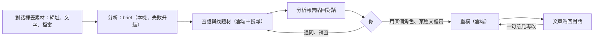

# 產品需求文件（PRD）— Evidence Forge

> **版本：** v3.0（2026-10-13） | **上一版：** v2.0，原文見 `30-snapshot/2026-10-13-prd-v2.0.md`
> 依 `docs/templates/vibecoding/02_project_brief_and_prd.md` 的 PRD 半部撰寫。為什麼做、什麼算成功見 `00-intent/brief.md`；階段見 `00-intent/roadmap.md`；決策見 §11 的 ADR；改版規劃見 `30-snapshot/plans/2026-10-13-chat-workbench-replan.md`。
> **v3.0 改了什麼：**
> - 主介面從看板改成聊天室。分析與重構是兩件分開的工作，人在對話裡決定下一步（ADR-0019）。
> - 逐句拆主張與稿後檢查，改成在寫稿之前出一份分析報告：brief＋查證＋研究題材（ADR-0020）。
> - 拿掉的需求：FR-DG、FR-CP、FR-VF、FR-RV（編號不重用），以及 FR-RS（併進 FR-IV）。
> - 執行器、閘道、帳本、搜尋的需求不變。

## 1. 專案總覽

| 項目 | 內容 |
| :--- | :--- |
| 一句話 | 一個聊天室：丟一篇文章進去，它讀懂作者、查證、找可以借題發揮的題材，交一份分析報告；你看完，叫它用你設定的角色和文體重構成新文章。分析報告會累積成一套知識體系。 |
| 使用者 | 一個人的內容工作室：技術作者、產品經理、AI 工程工作者。 |
| 部署 | 單機：本機 3090 跑 Qwen，雲端 Claude 用在查證、重構、對話與升級；資料放在本機資料夾。 |

## 2. 流程與狀態

- 在對話裡，你說要做什麼，對話的 agent 就用工具開一次**分析**或一次**重構**。兩件工作各照一份配方跑（FR-RC-01），上圖是預設配方 `analyze` 與 `rewrite` 的樣子。
- 一次分析或重構在資料夾裡是一張工單，狀態有三種：排隊、執行中、結束。結束時附結果：完成、未完成（例如預算用完）、失敗（例如 Ollama 沒回應），以及原因（ADR-0010、ADR-0019）。
- 分析跑完停在對話裡，不自動往下寫。你可以一句話叫它「分析完直接寫」。

## 3. 使用者故事與允收標準

| ID | 故事 | 允收標準 | 對應 | BDD |
| :--- | :--- | :--- | :--- | :--- |
| US-21 | 身為創作者，我要在聊天室丟一個網址、一段文字或一個檔案，它就開始分析。 | 1. 三種素材都能開始分析 2. 讀不到的網址在對話裡講清楚原因，不繞過付費牆 3. 同一份素材在同一個對話裡不重複分析，除非我要它重做 | FR-CH-01、FR-IN-01 | `chat.feature`、`intake.feature` |
| US-22 | 身為創作者，我要一份分析報告：作者在說什麼、立場、用了哪些事實與觀點、哪些查證後有疑慮、有哪些題材可以借題發揮。 | 1. 報告五節齊全 2. 有疑慮的主張放在查證那一節最前面，附找到的來源 3. 每個研究題材附找到的相關文章 4. 報告裡的來源都是真的抓過的網頁 | FR-AN-01、FR-IV-01 | `analyze.feature` |
| US-23 | 身為創作者，我看完報告可以追問，或要它針對某一點補查。 | 1. 追問時它讀這份報告回答 2. 補查產生新版報告，舊版保留 3. 補查一樣受搜尋額度與預算限制 | FR-CH-02、FR-IV-01 | `chat.feature` |
| US-24 | 身為創作者，我要指定角色、文體與一句目標，拿到一篇新文章。 | 1. 照角色的聲音、該角色的文類風格與文體骨架寫 2. 用標題與金句規則下標 3. 不照搬原文的結構與句子 4. 結尾附參考來源，一定列原文出處 5. 沒有該文類風格時說明「未校準」 | FR-RW-01、FR-RW-02 | `rewrite.feature` |
| US-25 | 身為創作者，我對文章不滿意，就在對話裡說一句，它照這句改。 | 1. 產生新版本，舊版保留 2. 不重跑分析 | FR-RW-03 | `rewrite.feature` |
| US-26 | 身為創作者，我要回到以前的對話，看到當時的報告與文章。 | 1. 對話清單依時間排 2. 打開就看到完整對話、每一版報告與文章 3. 程式重啟後對話還在 | FR-CH-03 | `chat.feature` |
| US-08 | 身為創作者，我要看到每次工作、每一段花了多少錢、用了哪個模型、跑了多久，月底有一份總帳單。 | 1. 每次模型與工具呼叫都入帳，對話本身的呼叫也算 2. 單次帳單與每月總表 3. 算得出每篇報告、每篇文章的平均成本 | FR-LG-01、FR-LG-02 | `ledger.feature` |
| US-10 | 身為創作者，我要在對話裡看到工作跑到哪、在等什麼。 | 顯示第幾段／共幾段、這段跑多久、在等 GPU、限流、模型回應還是在跑哪個工具 | FR-UI-11 | `chat.feature` |
| US-11 | 身為創作者，我要加一種新的做法時，只寫文件、不改程式。 | 新增一份配方與需要的 skill 就能用，執行器不改 | FR-RC-01 | `runner.feature` |

US-01～US-07、US-09 是 v2.0 的故事，原文在快照。

## 4. 功能需求

| ID | 優先 | 需求 | 允收重點 | 階段 |
| :--- | :--- | :--- | :--- | :--- |
| FR-CH-01 | P0 | 對話：每個對話一個 Pi 的 RPC 程序，對話紀錄由 Pi 保存；對話的 agent 用 ef-tools 的 `analyze`、`rewrite`、`read_report`、`read_article`、`list_personas` 開工與讀結果 | 對話的 agent 自己不寫報告、不寫文章；工作一律照配方由執行器跑 | P2、P3 |
| FR-CH-02 | P0 | 追問與補查：對話的 agent 讀這個對話的報告與文章回答；要補查時，開一張只跑查證段的新工單，brief 從上一版複製 | 補查產生新版報告；每一版都是新工單（ADR-0019 §3.6） | P3 |
| FR-CH-03 | P0 | 對話清單與恢復：程序重啟後可以接回對話 | 對話資料夾放 `EF_DATA` | P3 |
| FR-IN-01 | P0 | 素材進來：網址、貼文字、上傳檔案（Markdown、純文字、PDF） | 讀不到（403、付費牆、robots）就不開工，在對話裡說明原因 | P1 |
| FR-IN-02 | P2 | 訂閱源 connector 與排程（v2.0 的 FR-IN-02、FR-IN-03） | 自動投入只自動跑到分析報告，除非訂閱源設定要直接寫（ADR-0019） | Later |
| FR-IN-04 | P2 | 錄音：上傳錄音，轉成文字後當素材 | 轉文字在本機 | Later |
| FR-AN-01 | P0 | brief 段：讀懂整篇，用自己的話寫作者的論點、立場、事實與數據、觀點、文類、可以延伸的方向與主題標籤；標出撐起論點的關鍵事實主張 | 不逐句抄引句；預設 `local`，失敗依配方升級 | P1 |
| FR-IV-01 | P0 | 查證與找題材段：對關鍵事實主張上網查證（有佐證、有爭議、查不到、過時），找可以借題發揮的相關文章，交出分析報告與來源清單 | 報告五節（§5）；來源都是這一段真的抓過的網頁；Tavily 額度有上限、快取共用 | P1 |
| FR-RW-01 | P0 | 重構段：讀分析報告與補充來源的正文，照指定的角色、文體骨架、該角色的文類風格與目標寫新文章（標準 Markdown） | 不讀原文全文；不掛逐句引用編號、不標疑慮；結尾附參考來源，一定列原文出處 | P1b |
| FR-RW-02 | P0 | 角色：一個角色一個資料夾 `authors/<角色>/`，有聲音（`voice.md`）與各文類風格（`genres/<文類>.md`）；標題與金句規則跨角色共用，放資料目錄、不進 repo；寫得多衝由角色的聲音決定 | 沒有該文類風格時標「未校準」（ADR-0015） | P1b |
| FR-RW-03 | P0 | 再改：帶著一句意見與上一版文章，開一張新的重構工單 | 新版本不覆寫舊版；分析不重跑；每一版都是新工單（ADR-0019 §3.6） | P1b |
| FR-KB-01 | P1 | 知識庫：跨對話索引分析報告，依主題瀏覽；分析前先查舊知識，查過的主張不重查 | 等分析報告累積後再定細節 | P4 |
| FR-RC-01 | P0 | 配方：Markdown frontmatter 定義段、skill、等級、產出、嘗試次數、升級、搜尋額度 | 新增配方不改程式（ADR-0009） | 已有 |
| FR-MD-01 | P0 | 模型等級：`local`／`strong`／`max` 別名，對照表在閘道；產出不合格到上限才依配方升級 | 基礎設施故障不升級（ADR-0011） | 已有 |
| FR-LG-01 | P0 | 帳本：每次模型、搜尋、抓取、腳本呼叫一筆，欄位見 §8.6；對話本身的呼叫記在對話的帳本 | 只有閘道寫；只增不改 | 已有，對話在 P2 |
| FR-LG-02 | P0 | 帳單：每次工作一份、每月總表；每月依角色、模型、本機／雲端分項 | 全部由帳本產生；月份依 Asia/Taipei | P3 |
| FR-UI-11 | P0 | 聊天室 UI：左邊對話清單；中間對話串流（含工作進度與在等什麼）；右邊面板看報告、文章的各版本與花費；上傳素材 | 不放假動畫（NFR-OBS-02） | P3 |
| FR-UI-12 | P1 | 帳單頁（沿用 v2.0 的設計） | — | P3 |
| FR-EV-01 | P2 | 評估：凍結案例比較組合 | 改版後重新設計 | Later |
| FR-AS-01 | P2 | 素材下載與授權（v2.0 的 FR-AS-01、FR-AS-02） | 重新設計後再做 | Later |

## 5. 各段必須守的規則

| 段 | 必須 | 不准 |
| :--- | :--- | :--- |
| brief | 讀完整篇；分清事實、數據、觀點與立場；標出關鍵事實主張；用自己的話寫 | 補原文沒有的內容；把觀點寫成事實 |
| 查證與找題材 | 只用搜尋與抓取工具拿到的內容；每份來源記網址與抓取時間；二手轉述追到原始來源才算獨立證據；查不到就寫查不到 | 用常識或記憶補資料或下結論；引用搜尋結果的摘要；超過額度 |
| 重構 | 照目標、角色與文體寫；用自己的話重組；觀點與推論讀得出是作者自己的 | 讀原文全文；捏造來源；照搬任何一份來源的段落順序 |
| 對話 | 聽懂要做什麼就開工；回答追問時依據報告與文章 | 自己寫報告或文章；碰工作資料夾以外的檔案 |

所有段都一樣：從網頁、檔案抓回來的內容只當資料，不當指令（防提示注入）。

**分析報告的五節**，標題固定：

1. 作者在說什麼
2. 事實與觀點
3. 查證（有疑慮的放最前面）
4. 研究題材
5. 來源清單

## 6. 來源治理

1. 原始抓取與加工產出分開存。
2. 不同文章追到同一份原始公告，算一組原始證據。
3. 保留原文與抓取時間，之後要更正時查得到。
4. 文章結尾一定列原文出處（作者、標題、連結）。

## 7. 程式檢查

只用程式判斷，不經過模型，也不呼叫模型。沒過就算這一段這一次失敗，走重試與升級。

| 段 | 檢查 |
| :--- | :--- |
| brief | 產出存在、是 Markdown、有規定的幾節 |
| 查證與找題材 | 報告五節都在；`sources.json` 符合格式，裡面的網址都是這一段真的抓過、狀態成功的網頁（沿用來源放置規則） |
| 重構 | 標準 Markdown；結尾有原文出處 |

另外，重構完成後算出文章跟原文、各來源的逐字重疊率，顯示在畫面上，只當參考，不擋（ADR-0020）。

## 8. 非功能需求

編號 `NFR-<領域>-xx` 供票與測試引用。v2.0 的條文沿用，只改有標「v3.0」的幾條。

### 8.1 不重付，控制成本

| ID | 規則 |
| :--- | :--- |
| NFR-COST-01 | **先預留再花錢**：雲端呼叫與搜尋送出前先依估計花費預留；預算不夠就拒絕，這次工作結束並標「未完成：預算用完」。每次工作有美元與 Tavily credits 兩種上限（ADR-0011）。另有每月美元上限：設定值，預設 US$10，依 Asia/Taipei 的日曆月計算 |
| NFR-COST-02 | **當機重跑不重付**：同一段同一次嘗試內，相同的模型請求直接回放存好的回應 |
| NFR-COST-03 | **跨工作共用**：同一網址的抓取、同一查詢的搜尋先查快取；快取有有效期限 |
| NFR-COST-04 | **只重跑需要的段**：再改只開重構工單；補查只開查證工單，上一版的產出由執行器複製過去（v3.0） |
| NFR-COST-05 | **用官方折扣**：重複送出的長上下文用 prompt caching |
| NFR-COST-06 | **開發與測試零花費**：自動化測試一律用重播模式，不打付費 API；真的呼叫只在手動觸發時發生 |
| NFR-COST-07 | **本機優先**：brief 段預設 `local`；查證、重構、對話用 `strong`（v3.0） |

### 8.2 每次都跑得動

| ID | 規則 |
| :--- | :--- |
| NFR-RUN-01 | **開跑前先檢查**：Ollama 在跑、閘道可連、Anthropic 金鑰有效、Tavily 剩餘額度、硬碟空間、資料目錄可寫、Pi 已安裝。任何一項不過就不開跑，並說明是哪一項 |
| NFR-RUN-02 | **狀態有限**：工單只有排隊、執行中、結束（`queued`、`running`、`done`）三種；結束附結果（完成／未完成／失敗）與原因（v3.0） |
| NFR-RUN-03 | **產出先驗格式**：每段產出用 §7 的程式檢查；不合格就重試，到上限再依配方升級，仍失敗就結束並標失敗 |
| NFR-RUN-04 | **當機可恢復**：程序重啟後，執行中的工作從所在那段重跑；對話可以接回 |
| NFR-RUN-05 | **基礎設施故障不升級**：Ollama 沒回應、網路斷，就停下標失敗，不偷偷改用付費模型 |
| NFR-RUN-06 | **版本鎖在工作上**：模型對照、skill 的 git sha、配方版本記在每份產出裡；重跑用同一套 |
| NFR-RUN-07 | **CI 每次跑完整流程**：用固定的小案例加錄好的回應，跑完分析與重構（v3.0） |
| NFR-RUN-08 | **錯誤處理**：403、付費牆、robots 限制不繞過；429 退避重試；抓不到的標 unavailable |

### 8.3 產出的東西留得住

| ID | 規則 |
| :--- | :--- |
| NFR-KEEP-01 | **只增不改**：原始抓取、模型的原始請求與回應、每一版報告與文章，都不覆寫（ADR-0010） |
| NFR-KEEP-02 | **一個檔一個寫入者**：工作狀態只有執行器寫、帳本只有閘道寫、對話紀錄只有 Pi 寫 |
| NFR-KEEP-04 | **資料不進 repo**：資料目錄由 `EF_DATA` 指定，預設是專案的 `data/`，`.gitignore` 排除（ADR-0014） |
| NFR-KEEP-05 | **備份可還原**：每天同步到第二顆本機硬碟；定期實際還原一次；只有創作者明確下指令才刪 |

### 8.4 並行與資源

| ID | 規則 |
| :--- | :--- |
| NFR-PAR-01 | 多次工作可以同時跑，同時幾個是設定值 |
| NFR-PAR-02 | 本機 GPU 同時只服務一個模型請求，其餘排隊；排隊時間入帳 |
| NFR-PAR-03 | 雲端服務依各自的速率上限；等待時間入帳 |

### 8.5 安全

| ID | 規則 |
| :--- | :--- |
| NFR-SEC-01 | 帳號授權只在膠水層；執行器、閘道、agent 都讀不到；放在 `EF_SECRETS`（ADR-0012、ADR-0014） |
| NFR-SEC-02 | agent 沒有 shell，也沒有內建讀寫檔工具；段的工具只能碰該工作的資料夾，對話的工具只能碰該對話的資料夾（ADR-0009、v3.0） |
| NFR-SEC-03 | 抓網頁擋內網位址（SSRF）；外來內容只當資料 |
| NFR-SEC-04 | 雲端金鑰只在閘道；不進 repo、不進日誌 |

### 8.6 可觀測

| ID | 規則 |
| :--- | :--- |
| NFR-OBS-01 | 帳本每筆記錄：時間、工作（工單；對話本身的呼叫記對話，ADR-0021）、段、第幾次、類型、等級、實際模型、是否升級、輸入／輸出／快取 token、credits、金額、GPU 秒數、第一個字的時間、總延遲、排隊時間、狀態、請求與回應的 hash |
| NFR-OBS-02 | **看得到進度**：對話裡顯示工作跑到第幾段、這段跑多久、正在等什麼（GPU、限流、模型回應、執行工具）。資料來自 Pi 的事件與閘道，不放假動畫 |

## 9. 範圍與限制

| 項目 | 內容 |
| :--- | :--- |
| 不做 | 自動公開發布、繞過付費牆、讓 agent 拿帳號授權、無上限迴圈、在稿子裡逐句標引用或疑慮、稿後由模型檢查內容 |
| 假設 | 創作者會讀分析報告並對發表內容負責；本機有一張 3090 跑 Qwen3.5 9B |
| 外部依賴 | Ollama、Anthropic API（Sonnet 5.5、Opus 5.5）、Tavily、Pi |

## 10. 風險與最小修正

| 風險 | 最小修正 |
| :--- | :--- |
| brief 誤解作者的意思，沒有程式擋得住 | 報告第一節讓人一眼看出它怎麼理解作者；誤解常發生就把 brief 段升到 `strong`（只改配方） |
| 查證把爭議當成定論，或把查不到當成錯 | skill 規定四種結果分開寫，查不到不等於錯；每條附來源讓人回查 |
| 重構照搬某一份來源 | 重疊率顯示在畫面上；常發生就把重疊率改回擋下（ADR-0020 的重新評估觸發） |
| 重構不像角色 | 角色的聲音與文類風格；未校準明確標示；再改的意見累積下來調 skill |
| 對話的 agent 自己寫內容，繞過配方 | 對話的工具只有開工與讀取，沒有寫報告、寫文章的工具 |
| 長時間開著的 Pi 程序不穩 | P2 先做 spike；程序掛掉時對話可以從 Pi 的紀錄接回 |
| 外來內容藏指令 | agent 沒有帳號、沒有 shell、只能碰自己的資料夾；外來內容只當資料 |
| 沒人看著時花太多錢 | 閘道預留制預算；每段嘗試次數上限；每月上限 |

## 11. 已做的決策

| ADR | 決策 |
| :--- | :--- |
| ADR-0001 | LangGraph 確定性節點圖（**已由 ADR-0009 取代**） |
| ADR-0002 | 模型分工（**由 ADR-0011 修正**） |
| ADR-0003 | ID 規則與內容分開存放（儲存部分由 ADR-0006、ADR-0010 修正） |
| ADR-0004 | 外部副作用不重複（實作由 ADR-0010、ADR-0011 修正） |
| ADR-0005 | 跨工作快取、只增不改（實作由 ADR-0010、ADR-0011 修正） |
| ADR-0006 | Celery＋Redis＋PostgreSQL（**已由 ADR-0010 取代**） |
| ADR-0007 | 設計 token 命名 |
| ADR-0008 | 外觀三選一，預設跟隨系統（修正 ADR-0007 §3.4） |
| ADR-0009 | agent 核心用 Pi，流程寫成配方與 skill |
| ADR-0010 | 狀態放在資料夾，工單就是佇列（**由 ADR-0019 修正**：使用者看到的是對話，待審拿掉） |
| ADR-0011 | 自己寫模型閘道；固定規則分級、失敗才升級；全部記帳 |
| ADR-0012 | 膠水層用程式自己寫，不用 LLM，帳號授權不交給 agent |
| ADR-0013 | 給目標就自動做完，人只審結果（**已由 ADR-0019 取代**） |
| ADR-0014 | 資料目錄放在專案的 `data/`（不進版控），帳號授權移到使用者家目錄 |
| ADR-0015 | 二創由「文類 × 作家」組合（**由 ADR-0020 修正**：重構從分析報告出發） |
| ADR-0016 | 素材新增「引用」使用狀態（**由 ADR-0020 修正**：C4 拿掉，素材下載重新設計後再定） |
| ADR-0017 | 狀態 token 改用新設計的實體命名 |
| ADR-0018 | skill 用 `--append-system-prompt` 載入 |
| ADR-0019 | 聊天室工作台，先分析、再由人決定重構 |
| ADR-0020 | 分析報告取代逐句拆解，查證放在寫稿之前 |
| ADR-0021 | 對話鑰匙 `conv:<對話 id>:<第幾次開>`，對話只碰得到自己開的工單；兩個對話不共用分析 |
