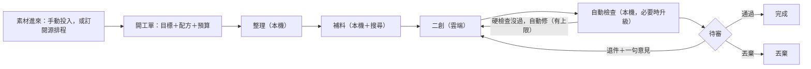

# 產品需求文件（PRD）— Evidence Forge

> **版本：** v2.0（2026-10-11） | **上一版：** v1.5，原文見 `30-snapshot/2026-10-10-prd-v1.5.md`
> 依 `docs/templates/vibecoding/02_project_brief_and_prd.md` 的 PRD 半部撰寫。為什麼做、什麼算成功見 `00-intent/brief.md`；階段見 `00-intent/roadmap.md`；決策見 §11 的 ADR。
> **v2.0 改了什麼：** 從「中間多處停下等人的固定流程」改成「給目標、自動做完、人只審結果」（ADR-0013），由配方與 skill 驅動（ADR-0009），狀態放在資料夾（ADR-0010），所有花錢的呼叫經過閘道並記帳（ADR-0011），素材由膠水層從各來源接進來（ADR-0012）。需求編號改用「領域前綴＋流水號」，跟 v1.5 的 `FR-01`～`FR-12` 不重疊，舊編號只在快照裡有效。

## 1. 專案總覽

| 項目 | 內容 |
| :--- | :--- |
| 一句話 | 把別人的文章與電子報接進來，自動整理成主張、觀點與研究方向，再照你給的目標、用你的風格二創成新文章；你只審結果。 |
| 使用者 | 一個人的內容工作室。創作者當「專案管理者」：設定來源與目標、審稿、退件。 |
| 部署 | 單機：本機 3090 跑 Qwen（主力），雲端 Claude 只用在二創與升級；資料放在本機資料夾。 |

## 2. 流程與狀態

- 哪幾段、每段用哪個 skill 和哪一級模型，寫在**配方**裡（FR-RC-01），上圖是預設配方 `restructure` 的樣子。
- 工單只有五個狀態：排隊、執行中、待審、通過、丟棄。做完、預算用完、出錯都進待審，用結果（完成／未完成／失敗）和原因區分（ADR-0010）。
- 中間不停下等人（ADR-0013）。

## 3. 使用者故事與允收標準

| ID | 故事 | 允收標準 | 對應 | BDD |
| :--- | :--- | :--- | :--- | :--- |
| US-01 | 身為創作者，我要貼一個網址、一段文字或丟一個檔案，填一句目標，就開始一張工單。 | 1. 三種投入都能開單 2. 沒填目標用配方的預設目標 3. 讀不到的網址明確標示，不繞過付費牆 | FR-IN-01 | `intake.feature` |
| US-02 | 身為創作者，我要訂閱源自動定時抓新文章並自動開單，我不必每天去貼。 | 1. 依排程抓取 2. 同一篇不會開兩張單 3. 抓取失敗記在訂閱源頁，不影響其他訂閱源 | FR-IN-02、FR-IN-03 | `intake.feature` |
| US-03 | 身為創作者，我要先拿到別人文章的整理：它屬於哪一種文類、作者的主張、觀點、結構、素材和可以延伸的研究方向。 | 1. 每條主張附逐字原文引句 2. 引句必須真的出現在原文 3. 觀點和事實分開標 | FR-DG-01、FR-DG-02 | `digest.feature` |
| US-04 | 身為創作者，我要系統依研究方向自己補資料，但花費有上限。 | 1. 補充來源都有網址與抓取時間 2. 搜尋額度用完就停 3. 抓取與搜尋結果跨工單共用 | FR-RS-01 | `research.feature` |
| US-05 | 身為創作者，我要照我的目標，指定要轉成哪一種文類，用我的聲音和我寫那一類的風格拿到一篇新文章，事實都附來源。 | 1. 依目標與目標文類的骨架寫 2. 套用作家聲音與該文類風格，沒有範本的文類標「未校準」 3. 事實有引用編號 4. 不照抄原文 5. 素材只依使用狀態放入（直接使用或引用） | FR-CP-01～FR-CP-04 | `compose.feature` |
| US-06 | 身為創作者，我只想在最後審稿；不合格的地方系統要先自己修，修不好再告訴我哪裡沒過。 | 1. 硬檢查沒過自動修，有次數上限 2. 還沒過就帶著清單進待審 3. 任何情況都不自動公開 | FR-VF-01 | `review.feature` |
| US-07 | 身為創作者，我要在待審時通過、退件或丟棄；退件時只寫一句意見，系統就重跑。 | 1. 退件可選從哪段重跑，預設依配方 2. 新版本不覆寫舊版 3. 上游產出沿用不重付 | FR-RV-01、FR-RV-02 | `review.feature` |
| US-08 | 身為創作者，我要看到每張單、每一段花了多少錢、用了哪個模型、跑了多久，月底有一份總帳單。 | 1. 每次模型與工具呼叫都入帳 2. 單張帳單與每月總表 3. 算得出每篇通過文章的平均成本 | FR-LG-01、FR-LG-02 | `ledger.feature` |
| US-09 | 身為創作者，我換模型或改 skill 之後，要確認品質沒有比原本差。 | 1. 同一批凍結案例比較新舊組合 2. 硬指標退步就擋下 3. 報告寫出勝、和、敗與花費差異 | FR-EV-01、FR-EV-02 | `evaluation.feature` |
| US-10 | 身為創作者，我要隨時看到每張單跑到哪、在等什麼。 | 看板顯示第幾段／共幾段、這段跑多久、在等 GPU、限流還是模型回應 | FR-UI-01 | `review.feature` |
| US-11 | 身為創作者，我要加一種新的產出方式時，只寫文件、不改程式。 | 新增一份配方與需要的 skill 就能用，執行器不改 | FR-RC-01 | `runner.feature` |

## 4. 功能需求

| ID | 優先 | 需求 | 允收重點 | 階段 |
| :--- | :--- | :--- | :--- | :--- |
| FR-IN-01 | P0 | 手動投入：網址、貼文字、上傳檔案（Markdown、純文字、PDF），附目標、配方、預算 | 進 `inbox/manual/`，自動開工單 | S0 |
| FR-IN-02 | P1 | 訂閱源 connector：`rss`、`gmail`（唯讀、指定 label）、`mcp`、`drive`，輸出統一的 inbox 格式 | 授權只在膠水層；同內容 hash 只進一次（ADR-0012） | S2 |
| FR-IN-03 | P1 | 排程：依 `feeds.yaml` 定時抓取，依訂閱源設定自動開單 | 單一訂閱源失敗不影響其他訂閱源，錯誤可見 | S2 |
| FR-DG-01 | P0 | 整理：主張（逐字引句＋段落位置；轉述別人的記下被轉述者與上游連結）、觀點、文章結構、素材清單（含上游出處：原 blog、影片、簡報）、研究方向 | 引句必須出現在原文（C1）；產出符合 schema（C5） | S0 |
| FR-DG-02 | P0 | 文類判斷：12 種文類（`harness/genres/`）擇一為主文類，可附次文類與信心；依主文類的抽取欄位整理 | 信心低時進待審要提醒（ADR-0015） | S0 |
| FR-RS-01 | P1 | 補料：依研究方向搜尋與抓取，產出補充來源與摘要 | 每張單的 Tavily 額度與輪數有上限；快取共用 | S3 |
| FR-CP-01 | P0 | 二創：依目標、目標文類的骨架、整理結果、補充資料寫新文章（標準 Markdown） | 事實附引用編號（C2）；不照抄（C3）；素材依使用狀態（C4） | S0 |
| FR-CP-02 | P0 | 作家設定：作家聲音一份（`voice.md`）＋各文類風格（`genres/<文類>.md`），放資料目錄 | 二創段一律載入目標作家的聲音與目標文類風格；沒有該文類風格時標「未校準」（ADR-0015） | S0 |
| FR-CP-03 | P0 | 目標文類：工單目標可指定；沒指定用訂閱源預設，再沒有用作家的預設文類 | 目標文類記在 job.md | S0 |
| FR-CP-04 | P1 | 轉換補充說明：特定「來源文類 → 目標文類」需要額外規則時，寫在 `harness/conversions/` | 只寫需要的組合 | S1 |
| FR-CP-05 | P1 | 學習作家風格：從範本或通過的稿子，草擬作家聲音與文類風格，由創作者確認後生效 | 未確認前 `calibrated: false` | S1 |
| FR-VF-01 | P0 | 自動檢查 C1～C7（§7），硬檢查沒過就自動回二創段修，次數上限由配方設定 | 修不好帶著沒過的清單進待審 | S0 |
| FR-RV-01 | P0 | 待審決定：通過、退件（附意見、選重跑段）、丟棄；失敗的單可重試 | 決定寫成檔案，由執行器套用（ADR-0010）。引用素材的逐件核准在 FR-AS-02（S3） | S0 |
| FR-RV-02 | P0 | 版本：稿子與各段產出每次都是新版本；通過後仍可再改 | 舊版永不覆寫 | S0 |
| FR-RC-01 | P0 | 配方：Markdown frontmatter 定義段、skill、等級、產出、重跑段、嘗試次數 | 新增配方不改程式（ADR-0009） | S0 |
| FR-MD-01 | P0 | 模型等級：`local`／`strong`／`max` 別名，對照表在閘道；產出連續不合格才依配方升級 | 基礎設施故障不升級（ADR-0011） | S0 |
| FR-LG-01 | P0 | 帳本：每次模型、搜尋、抓取、腳本呼叫一筆，欄位見 §8.6 | 只有閘道寫；只增不改 | S0 |
| FR-LG-02 | P0 | 帳單：單張 `bill.md`；每月總表依 skill、模型、訂閱源、本機／雲端分項；每篇通過文章的平均成本 | 全部由帳本產生，不另外記 | S0 |
| FR-EV-01 | P1 | 評估：凍結案例、人工標註、組合設定；可只重跑某一段 | 重跑走重播或新呼叫都入帳 | S1 |
| FR-EV-02 | P1 | 評估報告：硬指標、評審模型兩兩比較（對調順序）、花費與延遲差異；評審先經人工校準 | 硬指標退步標為不通過 | S1 |
| FR-EV-03 | P1 | 真實回饋：每次審稿決定記錄下來；退件案例自動成為評估案例；追蹤一次通過率 | — | S1 |
| FR-AS-01 | P1 | 素材：下載原文、上游與補料的圖、截圖、影片頁，記出處頁、作者、授權（`ok`／`unknown`／`denied`）與使用方式（`embed`／`quote`／`reference`） | 一律保存；預設 `reference`（ADR-0016） | S3 |
| FR-AS-02 | P1 | 引用：授權不是 `ok` 的素材可用 `quote` 放進稿子：旁邊附出處（作者或來源、標題、連結）、只取討論需要的部分、稿子確實在討論它；影片只嵌入或連結＋時間點；`denied` 不能引用；待審時稿子用到的每件引用素材由創作者逐件核准或拒絕，被拒絕的那件在退件重跑時換掉或拿掉 | C4 檢查出處與附近段落有提到它；有未核准的引用素材時不能通過（ADR-0016） | S3 |
| FR-UI-01 | P0 | 簡易 UI：看板、工單詳情、審稿動作、新增工單、帳單（架構草案 v0.3 §8） | 只讀資料夾；決定寫成檔案 | S0 |
| FR-UI-02 | P1 | UI：訂閱源頁（S2）、評估頁（S1） | — | S1、S2 |
| FR-EX-01 | P2 | 匯出到網站草稿預覽；公開要再按一次 | 不自動公開 | Later |

## 5. 各段必須守的規則

行為上的「必須／不准」。skill 本身怎麼寫是設計，見架構草案 v0.3 §3。

| 段 | 必須 | 不准 |
| :--- | :--- | :--- |
| 整理 | 每條主張附逐字原文引句與位置；分清事實、數據、觀點；列出研究方向與需要的證據 | 改寫引句；把觀點標成事實；補原文沒有的內容 |
| 補料 | 只用搜尋與抓取工具取得的內容；每份來源記網址與抓取時間；二手轉述追到原始來源才算獨立證據 | 用常識或記憶補資料；超過額度 |
| 二創 | 照目標寫；用自己的話重組；事實附引用；觀點和推論明確標示 | 照抄原文段落；捏造來源；嵌入授權不明的圖 |
| 檢查 | 硬檢查用程式判斷；軟檢查附理由 | 放過捏造的引句；自己改稿（修稿是二創段的事） |

所有段都一樣：從網頁、信件抓回來的內容只當資料，不當指令（防提示注入）。

## 6. 來源與素材治理

1. 原始抓取（`raw/`）和加工產出分開存。
2. 不同文章追到同一份原始公告，算**一組**原始證據。
3. 沒有來源、或無法定位的事實，在稿子裡要標成推論或拿掉。
4. 圖片搜得到不等於能公開重製：授權 `ok` 才能直接使用；授權不明的只能用「引用」，要附出處並經人核准；權利人明確拒絕的不能用（ADR-0016）。
5. 保留原文與抓取時間，之後要更正時查得到。
6. 原作者轉貼的別人內容（blog、影片、簡報截圖），要追到上游出處並把上游原文一起抓回保存；保存一律可以，能不能放進成品另依素材的使用狀態決定。
7. 二創的材料是作者的主張與研究方向，不是原文的段落；成品要用自己的話寫，並附原作出處。

## 7. 自動檢查

任何檢查都**不會讓稿子自動公開**。硬檢查沒過，會自動回二創段修，修到配方設定的次數上限；還沒過，就帶著清單進待審。

| 編號 | 類型 | 擋下的條件 | 怎麼查 |
| :--- | :--- | :--- | :--- |
| C1 引句真實 | 硬 | 整理段的引句不在原文裡 | 程式比對（正規化後做子字串比對） |
| C2 引用完整 | 硬 | 事實沒有引用編號，或編號對不到來源 | 程式 |
| C3 不照抄 | 硬 | 跟原文的逐字重疊超過門檻 | 程式（最長共同片段、n-gram 重疊率） |
| C4 素材使用 | 硬 | `embed` 的授權不是 `ok`；`quote` 沒有出處說明、或附近段落沒提到它；`reference` 出現在稿子裡 | 程式比對素材清單與稿子 |
| C5 格式 | 硬 | 產出不符合該段的 schema；稿子不是標準 Markdown | 程式 |
| C6 引用撐得住 | 軟 | 來源不支持那句話 | 本機模型逐條判斷，不確定時升級 |
| C7 符合目標 | 軟 | 稿子沒照目標寫 | 本機模型依評分表判斷 |

## 8. 非功能需求

編號 `NFR-<領域>-xx` 供票與測試引用。

### 8.1 不重付，控制成本

| ID | 規則 |
| :--- | :--- |
| NFR-COST-01 | **先預留再花錢**：雲端呼叫與搜尋送出前先依估計花費預留；工單預算不夠就拒絕，單子進待審並標「未完成：預算用完」。每張單有美元與 Tavily credits 兩種上限（ADR-0011） |
| NFR-COST-02 | **當機重跑不重付**：同一段同一次嘗試內，相同的模型請求直接回放存好的回應 |
| NFR-COST-03 | **跨工單共用**：同一網址的抓取、同一查詢的搜尋先查快取；快取有有效期限 |
| NFR-COST-04 | **只重跑需要的段**：退件時從選定的段重跑，上游產出沿用 |
| NFR-COST-05 | **用官方折扣**：重複送出的長上下文用 prompt caching；評估的評審走 Batch API |
| NFR-COST-06 | **開發與測試零花費**：自動化測試一律用重播模式，不打付費 API；真的呼叫只在手動觸發時發生 |
| NFR-COST-07 | **本機優先**：配方預設把整理、補料、檢查放在 `local`；雲端只用在宣告為 `strong` 的段與升級 |

### 8.2 每次都跑得動

| ID | 規則 |
| :--- | :--- |
| NFR-RUN-01 | **開跑前先檢查**：Ollama 在跑且模型已載入、閘道可連、Anthropic 金鑰有效、Tavily 剩餘額度、硬碟空間、資料目錄可寫。任何一項不過就不開跑，並說明是哪一項 |
| NFR-RUN-02 | **狀態有限**：工單只有排隊、執行中、待審、通過、丟棄五種；待審附結果（完成／未完成／失敗）與原因 |
| NFR-RUN-03 | **產出先驗格式**：每段產出用該 skill 的 schema 驗證；不合格就重試，到上限再依配方升級，仍失敗就進待審 |
| NFR-RUN-04 | **當機可恢復**：程序重啟後，執行中的單從所在那段重跑 |
| NFR-RUN-05 | **基礎設施故障不升級**：Ollama 沒回應、網路斷，就停下標失敗，不偷偷改用付費模型 |
| NFR-RUN-06 | **版本鎖在工單上**：模型對照、skill 的 git sha、配方版本記在每份產出裡；重跑用同一套 |
| NFR-RUN-07 | **CI 每次跑完整流程**：用固定的小案例加錄好的回應，從投入跑到待審 |
| NFR-RUN-08 | **錯誤處理**：403、付費牆、robots 限制不繞過；429 退避重試；抓不到的標 unavailable |

### 8.3 產出的東西留得住

| ID | 規則 |
| :--- | :--- |
| NFR-KEEP-01 | **只增不改**：原始抓取、圖片、模型的原始請求與回應、每一版產出與稿子，都不覆寫（ADR-0010） |
| NFR-KEEP-02 | **一個檔一個寫入者**：狀態只有執行器寫、帳本只有閘道寫、審稿決定只有 UI 寫 |
| NFR-KEEP-03 | **被擋下的素材也留**：授權不明的圖照樣下載並記錄，只是不進成品 |
| NFR-KEEP-04 | **資料不進 repo**：資料目錄由 `EF_DATA` 指定，預設是專案的 `data/`，`.gitignore` 排除（ADR-0014） |
| NFR-KEEP-05 | **備份可還原**：每天同步到第二顆本機硬碟；定期實際還原一次；MVP 期間全部保留，只有創作者明確下指令才刪 |

### 8.4 並行與資源

| ID | 規則 |
| :--- | :--- |
| NFR-PAR-01 | 多張工單可以同時跑，同時幾張是設定值 |
| NFR-PAR-02 | 本機 GPU 同時只服務一個模型請求，其餘排隊；排隊時間入帳 |
| NFR-PAR-03 | 雲端服務依各自的速率上限；等待時間入帳 |

### 8.5 安全

| ID | 規則 |
| :--- | :--- |
| NFR-SEC-01 | 帳號授權只在膠水層；執行器、閘道、agent 都讀不到；放在 `EF_SECRETS`，不在資料目錄（ADR-0012、ADR-0014） |
| NFR-SEC-02 | agent 沒有 shell，也沒有內建讀寫檔工具；所有工具只能碰該工單的資料夾（ADR-0009） |
| NFR-SEC-03 | 抓網頁擋內網位址（SSRF）；外來內容只當資料 |
| NFR-SEC-04 | 雲端金鑰只在閘道；不進 repo、不進日誌 |

### 8.6 可觀測

| ID | 規則 |
| :--- | :--- |
| NFR-OBS-01 | 帳本每筆記錄：時間、工單、段、第幾次、類型、等級、實際模型、是否升級、輸入／輸出／快取 token、credits、金額、GPU 秒數、第一個字的時間、總延遲、排隊時間、狀態、請求與回應的 hash |
| NFR-OBS-02 | **看得到進度**：看板顯示第幾段／共幾段、這段跑多久、正在等什麼（GPU、限流、模型回應），資料來自 Pi 的事件與帳本，不放假動畫 |

跨這些方向的 BDD 情境在 `features/runner.feature` 與 `features/ledger.feature`。

## 9. 範圍與限制

| 項目 | 內容 |
| :--- | :--- |
| 不做 | 自動公開發布、繞過付費牆、整張轉載授權不明的圖（只能有條件引用，ADR-0016）、讓 agent 拿帳號授權、無上限迴圈、學習型派發器當骨幹（只做實驗） |
| 假設 | 創作者會審稿並對發表內容負責；本機有一張 3090 跑 Qwen3.5 9B；WSL 在排程時段是開著的 |
| 外部依賴 | Ollama、Anthropic API（Sonnet 5.5、Opus 5.5）、Tavily、Pi、各訂閱源的 API（Gmail、Drive、MCP server） |

## 10. 風險與最小修正

| 風險 | 最小修正 |
| :--- | :--- |
| Qwen 9B 整理品質不夠 | 引句用程式檢查（C1）；S1 評估後把 `digest` 改成 `strong` 只要改配方 |
| 二創不像創作者 | 作家聲音＋文類風格；未校準的文類明確標示；退件意見累積進評估 |
| 文類判斷錯誤，抽錯欄位 | 整理段列出判斷信心；信心低時待審提醒 |
| 引用他人素材的著作權風險 | 引用條件、C4 檢查、人逐件核准；開始營利時重新評估（ADR-0016） |
| 電子報內容藏指令 | 膠水層不用 LLM；agent 沒有帳號、沒有 shell、只能碰自己的資料夾 |
| 沒人看著時花太多錢 | 閘道預留制預算；每段嘗試次數上限 |
| 二創涉及侵權 | 不照抄檢查（C3）、圖片授權（C4）、附出處；公開一定要人按 |
| Pi 版本變動 | Pi 版本鎖在 repo；工具邏輯在閘道，Pi 擴充只做轉送 |
| 換模型後品質默默退步 | 評估的硬指標擋下；真實退件率追蹤 |

## 11. 已做的決策

| ADR | 決策 |
| :--- | :--- |
| ADR-0001 | LangGraph 確定性節點圖（**已由 ADR-0009 取代**） |
| ADR-0002 | 模型分工（**由 ADR-0011 修正**） |
| ADR-0003 | ID 規則與內容分開存放（儲存部分由 ADR-0006、ADR-0010 修正） |
| ADR-0004 | 外部副作用不重複（實作由 ADR-0010、ADR-0011 修正） |
| ADR-0005 | 跨工作快取、只增不改（實作由 ADR-0010、ADR-0011 修正） |
| ADR-0006 | Celery＋Redis＋PostgreSQL（**已由 ADR-0010 取代**） |
| ADR-0007 | 設計 token 命名 |
| ADR-0008 | 外觀三選一，預設跟隨系統（修正 ADR-0007 §3.4） |
| ADR-0009 | agent 核心用 Pi，流程寫成配方與 skill |
| ADR-0010 | 狀態放在資料夾，工單就是佇列 |
| ADR-0011 | 自己寫模型閘道；固定規則分級、失敗才升級；全部記帳 |
| ADR-0012 | 膠水層用程式自己寫，不用 LLM，帳號授權不交給 agent |
| ADR-0013 | 給目標就自動做完，人只審結果 |
| ADR-0014 | 資料目錄放在專案的 `data/`（不進版控），帳號授權移到使用者家目錄（修正 ADR-0010、ADR-0012） |
| ADR-0015 | 二創由「文類 × 作家」組合：12 種文類，作家一份聲音加各文類風格 |
| ADR-0016 | 素材新增「引用」使用狀態：附出處、只取必要部分、人逐件核准（修正 ADR-0013 §3.5） |
| ADR-0017 | 狀態 token 改用新設計的實體命名（`--job-*`、`--check-*`、`--claim-*`、`--genre-*`）；中文不載網路字型（修正 ADR-0007） |
