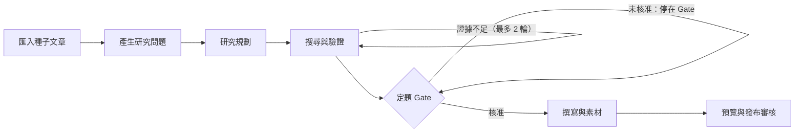

# 產品需求文件（PRD）— Evidence-led Editorial Studio

> **版本：** v1.5 | **更新：** 2026-10-10 | **狀態：** 設計基準，待 POC 實測
> 依 `docs/templates/vibecoding/02_project_brief_and_prd.md` 的 PRD 半部撰寫。
> 為什麼做、成功門檻、成本假設 → `00-intent/brief.md`；階段 → `00-intent/roadmap.md`；決策理由 → `adr/`；詞的定義 → 根目錄 `CONTEXT.md`。
> 原始版本：`30-snapshot/2026-10-10-prd-roadmap-v1.0.md`。v1.1：FR-11 改為 P0（見 `roadmap.md`）。v1.2：FR-10 改為 P0、提前到 R0；預覽拆成「本機預覽」與「網站草稿預覽」；§8 依「不重跑、跑得動、留得住」三個方向補齊。v1.3：§8.4 並行與資源排程（ADR-0006）；持久化改 PostgreSQL。v1.4：選題停點、原作者立場、匯出後可改論點、人工補搜上限、受限 MDX、檢查不過不自動重寫、Run 狀態補齊、進度顯示（NFR-24）。v1.5：補搜超限時的三個選項寫明（FR-11）。FR 編號不變。

這份只寫**必須成立什麼**。各項目前做到哪，看 `20-state/`。

## 1. 專案總覽

| 項目 | 內容 |
| :--- | :--- |
| 產品 | 單人使用的研究與圖文產製工作室，固定流程、受限分支 |
| 主要使用者 | 創作者：技術作者／產品經理／資料科學與 AI 工程工作者，可審查來源、對論點負責 |
| MVP 交付物 | 研究提案（Research Brief）、證據矩陣、`sources.json`、`assets.json`、`article.mdx`、審查報告、`run.json` |
| MVP 範圍 | `roadmap.md` 的 R0～R3 |

## 2. 流程與狀態

| 畫面／狀態 | 創作者做什麼、系統做什麼 | 往下走的條件 |
| :--- | :--- | :--- |
| 01 New Research | 貼 URL；設定主題範圍、語言、目標讀者、搜尋上限 | 來源讀得到才啟動；讀不到時提供手動貼內容 |
| 02 Research Proposal | 看候選研究問題、建議的論點與證據缺口 | 研究規劃的輸出通過 schema 驗證才開始搜尋 |
| 03 Evidence Review | 看引用鏈、原文定位、反證、版本日期與圖片素材 | 證據不足時最多回搜 2 輪；超過就交給人決定 |
| 04 Human Thesis Gate | 接受／修改／否決論點；寫下自己的觀點 | 核准才進入寫作 |
| 05 Draft Preview | 在**本機預覽**對照大綱與文章；檢查圖、引用和授權狀態 | G1～G5 全過才產出可發表的內容包 |
| 06 Publish Review | 最後人工核准，送到**網站草稿預覽**，不直接上線 | 未核准的外部圖片一律不打包 |

## 3. 使用者故事與允收標準

「創作者」指使用這套系統的那一個人；其餘名詞照 `CONTEXT.md`。BDD 情境在 `features/`。

### Epic 1：來源擷取

| ID | 故事 | 允收標準 | 需求 | BDD |
| :--- | :--- | :--- | :--- | :--- |
| US-01 | 身為創作者，我要貼一篇種子文章的 URL，系統就追出它引用了哪些來源，讓我不必手動整理 References。 | 1. 每個來源都有 URL、擷取時間、狀態 2. 讀不到（403、付費牆）標成不可驗證，不繞過 3. 同一個 canonical URL 只出現一次 | FR-01 | `source-intake.feature` |

### Epic 2：研究提案

| ID | 故事 | 允收標準 | 需求 | BDD |
| :--- | :--- | :--- | :--- | :--- |
| US-02 | 身為創作者，我要看到 3–5 個候選研究問題，每題都附原文前提，讓我知道研究從哪裡切入。 | 1. 每題有 premise、why_now、evidence_needed、risk、source_ids 2. 缺證據的地方標 UNKNOWN 3. 產完題目後停下等我選定或改寫，選好了才開始研究規劃 | FR-02 | `research-proposal.feature` |
| US-03 | 身為創作者，我要看到一份研究計畫：建議的論點、競爭假說、反方問題、查證路徑，讓研究不會只順著原作者的說法走。 | 1. 輸出 original_stance（原作者立場）、thesis、alternative_views、research_queries、stop_rules 2. 至少一個競爭假說 3. 原作者立場與建議論點並列，讓我看得出差在哪 4. 輸出不合 schema 就不開始搜尋 | FR-03 | `research-proposal.feature` |

### Epic 3：證據

| ID | 故事 | 允收標準 | 需求 | BDD |
| :--- | :--- | :--- | :--- | :--- |
| US-04 | 身為創作者，我要看到每個主張對到哪個來源的哪一段，讓我能自己核對。 | 1. 核心主張都能定位到來源原文 2. 二手引用不算獨立來源 3. 找不到來源的主張標 UNVERIFIED | FR-04、FR-05 | `evidence.feature` |
| US-05 | 身為創作者，證據不夠時我要系統自己補搜，但有次數上限，不要無止境燒錢。 | 1. 自動補搜最多 2 輪 2. 超過就停下交給我決定，選項有三個：用現有證據進 Gate、加預算再補、取消這次研究 3. 我授權的補搜最多再 2 輪 4. 每輪的查詢數與 credits 有上限且記錄用量 | FR-04、FR-11 | `evidence.feature` |

### Epic 4：定題 Gate

| ID | 故事 | 允收標準 | 需求 | BDD |
| :--- | :--- | :--- | :--- | :--- |
| US-06 | 身為創作者，我要在寫作前接受、修改或否決論點，並寫下自己的觀點，讓文章的立場是我決定的。 | 1. 沒核准就不會開始寫 2. 否決之後不會產出稿子 3. 程式重啟後，同一個 Run 可以從 Gate 接著走 4. 決定、時間與我的觀點都留紀錄 5. 匯出之後我仍可回到 Gate 改論點，產生新版草稿，舊的內容包保留 | FR-06 | `thesis-gate.feature` |

### Epic 5：寫作

| ID | 故事 | 允收標準 | 需求 | BDD |
| :--- | :--- | :--- | :--- | :--- |
| US-07 | 身為創作者，我要依核准的論點和證據拿到大綱與 2,000–3,000 字的草稿，每個事實都附來源編號。 | 1. 非個人推測的核心事實都有 claim／source ID 2. 沒有憑空補出的來源 3. 來源不支持的敘述標成推論 4. 不沿用原文的敘事順序 | FR-07 | `editorial-draft.feature` |

### Epic 6：素材授權

| ID | 故事 | 允收標準 | 需求 | BDD |
| :--- | :--- | :--- | :--- | :--- |
| US-08 | 身為創作者，我要每張圖都附出處和授權狀態，授權不明的預設擋下，讓我不會誤用別人的圖。 | 1. 每張圖有來源 URL、出處頁、作者、授權、使用狀態 2. 授權 unknown 或 denied 一律不進公開內容 3. 只有合法且人工核准的圖能用 | FR-08 | `asset-rights.feature` |

### Epic 7：匯出與發布

| ID | 故事 | 允收標準 | 需求 | BDD |
| :--- | :--- | :--- | :--- | :--- |
| US-09 | 身為創作者，我要拿到網站能直接讀的內容包。 | 1. 產出 `article.mdx`、`sources.json`、`assets.json`、`run.json` 2. 全部通過 schema 驗證 3. 本機預覽沒有遺失的圖或斷掉的連結 | FR-09 | `export.feature` |
| US-10 | 身為創作者，我要把核准的內容送到網站草稿預覽，但公開一定要我再按一次。 | 1. 可產生網站草稿預覽（網站還沒架，形式在 R3 結束前決定） 2. 沒有人工核准就不公開 | FR-12 | `export.feature` |

### Epic 8：執行紀錄

| ID | 故事 | 允收標準 | 需求 | BDD |
| :--- | :--- | :--- | :--- | :--- |
| US-11 | 身為創作者，我要看到每個節點花了多少時間、多少錢、用了哪個模型和 prompt 版本，讓我能比較與追查。 | 每個節點記錄耗時、input／output hash、模型版本、prompt 版本、搜尋請求、費用、錯誤碼 | FR-10 | `run-trace.feature` |

## 4. 功能需求

| ID | 優先 | 功能 | 驗收準則 |
| :--- | :---: | :--- | :--- |
| FR-01 | P0 | URL／Reference 擷取：meta、canonical、出站連結、原文段落定位 | 有來源 URL、擷取時間、狀態；403 或失敗時標示不可驗證 |
| FR-02 | P0 | Scout：產 3–5 個候選研究問題，標記原文前提；產完停下等創作者選題 | 每題有 premise、why_now、evidence_needed、risk、source_ids；沒選定題目不進研究規劃 |
| FR-03 | P0 | Director：選題、建立假說、反方問題、查證計畫 | 輸出 original_stance、thesis、alternative_views、research_queries、stop_rules；thesis 與 original_stance 不得實質相同 |
| FR-04 | P0 | Search：先追 References，有缺口才觸發 Tavily；相同 canonical 去重 | 每輪 max_queries／max_credits 可設定；記錄用量 |
| FR-05 | P0 | Evidence：來源品質、主張對照、引用片段與引用鏈 | 核心主張可定位到來源；二手引用不重複算成獨立來源 |
| FR-06 | P0 | 定題 Gate：人工接受／修改／否決並恢復流程 | 重啟後依 thread_id 恢復；否決後不寫稿；匯出後可回 Gate，只重跑寫作並產生新版，舊版保留 |
| FR-07 | P0 | Writer：依核准論點＋有引用的證據產大綱與 MDX | 非個人推測的核心事實都配 claim／source ID；禁止憑空補來源；只輸出受限 MDX（標準 Markdown，不含 JSX 元件） |
| FR-08 | P0 | Asset：圖片 URL、原文位置、作者／授權、下載狀態 | license=unknown 預設擋下；只能用合法且審核通過的 |
| FR-09 | P0 | Export：`article.mdx`、`sources.json`、`assets.json`、`run.json` | schema 驗證通過；本機預覽沒有遺失圖或斷鏈 |
| FR-10 | **P0** | Run Trace：token、模型版本、prompt 版本、搜尋請求與花費（`run.json` 的內容來源，所以和成本計量一起在 R0 做） | 每個節點有耗時、input／output hash、費用、錯誤碼 |
| FR-11 | **P0** | 反證迴圈：審查後有限次補查 | 自動最多 2 輪；超過進人工審查，選項只有：用現有證據進 Gate、加預算再補、取消；人工授權的補搜最多再 2 輪；不無限迴圈 |
| FR-12 | P2 | 網站草稿預覽整合 | 可產生網站草稿預覽；公開發布要人工核准 |

## 5. 各節點必須守的規則

這裡只寫行為上「必須／不准」。提示詞本身怎麼寫、怎麼做版本管理，是設計，見 `30-snapshot/plans/2026-10-10-architecture-draft.md`。

| 節點 | 必須 | 不准 |
| :--- | :--- | :--- |
| Scout | 提出可驗證、可反駁、對讀者有價值的問題；附原文前提、可能的反例、需要的資料與來源 ID | 自己宣告結論成立；缺證據時不標 UNKNOWN |
| Director | 選出最值得研究的論點；提出競爭假說、資料需求、反證路徑、來源分級、查詢預算與停止條件 | 把二手引用當獨立證明；用常識補資訊缺口 |
| Reviewer | 逐條核對主張與來源定位；指出支持不足、版本不合、衝突與替代解釋；判 PASS／RESEARCH_MORE／BLOCK | 放過沒有證據的主張；RESEARCH_MORE 超過 2 輪 |
| Writer | 只用核准論點、創作者觀點和證據包寫作；圖文依素材 ID 標註 | 照原文的敘事順序重寫；把來源沒支持的敘述寫成事實；捏造引用 |

所有節點：從網頁抓回來的內容只當資料，不當指令（防 Prompt Injection）。

## 6. 來源與素材治理

1. 原始資料和 AI 摘要分開存。
2. 不同文章追到同一份原始公告，算**一組**原始證據。
3. 沒有來源、或無法精確定位的主張，標 UNVERIFIED。
4. 圖片搜得到不等於能公開重製。
5. 保留原文段落與擷取時間，之後要更正版本時才查得到。

## 7. 品質關卡

任一關卡沒過，都不能自動公開發布，**也不自動重寫**：草稿照樣進發布審核，列出沒過的關卡，由創作者決定重寫、改素材或回 Gate。

| 關卡 | 擋下的條件 | 怎麼檢查 |
| :--- | :--- | :--- |
| G1 Source | 主要證據沒有 URL、日期或原文定位，或原始來源已失效 | 來源驗證程式＋URL／段落錨點 |
| G2 Claim | 核心事實沒有直接支持；關鍵數據與版本不一致 | 證據矩陣；Reviewer 反證＋人工抽查 |
| G3 Human Thesis | 創作者還沒選定論點，或否決後仍進入寫作 | LangGraph interrupt＋審核紀錄 |
| G4 Asset Rights | 圖片授權 unknown 或 denied 卻輸出公開圖片 | 素材清單檔自動拒絕＋人工核准 |
| G5 Editorial | MDX schema 錯誤、重要引用遺失、文章觀點與核准版本不一致 | Lint／預覽＋人工核稿 |

## 8. 非功能需求

四個方向：**做過的不重做**、**每次都跑得動**、**產出的東西留得住**、**多篇同時跑而不搶資源**。編號 `NFR-xx` 供票與測試引用。

### 8.1 不重做，控制成本

| ID | 規則 |
| :--- | :--- |
| NFR-01 | **同一次 Run 恢復不重做**：每個外部副作用（搜尋、LLM 呼叫、寫檔、送出）以 `run_id + operation_key` 記錄；恢復時做過的直接取回結果，不重複收費、不重複發布（ADR-0004） |
| NFR-02 | **不同 Run 共用結果**：同一個 canonical URL 的擷取、同樣的 Tavily 查詢、同樣的「模型＋prompt 版本＋輸入」的 LLM 呼叫，都先查快取；擷取與搜尋的快取有有效期限（ADR-0005） |
| NFR-03 | **只重跑下游**：在定題 Gate 修改論點，只重跑寫作之後的節點；上游的擷取、搜尋、複核結果沿用 |
| NFR-04 | **先預留再花錢**：每次外部呼叫前先預估花費並從預算扣除預留額；預算不足就停在「等人調預算」，不准先花了才發現超支。每個 Run 都有 Tavily credits、Opus／Sonnet token、美元三種上限 |
| NFR-05 | **用官方折扣**：同一份證據包會在 Reviewer 多輪之間重送，要用 prompt caching；不需要即時回應的批次工作（R5 實驗）走 Batch API |
| NFR-06 | **實驗共用快照**：比較組（`brief.md` §5.2）讀同一份凍結的證據包，搜尋只付一次 |
| NFR-07 | **開發與測試零花費**：自動化測試一律重播錄好的回應，不打付費 API；真的呼叫只在手動觸發時發生 |

### 8.2 每次都跑得動

| ID | 規則 |
| :--- | :--- |
| NFR-08 | **開跑前先檢查**：Ollama 在跑且模型已載入、PostgreSQL 與 Redis 連得上、API key 有效、Tavily 剩餘額度、硬碟空間、資料庫版本。任何一項不過就不開始，並說明是哪一項 |
| NFR-09 | **狀態有限且明確**：Run 只有這幾種狀態——排隊中、執行中、等選題、等人工決定（補搜超限或格式重試失敗）、等定題、等人調預算、等發布審核、可重試的失敗、部分完成、完成、已否決、已取消。每種都有明確的下一步；部分成功不當成完成。各狀態之間怎麼轉換，隨程式寫進 `architecture.md` |
| NFR-10 | **輸出先驗格式**：每個節點的輸出做 schema 驗證，不合格最多重試 2 次，再不行就停下交給人 |
| NFR-11 | **CI 每次跑完整流程**：用一篇固定的小種子文章加錄好的回應，從匯入跑到匯出；另留一個手動觸發、預算很小的真實冒煙測試 |
| NFR-12 | **版本鎖在 Run 上**：LangGraph、模型 ID、prompt 版本記在 Run 裡；恢復時用同一套版本 |
| NFR-13 | **錯誤處理**：403、付費牆、robots 限制不繞過；API 429 指數退避；抓不到的引用標 unavailable；Ollama 沒回應時停下，不偷偷改用付費模型；本機 GPU 記憶體不足時縮短 context，不換模型 |
| NFR-24 | **看得到進度**：排隊中與執行中的 Run 要顯示真實的進度——排在第幾位；目前在第幾步、共幾步；這一步跑了多久；正在等什麼（等 GPU、等 API 限流、等雲端模型回應）。進度由 worker 回報，不放假動畫。等人操作的狀態不顯示進度條，改顯示「輪到你了」和要做的事 |

### 8.3 產出的東西留得住

| ID | 規則 |
| :--- | :--- |
| NFR-14 | **只增不改**：原始 HTML、抽出的全文、圖片、LLM 的原始回應、送出的 prompt、每一版 MDX，都依內容 hash 存檔，永不覆寫（ADR-0005） |
| NFR-15 | **原始與加工分開**：原始擷取與 AI 產出分開存放（§6 第 1 條） |
| NFR-16 | **每個 Run 一份清單**：`run.json` 列出這次用到的所有檔案 hash，可完整還原當時的狀態 |
| NFR-17 | **被擋下的素材也留**：授權不明的圖片照樣下載並記錄授權資訊，只是不打包進公開內容 |
| NFR-18 | **資料不進 repo**：資料目錄由環境變數指定，不在 git 版控內 |
| NFR-19 | **備份可還原**：資料庫用 SQLite 的線上備份（不直接複製寫入中的檔案），檔案儲存區同步到另一個位置；定期實際還原一次。每天備份到第二顆本機硬碟；MVP 期間全部保留，只有創作者明確下指令才刪 |

### 8.4 並行與資源排程

| ID | 規則 |
| :--- | :--- |
| NFR-20 | **多篇同時跑**：多個 Run 可以同時推進；同一個 Run 同時只有一個 worker 在推進（ADR-0006） |
| NFR-21 | **限資源，不限 Run**：本機 GPU 同時只服務 1 個 Qwen 呼叫；Anthropic、Tavily 照各自的速率上限；上限都是設定值 |
| NFR-22 | **worker 掛掉不掉工作**：未完成的工作會被重送；重送靠 NFR-01 保證不重扣錢 |
| NFR-23 | **佇列遺失可重建**：佇列只放待辦；Run 的真正狀態在資料庫，佇列資料遺失時可從資料庫重新排回 |

### 8.5 其他

| 主題 | 規則 |
| :--- | :--- |
| 持久化 | checkpoint、Run 狀態、操作紀錄、快取索引都存 PostgreSQL（ADR-0006，修正 ADR-0003 的 SQLite）；PostgreSQL 與 Redis 用 Docker 跑 |
| 資料安全 | URL 白名單與 URL 解析防 SSRF；過濾敏感 token；網頁內容不得改寫系統規則 |
| 可觀測 | 每個節點存模型 ID、prompt hash、耗時、token、工具呼叫、結果 hash、審核決定（FR-10） |
| 部署 | 本機 Ollama 與 Celery worker 分開；GPU 爭用由 NFR-21 的限流處理，不再限制一次只跑一個 Run |

跨這三個方向的 BDD 情境在 `features/run-reliability.feature`。

## 9. 範圍與限制

| 項目 | 內容 |
| :--- | :--- |
| 不做 | 全自動公開發布、轉載侵權素材、跨文章 RAG、繞過付費牆、無上限的自主迴圈、多搜尋商聚合 |
| 假設 | 創作者會審來源並對論點負責；本機有一張 3090 跑 Qwen3.5 9B |
| 外部依賴 | Anthropic API（Opus 5.5、Sonnet 5.5）、Tavily Search／Extract、Ollama |

## 10. 風險與最小修正

| 風險 | 最小修正 |
| :--- | :--- |
| Qwen 提的問題偏向原作者的框架 | Director 必須提出競爭假說（§5） |
| Opus 的推論看似可信但缺證據 | G2 以原文定位驗收，不看文字說服力 |
| 網頁內嵌惡意 Prompt | 搜尋內容只當資料、不當指令（§5） |
| interrupt 恢復時重跑節點，產生重複副作用 | 外部呼叫獨立成節點＋`operation_key`（ADR-0004、NFR-01） |
| 修 bug 或改 prompt 後重跑，整條流程重新花錢 | 跨 Run 快取＋只重跑下游（NFR-02、NFR-03） |
| 來源網頁改版或消失，證據對不回去 | 原文只增不改地存下來（NFR-14） |
| 圖片搜得到但沒授權 | 素材清單檔預設擋下授權不明的（FR-08、G4） |

## 11. 已做的決策

| ADR | 決策 |
| :--- | :--- |
| ADR-0001 | 工作流引擎用 LangGraph StateGraph，做成確定性節點圖 |
| ADR-0002 | 模型分工：Qwen 產問題、Opus 規劃與複核、Sonnet 寫作 |
| ADR-0003 | State 只存 ID，內容放檔案儲存區（持久化部分由 ADR-0006 修正） |
| ADR-0004 | 外部副作用獨立成節點，用冪等鍵去重 |
| ADR-0005 | 跨 Run 快取，檔案儲存區只增不改 |
| ADR-0006 | 多個 Run 並行：Celery＋Redis 排工作、PostgreSQL 存狀態、依資源限流（修正 ADR-0003 的持久化） |
