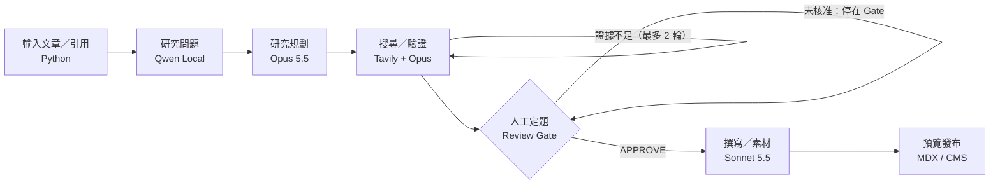

# Evidence-led Editorial Studio

`ONE-PAGE PRODUCT BRIEF · V1.0`

技術觀點文章的研究、查證與圖文產製｜雲地混合式固定工作流

|          |                                                          |
| -------- | -------------------------------------------------------- |
| 產品主張 | 讓創作者只需輸入一篇文章／研究主題，在核准研究切角後，取得可追溯證據、原始圖文素材與網站可發布的 MDX 草稿。 |

## 機會與核心價值

痛點：人工追溯 References、建立反證、整理圖文與引用成本高；純 AI 改寫容易複製原作者的框架、產生來源幻覺與圖片授權風險。

定位：不是「文章改寫器」，而是 Reference-first Research → Human Thesis Gate → Evidence-backed Writing 的個人研究工作室。

## 產品工作流

固定流程 · 受限分支 · 每節點保存輸入／輸出與成本。證據不足：從驗證回到定向搜尋（最多 2 輪）；人工未核准：停在 Gate，不進入撰寫。

## 角色、技術與邊界

| 節點／模型          | 核心交付            | 品質控制        |
| ------------------ | ------------------- | --------------- |
| Qwen3.5 9B（3090）   | 主張、引用、3–5 個候選研究問題   | 問題附來源／未知標記      |
| Opus 5.5           | 研究切角、假說、查證計畫；關鍵證據複核 | 反證與來源充分性審查      |
| Tavily + Python    | 追溯原始來源、定向搜尋、擷取圖片線索  | URL 與原文片段可回溯    |
| Human → Sonnet 5.5 | 核准立場後完成大綱、長文與 MDX   | 人工核准發表；授權不明圖片禁用 |

## MVP 範圍與成功條件

P0：URL 匯入、來源清單、Qwen 問題、Opus 研究計畫、Tavily 定向追證、人工審題、Sonnet 草稿、來源／圖片 Manifest、MDX 預覽。暫不做自動上線、RAG、多搜尋商。

成功條件（待實測）：20 篇跨題型測試；核心事實具可定位引用率 100%；授權不明素材公開使用率 0%；人工可於 Gate 改選觀點；單篇 API 基準約 US$0.64（未抵免費額度，依模型與工具預算計算）。

## 迭代路徑與決策

R0 基線與資料契約 → R1 來源＋研究問題 → R2 研究與反證＋人工 Gate → R3 Sonnet 寫作＋素材包 → R4 網站預覽與成效評估。採 LangGraph StateGraph，SQLite 開發／Checkpoint；規模化時升級 PostgreSQL。
