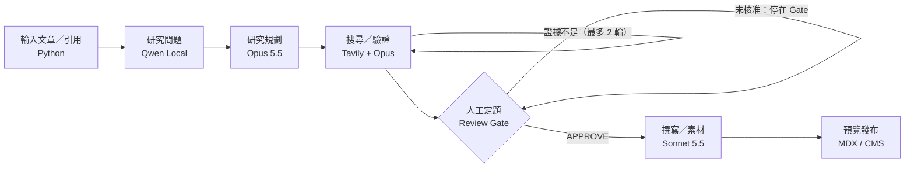

# Evidence-led Editorial Studio

`PRODUCT REQUIREMENTS DOCUMENT · V1.0`

PRD、系統架構、Prompt Contracts 與功能迭代 Roadmap｜Owner：個人內容工作室｜2026-10-10

|              |                                                                                                      |
| ------------ | ---------------------------------------------------------------------------------------------------- |
| Decision | 採用 LangGraph StateGraph；Qwen3.5 9B 產候選研究問題，Opus 5.5 審定研究計畫及關鍵證據，Sonnet 5.5 寫作；Tavily 搜尋；人工核准研究立場與發布。 |

文件狀態：設計基準（待 POC 實測）。「目標值」皆為產品驗收門檻，非已達成結果。VK 付費課程內文與專屬提示詞未取得，僅使用公開大綱作概念映射。

## 1. 產品背景與研究依據

使用情境：創作者提供技術文章 URL（Seed），原文往往已包含 References。系統先追溯引用鏈，對證據缺口做定向搜尋，再產出不同於原文的研究觀點。核心產出不是純摘要，而是受證據約束的技術論證，以及可交付網站的完整素材包。

| 公開課程脈絡    | 可觀察的設計原則                      | 本產品的映射                                    |
| ------------- | --------------------------------- | --------------------------------------------- |
| VK 產業研究（7 步）  | 研究主題 → 來源補足 → 關鍵字／全局觀 → 深入問題 → 筆記 | Seed／References → Topic Map → Research Brief  |
| VK 學術研究（7 步）  | 文獻理解、易混淆術語辨識、多維資料整理               | Evidence Matrix、版本檢核、術語定義                     |
| VK 內容創作（4 階段） | 資料蒐集、切角提煉、骨架建構、長文撰寫               | Human Thesis Gate → Outline → Editorial Draft |

註：產業研究的公開頁面列出部分 Step 名稱；學術與內容課程僅核實公開宣傳內容。70% AI／30% 個人觀點不是可驗證的效能比例，產品化為「人的立場決定權」。

## 2. 目標、非目標與使用者

| 類別      | 規格                                                                                           |
| ----------- | ------------------------------------------------------------------------------------------------ |
| 主要使用者       | 技術作者／產品經理／資料科學與 AI 工程工作者；可審查來源並對論點負責。                                                            |
| MVP 核心 JTBD | 提供種子文章後，快速取得研究提案與可引用證據；選定個人立場，再產出圖文整合稿。                                                          |
| MVP 產出      | Research Brief、Evidence Matrix、Source Manifest、Asset Manifest、Article MDX、Review Report、Run Log。 |
| 不在範圍        | 全自動公開發布、侵權素材轉載、跨文章 RAG、付費資料繞行、自主無限循環、多搜尋商聚合。                                                     |

## 3. 工作流框架選型與系統組件

| 候選               | 成立條件                                     | 本案結論／代價                                     |
| -------------------- | -------------------------------------------- | ----------------------------------------------- |
| LangGraph StateGraph | 固定節點、條件返工、人工 interrupt、checkpoint 與可觀測 State | 推薦；需設計 State Schema／Checkpoint／冪等性              |
| Prefect 3            | 以排程／批次執行／資料 ETL 為主，有既有 Prefect 維運            | 備選；LLM 逐節點狀態與審題 UX 需自行整合                        |
| Pydantic Graph       | 小型型別安全流程，分支單純，不需較完整 checkpoint workflow      | 簡化方案；V2 狀態恢復需另整合 StepPersistence／durable engine |

選型結論：從第一版即採用 LangGraph，但使用「graph of deterministic nodes」，而不是 Multi-Agent Swarm。節點內可由 Opus 產生有上限的查證任務；轉移由程式規則控制。只將輕量 JSON／ID 存入 State，全文與圖片另外保存在 Artifact Store。

固定流程 · 受限分支 · 每節點保存輸入／輸出與成本。證據不足：從驗證回到定向搜尋（最多 2 輪）；人工未核准：停在 Gate，不進入撰寫。

基本部署：FastAPI（建立／審核 run）→ LangGraph Worker → Ollama／Qwen（3090）＋ Anthropic API＋ Tavily → SQLite（metadata）＋檔案儲存（原始擷取、圖片、MDX）。正式多使用者版再評估 PostgreSQL Checkpointer、物件儲存及 Queue。

## 4. UX Journey、狀態與人工決策

| 畫面／狀態            | 使用者操作與系統行為              | 轉移判準               |
| -------------------- | --------------------------- | ---------------------- |
| 01 New Research      | 貼 URL；設定主題範圍、語言、目標受眾、搜尋上限   | 可讀取來源才啟動；失敗提供手動內容匯入    |
| 02 Research Proposal | 看 Qwen 候選問題和 Opus 建議切角／證據缺口 | Opus 輸出 schema 合格才進入搜尋 |
| 03 Evidence Review   | 看引用鏈、原文定位、反證、版本日期與圖像素材      | 不足則最多回搜 2 輪；超限人工決策     |
| 04 Human Thesis Gate | 接受／修改／否決立場；記錄你的個人洞察         | APPROVE 才允許進入 Writer   |
| 05 Draft Preview     | 比較大綱與文章；檢查圖、引用和授權狀態         | 完整 Gate 合格才產發表候選包      |
| 06 Publish Review    | 最後人工核准後匯出到網站預覽（不直接 live）    | 外部圖片未核准一律不打包           |

## 5. 功能需求（Functional Requirements）

| ID／優先 | 功能                                                  | 驗收準則（Acceptance Criteria）                              |
| --------- | ------------------------------------------------------- | ---------------------------------------------------------- |
| FR-01 P0  | URL／Reference 擷取：meta、canonical、出站連結、原文段落定位             | 有來源 URL、擷取時間、狀態；遇到 403／失敗能顯示不可驗證                           |
| FR-02 P0  | Scout：Qwen 產 3–5 候選研究問題並標記原文前提                          | 每題有 premise、why_now、evidence_needed、risk、source_ids     |
| FR-03 P0  | Director：Opus 選題、建立假說、反方問題、查證計畫                         | 輸出 thesis、alternative_views、research_queries、stop_rules |
| FR-04 P0  | Search：Reference-first、缺口觸發 Tavily、相同 canonical 去重      | 每輪 max_queries／max_credits 可配置，記錄 usage                  |
| FR-05 P0  | Evidence：來源品質、主張對照、引用片段與依賴鏈                             | 核心主張必須可定位到來源；二手引用不得重複計獨立來源                                 |
| FR-06 P0  | Research Gate：人工接受／修改／否決並恢復流程                           | restart 後能依 thread_id 恢復；拒絕不得寫稿                           |
| FR-07 P0  | Writer：Sonnet 依核准 thesis + cited evidence 產 Outline/MDX | 每個非個人推測的核心事實配 claim/source ID；禁止憑空補來源                      |
| FR-08 P0  | Asset：圖片 URL、原文位置、作者／授權、下載狀態                            | license=unknown 預設 block；只可合法且審核通過使用                       |
| FR-09 P0  | Export：article.mdx、sources.json、assets.json、run.json    | schema 驗證通過，預覽渲染不出現遺失圖或斷鏈                                  |
| FR-10 P1  | Run Trace：Token、模型版本、Prompt 版本、搜尋請求／花費                  | 每個節點有耗時、input/output hash、費用和錯誤碼                           |
| FR-11 P1  | 反證迴圈：Opus 審查後有限次追查                                      | 最多 2 輪，超過進 HUMAN_REVIEW，不無限迴圈                             |
| FR-12 P2  | 與網站 Git/CMS 預覽整合                                        | 可產 PR／草稿預覽；公開發布需人工批准                                       |

## 6. 資料契約、來源與圖片治理

資料契約（先採 Pydantic Typed Models，再進入 LangGraph State）：

| 物件            | 必要欄位（摘要）                                                                                         | 用途         |
| ----------------- | ---------------------------------------------------------------------------------------------------- | -------------- |
| ResearchRun       | run_id, seed_url, status, prompt_version, model_versions, token_usage, budget_cap              | 執行可回放與成本計量     |
| ResearchQuestion  | question_id, question, premise, novelty, search_queries, evidence_needed, risks                   | 研究問題可評估，而非只寫摘要 |
| Source            | source_id, canonical_url, publisher, published_at, fetched_at, type, content_hash, parent_refs | 時效、版本、來源依賴鏈    |
| ClaimEvidence     | claim_id, claim, source_id, quote_span, locator, stance, verification_status                     | Claim → 原文可追溯性 |
| Asset             | asset_id, source_url, origin_page, creator, license, permission, usage_status, sha256            | 素材來源、版權與去重     |
| EditorialDecision | gate_id, approved_thesis, author_opinion, reviewer, decision, timestamp                           | 保存作者自身的立場      |
| ContentPackage    | article_mdx, outline, citation_manifest, asset_manifest, preview_status                          | 網站可直接讀取        |

治理原則：原始資料與 AI 摘要分存；搜尋命中的不同文章若追溯同一公告，按「一組原始證據」計算；對無來源或無法精確定位的主張標記 UNVERIFIED；圖片可檢索不等於可公開重製；保留原文段落及取得時間以支援後續版本更正。

## 7. Prompt Contracts：每一節點都有自己的提示詞與結構

系統採 Prompt-as-Code：每個節點均有 system instructions、input schema、output schema、negative constraints、rubric、版本 ID。下方是可實作的最小提示詞規格（非 VK 課程原始 Prompt）。

| 節點／版本          | 正向任務（Prompt 要點）                                                                   | 禁止與檢查                                  |
| ------------------ | ------------------------------------------------------------------------------------- | ------------------------------------------ |
| SCOUT v1｜Qwen | 你是技術研究助理；由 Source Pack 提出 3–5 個「可驗證、可反駁、有讀者價值」的研究問題。對每題給原文前提、潛在反例、需要資料與引文 ID。         | 不可自行宣告結論成立；缺少證據標 UNKNOWN；JSON Schema 強制驗證。 |
| DIRECTOR v1｜Opus | 你是技術研究總編輯；選最值得研究的 thesis，提出競爭假說、資料需求、反證路徑、來源分級、查詢預算與停止條件。                             | 不把二手引用視為獨立證明；資訊缺口不可憑常識補完。                  |
| REVIEWER v1｜Opus | 你是反方審稿人；逐一核對 Claim 與來源定位，指出支持不足、版本不合、衝突與替代解釋，決定 PASS／RESEARCH_MORE／BLOCK。            | 拒絕無證據主張；RESEARCH_MORE 最多 2 輪，超出提交人工。      |
| WRITER v1｜Sonnet | 你是繁中技術專欄寫手；只能基於 Approved Thesis、個人觀點與 Evidence Pack 寫 2,000–3,000 字，圖文依 Asset IDs 標註。 | 不得重寫來源文章的敘事順序；來源沒支持的敘述標為推論；引用不得捏造。         |

Prompt Eval：使用相同 Source Pack + 固定模型設定執行 A/B，僅更動一個 Prompt 變數（研究問題指令或 Rubric）；用人工盲評與 Claim Support 分數決定升級。保存原 prompt、輸出和評論，避免只憑主觀感受。

## 8. 研究與發布 Quality Gates

| Gate        | 阻擋條件（P0）                                   | 如何檢查                             |
| --------------- | ---------------------------------------------- | ------------------------------------ |
| G1 Source       | 主要證據無 URL／日期／原文定位，或原始來源已失效                     | Source Validator + URL／段落錨點          |
| G2 Claim        | 核心事實無直接支援；關鍵數據與版本不一致                           | Claim-Evidence Matrix；Opus 反證與抽樣人工檢查 |
| G3 Human Thesis | 創作者尚未選定論點，或否決後仍進入 Writer                       | LangGraph interrupt + 審核紀錄           |
| G4 Asset Rights | 圖片 license／permission unknown 或 denied，卻輸出公開圖片 | Asset Manifest 自動拒絕＋人工核准             |
| G5 Editorial    | MDX schema 錯誤、重要引用遺失、文章觀點與核准版本不一致              | Lint／preview + 人工核稿                  |

MVP 驗收目標（20 篇、5 類主題）：核心主張可定位率 100%；受限圖片外發件數 0；失敗可恢復工作流 100%（故障注入測試）；每篇研究成本可計量；研究新穎性與反方覆蓋由技術作者盲評 ≥4/5。任一失敗不得自動公開發布。

## 9. 非功能性需求、可靠性與安全

| 主題 | MVP 規則／測試                                                                                         |
| ------ | ----------------------------------------------------------------------------------------------------- |
| 持久化與冪等 | Checkpoint 至 SQLite／具持久性的 saver；每個外部搜尋及檔案寫入使用 run_id + operation_key 去重；interrupt 恢復重跑節點時不能重複收費／發布。 |
| 成本控制   | 每 run 設 Tavily credits、Opus/Sonnet token 與 USD ceiling；到上限直接停止並請求人工調整，不允許無限工具迴圈。                      |
| 錯誤處理   | HTTP 403／付費牆／robots 限制不繞過；API 429 指數退避；引用抓取失敗標記 unavailable；Partial success 不當成 complete。             |
| 資料安全   | URL 白名單／URL 解析防 SSRF；過濾敏感 Token；引用頁面不可信內容不得改寫系統規則（Prompt Injection 防護）。                               |
| 可觀測    | 每節點存 model ID、prompt hash、耗時、token、工具呼叫、結果 hash 與 review decision；原始外部內容另行存檔。                         |
| 部署維運   | 3090 Ollama Worker 與 API Worker 分離；模型記憶體不足時回退 9B；MVP 單任務執行避免 GPU 爭用。                                  |

## 10. 成本模型與品質—價格實驗

截至 2026-10-10 官方標準單價：Opus 5.5 US$4 / $20 每百萬輸入／輸出 tokens；Sonnet 5.5 US$2 / $10；Tavily 每 credit US$0.008，且每月免費 1,000 credits。以下為設計假設，非實測。

| 階段                   | 每篇假設                            | 計算成本         |
| ------------------------ | ----------------------------------- | ---------------- |
| Tavily                   | 18 credits（搜尋＋擷取）                   | US$0.144（未扣免費額度） |
| Opus Director + Reviewer | 35,000 input + 7,000 output tokens  | US$0.280         |
| Sonnet Outline + Writer  | 50,000 input + 12,000 output tokens | US$0.220         |
| 地端 Qwen3.5 9B            | Token 無按量 API 費；GPU 電費另計            | US$0 API         |
| 合計基準                     | 假設無重試、無額外工具費                        | US$0.644／篇       |

依上述假設：30 篇／月，18 credits×30 = 540（在免費額度內），雲端 LLM 成本 US$15；100 篇／月，超過免費額度 800 credits，總額約 US$56.40。應另外監測 Opus adaptive thinking、重試、圖片擷取、瀏覽器與人工編修時間；提案並不保證成本上限。

實驗比較：A＝Qwen 規劃＋Sonnet 寫；B＝Qwen Scout＋Opus Director/Reviewer＋Sonnet 寫；C＝Opus 全程研究＋Sonnet 寫。20 篇同樣 Seed，控制搜尋預算與資料快照，測引用支持率、研究問題獨立性、反證覆蓋、人工修改分鐘數與總費用。只有 B 相對 A 明顯提升品質時才持續啟用 Opus 雙節點。

## 11. Feature Roadmap / WBS（依交付能力迭代）

| 階段／建議週次 | 納入功能（交付） | Exit Gate／阻擋條件 |
| --- | --- | --- |
| R0｜第 1 週 基線與契約 | Git 專案骨架、State Schema、Prompt registry、成本計量、20 篇 Seed 測試集 | 同一輸入可重現／記錄模型與 prompt 版本；基線報告完成 |
| R1｜第 2–3 週 Research Scout | FR-01/02：URL／References、資料去重、Qwen 問題；簡易 CLI/Web 表單 | 至少 90% 可存取測試文章保留原始來源與鏈結；候選問題可人工修改 |
| R2｜第 4–5 週 Research Director | FR-03/04/05/06：Opus 研究計畫、Tavily 定向追查、Evidence Matrix、Human Thesis Gate | 研究問題能追溯原文；人工 reject/approve、失敗復原測試全過；MVP 研究核心完成 |
| R3｜第 6–7 週 Editorial & Assets | FR-07/08/09：Sonnet Outline+Draft、引用審核、圖片 manifest、MDX 包 | 核心引用全部可定位；未核准圖片不輸出；Article Preview 可閱讀 |
| R4｜第 8 週 Publish Preview | FR-10/12：API、Git PR／CMS 草稿、頁面預覽、稽核紀錄 | 人工核准才能提交預覽；不直接公開；可追蹤文章與引用版本 |
| R5｜第 9–10 週 Quality Optimization | FR-11：反證迴圈；A/B 評測、Prompt 版本管理、選擇性 Opus 呼叫 | 20 篇品質／成本基準完成，訂出實際預算與升級門檻 |
| Later｜量產期 | 多搜尋商、批次排程、RAG、跨文章連結與舊文過期提醒 | 依已知漏搜率、文章庫規模與維運負荷再決定 |

## 12. 優先 Backlog 與風險決策

| 等級 | 待辦事項                                     | Owner 類型        |
| ------ | -------------------------------------------- | ------------------- |
| P0     | 證據來源定位／引用鏈、研究人工 Gate、授權未知圖片禁用、API 成本預算與重試停損  | AI/Backend + Editor |
| P1     | 更完整的 Opus 驗證 Rubric、搜尋品質評估、Prompt A/B、文章版本管理 | AI/Research         |
| P2     | 多搜尋來源、RAG、批次排程與分析儀表板；排除自動無審核發布               | Platform/Product    |

主要風險與最小修正：① Qwen 問題偏向原作者 → Director 強制生成競爭假說；② Opus 推論看似可信但缺證據 → Claim Gate 以原文定位而非文字說服力驗收；③ Web 嵌入惡意 Prompt → 搜尋內容當資料、不當指令；④ LangGraph interrupt 節點重放產生副作用 → 外部呼叫獨立節點＋ operation_key；⑤ 圖片可搜尋但無授權 → manifest 未授權狀態預設阻擋。

## 13. 參考來源（官方與公開大綱）

[01] LangGraph 官方：Workflows and agents · <https://docs.langchain.com/oss/python/langgraph/workflows-agents>

[02] LangGraph 官方：Interrupts · <https://docs.langchain.com/oss/python/langgraph/interrupts>

[03] LangGraph 官方：Persistence · <https://docs.langchain.com/oss/python/langgraph/persistence>

[04] Prefect 官方：Flows · <https://docs.prefect.io/v3/concepts/flows>

[05] Pydantic Graph 官方：Graph Builder／Persistence · <https://pydantic.dev/docs/ai/graph/builder/>

[06] Claude 官方：Opus 5.5 定價與能力 · <https://platform.claude.com/docs/zh-TW/models/opus-5-5/overview>

[07] Claude 官方：Sonnet 5.5 定價與能力 · <https://platform.claude.com/docs/zh-TW/models/sonnet-5-5/overview>

[08] Tavily 官方：價格 · <https://www.tavily.com/pricing>

[09] Tavily 官方：Search API · <https://docs.tavily.com/documentation/api-reference/endpoint/search>

[10] Tavily 官方：Extract API · <https://docs.tavily.com/documentation/api-reference/endpoint/extract>

[11] VK 公開課綱：產業研究 · <https://vktechread.kaik.io/courses/nblm-industry>

[12] VK 公開課綱：學術研究 · <https://vktechread.kaik.io/courses/nblm-academic>

[13] VK 公開課綱：內容創作 · <https://vktechread.kaik.io/courses/nblm-content>
