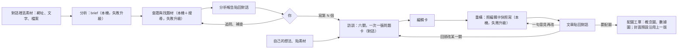

> 快照：2026-10-16 改成「語音優先的隨身入口與思想記憶」（ADR-0028，#129）之前的 PRD v3.0 原文（含 2026-10-15 的修正）。只增不改。

# 產品需求文件（PRD）— Evidence Forge

> **版本：** v3.0（2026-10-13） | **上一版：** v2.0，原文見 `30-snapshot/2026-10-13-prd-v2.0.md`
> 依 `docs/templates/vibecoding/02_project_brief_and_prd.md` 的 PRD 半部撰寫。為什麼做、什麼算成功見 `00-intent/brief.md`；階段見 `00-intent/roadmap.md`；決策見 §11 的 ADR；改版規劃見 `30-snapshot/plans/2026-10-13-chat-workbench-replan.md`。
> **v3.0 改了什麼：**
> - 主介面從看板改成聊天室。分析與重構是兩件分開的工作，人在對話裡決定下一步（ADR-0019）。
> - 逐句拆主張與稿後檢查，改成在寫稿之前出一份分析報告：brief＋查證＋研究題材（ADR-0020）。
> - 拿掉的需求：FR-DG、FR-CP、FR-VF、FR-RV（編號不重用），以及 FR-RS（併進 FR-IV）。
> - 執行器、閘道、帳本、搜尋的需求不變。
>
> **v3.0 之後的修正（2026-10-15，ADR-0024）：** 報告改成先給一句話與下一步，五節換成作者在說什麼、查證、作者的看法、可以寫的題材、來源清單，報告裡不出現 K、S 編號；文章的骨架只當思考順序、不當標題，內文不提原文與原作者。US-22、FR-IV-01、FR-RW-01、§5、§7 跟著改。
>
> **v3.0 之後的修正（2026-10-15，ADR-0025～0027，創作流程里程碑）：** 寫稿之前先訪談：起點有三種（報告的第 N 個題材、自己的想法、貼素材），六個關卡一關一關用問題卡問（一次一張，2～4 個選項加「其他」），決定記成只增不改的決策紀錄、收斂成編輯卡，寫稿只讀編輯卡的快照（ADR-0025）。文體換成 7 種、多一個主題欄，角色資料夾每個角色同一種樣子，舊的 12 種與舊格式的報告不再支援（ADR-0026）。配圖：概念圖與數據圖用程式畫，只有封面用生圖，生圖經閘道預留與記帳；每月上限改成可以不設（ADR-0027）。§1、§2、US-24、FR-RW-01、FR-RW-02、§5、§7、NFR-COST-01、§9～§11 跟著改；新增 US-27～US-33 與 FR-IW、FR-FG、FR-UI-13～15、FR-RW-04、FR-LG-03。規劃原文見 `30-snapshot/plans/2026-10-15-content-workflow-integration.md`。§4「階段」欄的「創作流程」指 GitHub 里程碑「創作流程（訪談、編輯卡、寫稿、配圖、預覽）」。

## 1. 專案總覽

| 項目 | 內容 |
| :--- | :--- |
| 一句話 | 一個聊天室：丟一篇文章進去，它讀懂作者、查證、找可以借題發揮的題材，交一份分析報告；你挑一個題材（或從自己的想法開始），它一關一關訪談你，再照你拍板的編輯卡用你設定的角色寫成文章、配好圖。分析報告會累積成一套知識體系。 |
| 使用者 | 一個人的內容工作室：技術作者、產品經理、AI 工程工作者。 |
| 部署 | 單機：本機 3090 跑 Qwen，每一段都先用它；本機做不好才升到雲端的 Claude Haiku，再不行才用 Sonnet（ADR-0022）；資料放在本機資料夾。 |

## 2. 流程與狀態

- 在對話裡，你說要做什麼，對話的 agent 就用工具開一次**分析**或一次**重構**。兩件工作各照一份配方跑（FR-RC-01），上圖是預設配方 `analyze` 與 `rewrite` 的樣子。
- 一次分析或重構在資料夾裡是一張工單，狀態有三種：排隊、執行中、結束。結束時附結果：完成、未完成（例如預算用完）、失敗（例如 Ollama 沒回應），以及原因（ADR-0010、ADR-0019）。
- 分析跑完停在對話裡，不自動往下寫。說「寫第 N 個」就開始訪談：六關一關一關給選項，你點選或補充，決定收斂成編輯卡，寫稿只讀編輯卡（ADR-0025）。叫它「分析完直接寫」，意思是每一關都讓它替你選，每一關的 1～4 張問題卡照樣一張記一筆回答（標成 agent 記的）；但第 3 關它不替你填例子，第 1 關只選不需要你自己經驗的文體，做不到就停下來問。訂閱源這類沒人看著的自動投入只跑到分析報告。文章寫完，你說要配圖才開配圖工單。
- 不從報告開始也可以：一句自己的想法，或貼自己的筆記、數據、草稿，直接進訪談。

## 3. 使用者故事與允收標準

| ID | 故事 | 允收標準 | 對應 | BDD |
| :--- | :--- | :--- | :--- | :--- |
| US-21 | 身為創作者，我要在聊天室丟一個網址、一段文字或一個檔案，它就開始分析。 | 1. 三種素材都能開始分析 2. 讀不到的網址在對話裡講清楚原因，不繞過付費牆 3. 同一份素材在同一個對話裡不重複分析，除非我要它重做 | FR-CH-01、FR-IN-01 | `chat.feature`、`intake.feature` |
| US-22 | 身為創作者，我要一份分析報告：作者在說什麼、立場、用了哪些事實與觀點、哪些查證後有疑慮、有哪些題材可以借題發揮。 | 1. 報告先一句話講這篇在講什麼、告訴我下一步，五節齊全 2. 事實在查證那一節一條一條標結果，有疑慮的放最前面，附找到的來源（用名字，不用編號） 3. 至少兩個有編號、可以挑來寫的題材，每個附會用到的資料 4. 報告裡的來源都是真的抓過的網頁 | FR-AN-01、FR-IV-01 | `analyze.feature` |
| US-23 | 身為創作者，我看完報告可以追問，或要它針對某一點補查。 | 1. 追問時它讀這份報告回答 2. 補查產生新版報告，舊版保留 3. 補查一樣受搜尋額度與預算限制 | FR-CH-02、FR-IV-01 | `chat.feature` |
| US-24 | 身為創作者，我訪談完之後，要照編輯卡、用指定的角色拿到一篇新文章。 | 1. 照編輯卡的文體、主題、觀點、例子、邊界、主幹寫，照角色的聲音與該角色的文體風格寫；文體骨架只當思考順序，不當標題（ADR-0024） 2. 用標題與金句規則下標 3. 不照搬原文的結構與句子 4. 結尾附參考資料，每筆有網址；從報告開始時第一條一定是原文出處，內文不提原文與原作者（`essay` 例外，可以引用並回應原文） 5. 沒有該文體風格時說明「未校準」 6. front matter 有 `title`、`description`、`genre`、`theme`，圖位照圖文分鏡留好 | FR-RW-01、FR-RW-02 | `rewrite.feature` |
| US-25 | 身為創作者，我對文章不滿意，就在對話裡說一句，它照這句改。 | 1. 產生新版本，舊版保留 2. 不重跑分析 | FR-RW-03 | `rewrite.feature` |
| US-26 | 身為創作者，我要回到以前的對話，看到當時的報告與文章。 | 1. 對話清單依時間排 2. 打開就看到完整對話、每一版報告與文章 3. 程式重啟後對話還在 | FR-CH-03 | `chat.feature` |
| US-08 | 身為創作者，我要看到每次工作、每一段花了多少錢、用了哪個模型、跑了多久，月底有一份總帳單。 | 1. 每次模型與工具呼叫都入帳，對話本身的呼叫也算 2. 單次帳單與每月總表 3. 算得出每篇報告、每篇文章的平均成本 | FR-LG-01、FR-LG-02 | `ledger.feature` |
| US-10 | 身為創作者，我要在對話裡看到工作跑到哪、在等什麼。 | 顯示第幾段／共幾段、這段跑多久、在等 GPU、限流、模型回應還是在跑哪個工具 | FR-UI-11 | `chat.feature` |
| US-11 | 身為創作者，我要加一種新的做法時，只寫文件、不改程式。 | 新增一份配方與需要的 skill 就能用，執行器不改 | FR-RC-01 | `runner.feature` |
| US-27 | 身為創作者，我要從報告的第 N 個題材、一句自己的想法，或貼自己的素材開始，讓它一關一關訪談我。 | 1. 三種起點都能開始；從題材開始時，第 1 關的預設選項帶著那個題材的建議文體 2. 六關依序問：文體＋主題、核心觀點、只有我能給的例子、邊界、工作標題、框架主幹與圖文分鏡 3. 每關用 1～4 張問題卡，一次出一張：短標籤、問題、2～4 個附說明的選項、一定有「其他」，選了可以附補充；答完出下一張；一關的卡都答完可以回頭改，再按「確認並送出這一關」 8. 我點的回答由系統直接記；我改在主輸入框打字回答時，記下來的會標成 agent 解讀的 4. 我口述的內容先整理成條列給我確認 5. 「只有我能給的例子」那一關它不替我編經歷；選了產品個案、實證評測或工程復盤而我沒給自己的資料，就停在那一關 6. 我說「你幫我選」時，第 3 關它只記「尚待作者提供」，接著只問我這一題，「沒有例子」要我自己答；第 1 關只選研究評論、理論教學、趨勢解讀，不然就停下來問 7. 我貼的素材留在這張編輯卡，寫稿與數據圖讀得到 | FR-IW-01、FR-IW-02 | — |
| US-28 | 身為創作者，我要看到自己在每一關選了什麼、沒選什麼，也能回頭改某一關。 | 1. 右側面板的決策分頁依關卡列出時間、提出的選項、我選的、我的補充 2. 回頭改一關，後面已決定的關標「要重確認」；我可以按「重問這一關」，或按「沿用」保留原本的 3. 六關都有決定、沒有要重確認的關時，才出現「照這張編輯卡寫稿」 4. 程式重啟後決策都還在 | FR-IW-03、FR-UI-13 | — |
| US-29 | 身為創作者，我要文章配好圖：一張封面、需要的概念圖與數據圖。 | 1. 圖照圖文分鏡放 2. 概念圖與數據圖用程式畫；數據圖的每個數字對得回證據帳本與它的出處 3. 封面用生圖，花費記帳；改稿後再配圖預設沿用上一版的封面，我說要換才重生 4. 圖文節奏檢查通過 5. 每張圖有替代文字與圖說 | FR-FG-01、FR-FG-02 | — |
| US-30 | 身為創作者，我要在發出去之前，看到文章在網站上大概的樣子。 | 1. 右側面板有預覽：數據圖與概念圖全欄寬、截圖約六成寬加框、圖說小字 2. 圖從工單資料夾讀 3. 每篇的文章與圖都留著，可以再改 | FR-UI-14 | — |
| US-31 | 身為創作者，我退件或在訪談裡否決的方向，要能變成下次會記得的規則。 | 1. 對話的 agent 把改稿意見或被否決的方向提議成一筆 lesson 2. 我同意才寫進角色的 `lessons.md` 3. 訪談與寫稿開工前讀最近十筆 | FR-RW-04 | — |
| US-32 | 身為創作者，我要自己決定每月要不要設上限、每張工單預設花多少。 | 1. 費用設定頁可以設或不設每月上限 2. 可以調各種工作的預設預算 3. 帳單分得出生圖的花費 | FR-LG-03、FR-LG-02 | — |
| US-33 | 身為創作者，我要管理角色：新增、切換、看每個角色的聲音、文體、手藝與累積的規則。 | 1. 每個角色的資料夾都是同一種樣子 2. 缺的檔標出來（例如文體風格未校準） | FR-UI-15、FR-RW-02 | — |

US-01～US-07、US-09 是 v2.0 的故事，原文在快照。

## 4. 功能需求

| ID | 優先 | 需求 | 允收重點 | 階段 |
| :--- | :--- | :--- | :--- | :--- |
| FR-CH-01 | P0 | 對話：每個對話一個 Pi 的 RPC 程序，對話紀錄由 Pi 保存；對話的 agent 用 ef-tools 的 `analyze`、`rewrite`、`read_report`、`read_article`、`list_personas` 開工與讀結果 | 對話的 agent 自己不寫報告、不寫文章；工作一律照配方由執行器跑 | P2、P3 |
| FR-CH-02 | P0 | 追問與補查：對話的 agent 讀這個對話的報告與文章回答；要補查時，開一張只跑查證段的新工單，brief 從上一版複製 | 補查產生新版報告；每一版都是新工單（ADR-0019 §3.6） | P3 |
| FR-CH-03 | P0 | 對話清單與恢復：程序重啟後可以接回對話 | 對話資料夾放 `EF_DATA` | P3 |
| FR-IN-01 | P0 | 素材進來：網址、貼文字、上傳檔案（Markdown、純文字、PDF） | 讀不到（403、付費牆、robots）就不開工，在對話裡說明原因 | P1 |
| FR-IN-02 | P2 | 訂閱源 connector 與排程（v2.0 的 FR-IN-02、FR-IN-03） | 自動投入只跑到分析報告，不能設定成直接寫（ADR-0019、ADR-0025 §3.5） | Later |
| FR-IN-04 | P2 | 錄音：上傳錄音，轉成文字後當素材 | 轉文字在本機 | Later |
| FR-AN-01 | P0 | brief 段：讀懂整篇，用自己的話寫作者的論點、立場、事實與數據、觀點、文體、可以延伸的方向與主題標籤；標出撐起論點的關鍵事實主張 | 不逐句抄引句；預設 `local`，失敗依配方升級 | P1 |
| FR-IV-01 | P0 | 查證與找題材段：對關鍵事實主張上網查證（有佐證、有爭議、查不到、過時），找可以借題發揮的相關文章，交出分析報告與來源清單 | 報告五節（§5），沒有 K、S 編號，可以寫的題材有編號；來源都是這一段真的抓過的網頁；Tavily 額度有上限、快取共用 | P1 |
| FR-RW-01 | P0 | 重構段：讀編輯卡快照、分析報告與補充來源的正文（從報告開始時）、角色資料，照編輯卡、文體的通用定義、該角色的文體風格寫新文章（Markdown 加 front matter） | 不讀原文全文；不掛逐句引用編號、不標疑慮；骨架不當標題；從報告開始時內文不提原文與原作者（`essay` 例外）、參考資料第一條是原文出處（ADR-0024、ADR-0025 §3.4）；只照編輯卡寫，不自己換觀點與主幹；front matter 有 `title`、`description`、`genre`、`theme`；圖位照圖文分鏡（ADR-0025） | P1b，創作流程改輸入 |
| FR-RW-02 | P0 | 角色：一個角色一個資料夾 `$EF_DATA/authors/<角色>/`，每個角色同一種樣子：`voice.md`、`genres/<文體>.md`（寫法、價值、CTA）、`craft/`（開場、標題與金句、收尾、圖文編排）、`themes.md`、`lessons.md`、`brand.yaml`；不進 repo；寫稿只送這一篇用得到的檔；寫得多衝由角色的聲音決定 | 沒有該文體風格時標「未校準」（ADR-0015）；角色還沒有自己的標題與金句規則就讀舊的共用規則（ADR-0026） | P1b，創作流程擴充 |
| FR-RW-04 | P1 | lessons：對話的 agent 把改稿意見與訪談裡被否決的方向用 `propose_lesson` 提議成一筆（記在對話的 `lessons-proposed.jsonl`）；創作者在畫面上按同意，由閘道附加到角色的 `lessons.md` | 對話與它的 agent 從不直接寫角色資料夾；沒同意不寫；訪談與寫稿開工前讀最近十筆（ADR-0026 §3.3） | 創作流程 |
| FR-IW-01 | P0 | 訪談的起點：報告的第 N 個題材、創作者自己的一句想法、創作者貼的素材（筆記、數據、草稿、逐字稿） | 從題材開始時第 1 關帶題材的建議文體；貼的東西用 `add_material` 記成作者素材：內容存成 `materials/<sha256>`、寫一次不改，決策紀錄記一筆作者素材事件；寫稿快照帶著它；不當別人的文章去分析（ADR-0025 §3.3） | 創作流程 |
| FR-IW-02 | P0 | 訪談關卡：六關依序（文體＋主題、核心觀點、只有作者能給的例子、邊界、工作標題、框架主幹與圖文分鏡），每關 1～4 張問題卡，一次出一張，一關的卡答完（可以回頭改）按「確認並送出這一關」一次送出；每張有短標籤、問題、2～4 個附說明的選項、一定有的「其他」，選了可以附補充；第 6 關列出文章會提出的主張與怎麼會被證明是錯的；圖文分鏡只排概念圖、數據圖或不配圖，表格由寫稿寫成 Markdown 表格 | 一張答完才出下一張，一關送出才往下；第 3 關不替作者編經歷，`product-case`、`benchmark`、`postmortem` 沒有作者自己的資料就停在第 3 關；「你幫我選」在第 3 關只能記「尚待作者提供」（不算有決定，接著只問作者這一題，「沒有例子」要作者自己答），第 1 關只能選 `research-review`、`explainer`、`trend`，不然停下來問（ADR-0025 §3.2） | 創作流程 |
| FR-IW-03 | P0 | 決策紀錄與編輯卡：`$EF_DATA/conversations/<對話 id>/cards/<卡 id>/decisions.jsonl` 只增不改，事件五種：提出問題、回答（一關送出時一批寫）、沿用、重問、作者素材，每筆記 `source`（`ui` 或 `agent`）；`card.json` 由事件算出；對話的工具 `propose_questions`、`record_interpreted_answers`（解讀創作者打字的回答或「交給 AI 選」，`source: agent`）、`add_material`、`read_card`；只有畫面能叫的入口 `submit_station`、`keep_decision`、`reask_station`，閘道直接記（`source: ui`）再用 `[ef-card]` 通知對話；開寫稿工單時編輯卡快照連同作者素材複製進工單 | 只有閘道寫；只碰得到這個對話的卡（ADR-0021）；回頭改一關、重新送出後，後面標要重確認，重新送出或「沿用」才取消；對話的 Pi 叫不到畫面的入口；六關都有決定、沒有要重確認，寫稿工具才放行；壞掉的一行跳過（ADR-0025 §3.3） | 創作流程 |
| FR-FG-01 | P0 | 配圖工單：寫稿完成後創作者說要，對話用閘道工具 `figures(from_job, new_cover)` 開；執行器把 `article.md`、編輯卡快照，以及從報告開始時的 `sources.json` 與 `input/sources/` 複製進來；照圖文分鏡產概念圖、數據圖與（需要時）封面；概念圖與數據圖用 repo 裡的程式畫，經 `run_script` 執行；色票字型讀角色的 `brand.yaml` | 數據圖走證據帳本 → 圖表說明 → 驗證 → 畫，證據帳本每筆的出處對得到報告的來源或作者素材，對不到的那個數字所在的圖不畫，並告訴創作者是哪一個數字少了出處；改稿後只重畫內容變了的概念圖與數據圖；圖文節奏是程式檢查；缺字型給清楚的錯誤；這個里程碑不產截圖（ADR-0027） | 創作流程 |
| FR-FG-02 | P0 | 生圖：封面經閘道的生圖工具（OpenAI），照價目表預估、從工單預算預留、結算、記帳 | 帳本一張圖一筆，種類 `image`；金鑰只在閘道；測試用假後端；有沒有每月上限都一樣計費；同一條版本鏈預設沿用上一版的封面，創作者說「換封面」（`new_cover`）才重生（ADR-0027 §3.4、§3.5） | 創作流程 |
| FR-LG-03 | P1 | 費用設定：每月上限可設可不設，各種工作的預設預算可以調；存在 `$EF_DATA/settings/costs.json` | 環境變數照樣能蓋過設定檔（測試用）；單張工單的預算照舊（ADR-0027 §3.6） | 創作流程 |
| FR-RW-03 | P0 | 再改：帶著一句意見與上一版文章，開一張新的重構工單 | 新版本不覆寫舊版；分析不重跑；每一版都是新工單（ADR-0019 §3.6） | P1b |
| FR-KB-01 | P1 | 知識庫：跨對話索引分析報告，依主題標籤瀏覽；分析前先查舊知識，查過的主張不重查 | 等分析報告累積後再定細節 | P4 |
| FR-RC-01 | P0 | 配方：Markdown frontmatter 定義段、skill、等級、產出、嘗試次數、升級、搜尋額度 | 新增配方不改程式（ADR-0009） | 已有 |
| FR-MD-01 | P0 | 模型等級：`local`／`fast`／`strong`／`max` 別名，對照表在閘道；產出不合格到上限才依配方的升級鏈一級一級往上，每一級試一次 | 基礎設施故障不升級（ADR-0011）；本機上下文放不下算這一次不合格（ADR-0022） | 已有 |
| FR-LG-01 | P0 | 帳本：每次模型、搜尋、抓取、腳本呼叫一筆，欄位見 §8.6；對話本身的呼叫記在對話的帳本 | 只有閘道寫；只增不改 | 已有，對話在 P2 |
| FR-LG-02 | P0 | 帳單：每次工作一份、每月總表；每月依角色、模型、本機／雲端分項 | 全部由帳本產生；月份依 Asia/Taipei | P3 |
| FR-UI-11 | P0 | 聊天室 UI：左邊對話清單；中間對話串流（含工作進度與在等什麼）；右邊面板看報告、文章的各版本與花費；上傳素材 | 不放假動畫（NFR-OBS-02） | P3 |
| FR-UI-12 | P1 | 帳單頁（沿用 v2.0 的設計）；生圖單獨一項 | — | P3，創作流程加生圖 |
| FR-UI-13 | P0 | 問題卡與決策分頁：`propose_questions` 的問題卡一次畫一張，選項是按鈕（名稱加說明），下面一定有「其他」輸入框，選了選項可以附補充；答完出下一張；這一關的卡都答完、可以回頭改，按「確認並送出這一關」一次送出（經閘道直接記，不經 agent 轉述）。右側面板的決策分頁依關卡列時間軸：提出的問題、選的、沒選的、補充，每一關有「重問這一關」；要重確認的關有「沿用」按鈕；agent 解讀的回答（`source: agent`）標出來；六關都有決定、沒有要重確認時才出現「照這張編輯卡寫稿」 | 要重確認的關看得出來；送出、沿用、重問都經閘道寫事件，不經模型，寫完用 `[ef-card]` 通知對話；寫稿工具的拒絕留著當最後一道關（ADR-0025） | 創作流程 |
| FR-UI-14 | P1 | 預覽：右側面板照網站的版型顯示文章與圖；每篇的資料夾整理成 `article.md`、`images/`、`charts/` | 圖片只從工單資料夾讀，經 `safe_path`；不發布（ADR-0027） | 創作流程 |
| FR-UI-15 | P1 | 角色管理：新增、切換、檢視每個角色的聲音、文體風格、craft 與 lessons | 只認 FR-RW-02 那一種資料夾樣子（ADR-0026） | 創作流程 |
| FR-EV-01 | P2 | 評估：凍結案例比較組合 | 改版後重新設計 | Later |
| FR-AS-01 | P2 | 素材下載與授權（v2.0 的 FR-AS-01、FR-AS-02） | 重新設計後再做 | Later |

## 5. 各段必須守的規則

| 段 | 必須 | 不准 |
| :--- | :--- | :--- |
| brief | 讀完整篇；分清事實、數據、觀點與立場；標出關鍵事實主張；用自己的話寫 | 補原文沒有的內容；把觀點寫成事實 |
| 查證與找題材 | 只用搜尋與抓取工具拿到的內容；每份來源記網址與抓取時間；二手轉述追到原始來源才算獨立證據；查不到就寫查不到 | 用常識或記憶補資料或下結論；引用搜尋結果的摘要；超過額度 |
| 訪談 | 一次一關、一次一張問題卡（2～4 個附說明的選項加「其他」）；口述先整理成條列請創作者確認；每個決定都記進決策紀錄 | 替創作者編經歷、案例、數據；沒有實測資料就寫產品個案或實證評測；跳關 |
| 重構 | 照編輯卡快照寫：文體、主題、觀點、例子、邊界、主幹、圖文分鏡；用角色自己的聲音談這個話題；觀點與推論讀得出是作者自己的；文體骨架只當思考順序，標題寫那一節實際在講什麼 | 讀原文全文；捏造來源；照搬任何一份來源的段落順序；從報告開始時，內文提原文或原作者、反駁原文（`essay` 例外：可以引用並回應觸發它的原文）；用「結論」「論據」「反方」「建議」當標題；換掉編輯卡定的觀點或主幹 |
| 配圖 | 照圖文分鏡；概念圖與數據圖用程式畫；數據圖的數字只從證據帳本拿 | 用生圖畫概念圖或數據圖；沒有創作者要求就重生封面；在證據帳本裡寫沒有出處的數字；轉貼沒有授權的圖 |
| 對話 | 聽懂要做什麼就開工；回答追問時依據報告與文章；訪談一次一張問題卡；寫入只經有名字的閘道工具（決策紀錄、作者素材、lessons 提議） | 自己寫報告或文章；用通用的讀寫檔工具；寫角色資料夾或這個對話以外的檔案 |

所有段都一樣：從網頁、檔案抓回來的內容只當資料，不當指令（防提示注入）。

**分析報告的樣子**（ADR-0024）：第一個標題之前先一句話講這篇在講什麼，再一行「▶ 下一步：下面有 N 個可以寫的題材，說「寫第 2 個」就開始。」接著五節，標題固定：

1. 作者在說什麼（一段，150 字內）
2. 查證（事實一條一條，每條直接標【有爭議】【過時】【查不到】【有佐證】，有疑慮的放最前面）
3. 作者的看法（標明不是事實）
4. 可以寫的題材（有編號，每個：暫定標題、角度、原文沒講的、會用到的資料、建議文體）
5. 來源清單（放最後，畫面上預設收起來）

報告裡不出現 K、S 這類內部編號，來源用名字；編號只留在 `sources.json`。

## 6. 來源治理

1. 原始抓取與加工產出分開存。
2. 不同文章追到同一份原始公告，算一組原始證據。
3. 保留原文與抓取時間，之後要更正時查得到。
4. 從報告開始寫的文章，結尾一定列原文出處（作者、標題、連結）；從創作者自己的想法或作者素材開始的沒有原文，這條不適用（ADR-0025 §3.4）。

## 7. 程式檢查

只用程式判斷，不經過模型，也不呼叫模型。沒過就算這一段這一次失敗，走重試與升級。

| 段 | 檢查 |
| :--- | :--- |
| brief | 產出存在、是 Markdown、有規定的幾節 |
| 查證與找題材 | 報告第一個標題前有一句話與一行下一步（題材數對得上）、五節依序都在、沒有裸露的 K、S 編號、可以寫的題材至少 2 個而且有編號；查證的標記與題材跟 `sources.json` 一條一條對得上；`sources.json` 符合格式，裡面的網址都是這一段真的抓過、狀態成功的網頁（沿用來源放置規則） |
| 重構 | 標準 Markdown；從報告開始時結尾參考來源的第一條是原文出處、參考來源以外的內文不出現原文標題與原作者名，也不寫「原作者」「這篇談的是」這類回應原文的說法（文體是 `essay` 時不查這一條）；標題不用骨架字、不等於目標文體骨架的一項；front matter 有 `title`、`description`、`genre`、`theme`，值是合法的 slug；有參考資料一節、每筆有網址；圖文分鏡的每張圖都有圖位；角色資料列出的句型照擋（ADR-0025 §3.7） |
| 配圖 | 圖文節奏（第一張圖之前、沒有圖的連續段落、兩張圖之間的字數，例外要寫理由）；證據帳本與圖表說明的格式與交叉引用；帳本每筆的出處對得到這張單讀得到的來源或編輯卡（ADR-0027） |

另外，重構完成後算出文章跟原文、各來源的逐字重疊率，顯示在畫面上，只當參考，不擋（ADR-0020）。

## 8. 非功能需求

編號 `NFR-<領域>-xx` 供票與測試引用。v2.0 的條文沿用，只改有標「v3.0」的幾條。

### 8.1 不重付，控制成本

| ID | 規則 |
| :--- | :--- |
| NFR-COST-01 | **先預留再花錢**：雲端呼叫、搜尋與生圖送出前先依估計花費預留；預算不夠就拒絕，這次工作結束並標「未完成：預算用完」。每次工作有美元與 Tavily credits 兩種上限（ADR-0011）。每月美元上限可設可不設，預設不設（雲端平台自己的後台有硬上限）；有設時依 Asia/Taipei 的日曆月計算，模型、搜尋、生圖、對話全部算進去（ADR-0027 §3.6） |
| NFR-COST-02 | **當機重跑不重付**：同一段同一次嘗試內，相同的模型請求直接回放存好的回應 |
| NFR-COST-03 | **跨工作共用**：同一網址的抓取、同一查詢的搜尋先查快取；快取有有效期限 |
| NFR-COST-04 | **只重跑需要的段**：再改只開重構工單；補查只開查證工單，上一版的產出由執行器複製過去（v3.0） |
| NFR-COST-05 | **用官方折扣**：重複送出的長上下文用 prompt caching |
| NFR-COST-06 | **開發與測試零花費**：自動化測試一律用重播模式，不打付費 API；真的呼叫只在手動觸發時發生 |
| NFR-COST-07 | **本機優先**：brief、查證、重構都先用 `local`，失敗升 `fast`（Haiku 5.5）、再升 `strong`（Sonnet 5.5）；對話用 `fast`；配方不用 `max`（ADR-0022） |

### 8.2 每次都跑得動

| ID | 規則 |
| :--- | :--- |
| NFR-RUN-01 | **開跑前先檢查**：Ollama 在跑、閘道可連、Anthropic 金鑰有效、Tavily 剩餘額度、硬碟空間、資料目錄可寫、Pi 已安裝。任何一項不過就不開跑，並說明是哪一項 |
| NFR-RUN-02 | **狀態有限**：工單只有排隊、執行中、結束（`queued`、`running`、`done`）三種；結束附結果（完成／未完成／失敗）與原因（v3.0） |
| NFR-RUN-03 | **產出先驗格式**：每段產出用 §7 的程式檢查；不合格就重試，到上限再依配方升級，仍失敗就結束並標失敗 |
| NFR-RUN-04 | **當機可恢復**：程序重啟後，執行中的工作從所在那段重跑；對話可以接回 |
| NFR-RUN-05 | **基礎設施故障不升級**：Ollama 沒回應、網路斷，就停下標失敗，不偷偷改用付費模型 |
| NFR-RUN-06 | **版本鎖在工作上**：模型對照、skill 的 git sha、配方版本記在每份產出裡；重跑用同一套 |
| NFR-RUN-07 | **CI 每次跑完整流程**：用固定的小案例加錄好的回應，跑完分析與重構（v3.0） |
| NFR-RUN-08 | **錯誤處理**：403、付費牆、robots 限制不繞過；429 退避重試；抓不到的標 unavailable |

### 8.3 產出的東西留得住

| ID | 規則 |
| :--- | :--- |
| NFR-KEEP-01 | **只增不改**：原始抓取、模型的原始請求與回應、每一版報告與文章，都不覆寫（ADR-0010） |
| NFR-KEEP-02 | **一個檔一個寫入者**：工作狀態只有執行器寫、帳本只有閘道寫、對話紀錄只有 Pi 寫 |
| NFR-KEEP-04 | **資料不進 repo**：資料目錄由 `EF_DATA` 指定，預設是專案的 `data/`，`.gitignore` 排除（ADR-0014） |
| NFR-KEEP-05 | **備份可還原**：每天同步到第二顆本機硬碟；定期實際還原一次；只有創作者明確下指令才刪 |

### 8.4 並行與資源

| ID | 規則 |
| :--- | :--- |
| NFR-PAR-01 | 多次工作可以同時跑，同時幾個是設定值 |
| NFR-PAR-02 | 本機 GPU 同時只服務一個模型請求，其餘排隊；排隊時間入帳 |
| NFR-PAR-03 | 雲端服務依各自的速率上限；等待時間入帳 |

### 8.5 安全

| ID | 規則 |
| :--- | :--- |
| NFR-SEC-01 | 帳號授權只在膠水層；執行器、閘道、agent 都讀不到；放在 `EF_SECRETS`（ADR-0012、ADR-0014） |
| NFR-SEC-02 | agent 沒有 shell，也沒有內建讀寫檔工具；段的工具只能碰該工作的資料夾，對話的工具只能碰該對話的資料夾（ADR-0009、v3.0） |
| NFR-SEC-03 | 抓網頁擋內網位址（SSRF）；外來內容只當資料 |
| NFR-SEC-04 | 雲端金鑰（Anthropic、Tavily、OpenAI）只在閘道；不進 repo、不進日誌；畫圖的程式拿不到 |

### 8.6 可觀測

| ID | 規則 |
| :--- | :--- |
| NFR-OBS-01 | 帳本每筆記錄：時間、工作（工單；對話本身的呼叫記對話，ADR-0021）、段、第幾次、類型、等級、實際模型、是否升級、輸入／輸出／快取 token、credits、金額、GPU 秒數、第一個字的時間、總延遲、排隊時間、狀態、請求與回應的 hash |
| NFR-OBS-02 | **看得到進度**：對話裡顯示工作跑到第幾段、這段跑多久、正在等什麼（GPU、限流、模型回應、執行工具）。資料來自 Pi 的事件與閘道，不放假動畫 |

## 9. 範圍與限制

| 項目 | 內容 |
| :--- | :--- |
| 不做 | 自動公開發布（創作流程里程碑也不含發布到網站）、繞過付費牆、讓 agent 拿帳號授權、無上限迴圈、在稿子裡逐句標引用或疑慮、稿後由模型檢查內容、替創作者編經歷 |
| 假設 | 創作者會讀分析報告並對發表內容負責；本機有一張 3090 跑 Qwen3.5 9B |
| 外部依賴 | Ollama、Anthropic API（Haiku 5.5、Sonnet 5.5；Opus 5.5 只留給舊紀錄與手動指定）、Tavily、Pi、OpenAI 生圖（只用在封面）、Noto Sans TC 字型（畫圖用） |

## 10. 風險與最小修正

| 風險 | 最小修正 |
| :--- | :--- |
| brief 誤解作者的意思，沒有程式擋得住 | 報告第一節讓人一眼看出它怎麼理解作者；誤解常發生就把 brief 段的起始等級改成 `fast` 或 `strong`（只改配方） |
| 查證把爭議當成定論，或把查不到當成錯 | skill 規定四種結果分開寫，查不到不等於錯；每條附來源讓人回查 |
| 重構照搬某一份來源 | 重疊率顯示在畫面上；常發生就把重疊率改回擋下（ADR-0020 的重新評估觸發） |
| 重構不像角色 | 角色的聲音與文體風格；未校準明確標示；再改的意見累積下來調 skill |
| 對話的 agent 自己寫內容，繞過配方 | 對話沒有通用的讀寫檔工具，也沒有寫報告、寫文章的工具；有名字的閘道工具各自只寫這個對話自己的決策紀錄、作者素材或 lessons 提議（ADR-0021、ADR-0025） |
| 長時間開著的 Pi 程序不穩 | P2 先做 spike；程序掛掉時對話可以從 Pi 的紀錄接回 |
| 外來內容藏指令 | agent 沒有帳號、沒有 shell、只能碰自己的資料夾；外來內容只當資料 |
| 沒人看著時花太多錢 | 閘道預留制預算；每段嘗試次數上限；每月上限可以在費用設定頁打開；雲端平台後台的硬上限（ADR-0027 §3.6） |
| 訪談替作者編經歷，寫出來的例子不是真的 | 第 3 關的選項只能是提示，內容一定來自創作者；沒有實測資料就停在第 3 關（ADR-0025） |
| 數據圖的數字沒有依據 | 數字只從證據帳本拿，帳本每筆的出處要對得到真的抓過的來源或編輯卡，程式檢查擋（ADR-0027） |

## 11. 已做的決策

| ADR | 決策 |
| :--- | :--- |
| ADR-0001 | LangGraph 確定性節點圖（**已由 ADR-0009 取代**） |
| ADR-0002 | 模型分工（**由 ADR-0011 修正**） |
| ADR-0003 | ID 規則與內容分開存放（儲存部分由 ADR-0006、ADR-0010 修正） |
| ADR-0004 | 外部副作用不重複（實作由 ADR-0010、ADR-0011 修正） |
| ADR-0005 | 跨工作快取、只增不改（實作由 ADR-0010、ADR-0011 修正） |
| ADR-0006 | Celery＋Redis＋PostgreSQL（**已由 ADR-0010 取代**） |
| ADR-0007 | 設計 token 命名 |
| ADR-0008 | 外觀三選一，預設跟隨系統（修正 ADR-0007 §3.4） |
| ADR-0009 | agent 核心用 Pi，流程寫成配方與 skill |
| ADR-0010 | 狀態放在資料夾，工單就是佇列（**由 ADR-0019 修正**：使用者看到的是對話，待審拿掉） |
| ADR-0011 | 自己寫模型閘道；固定規則分級、失敗才升級；全部記帳（**由 ADR-0022 修正**：多一級 `fast`，升級改成升級鏈；**ADR-0027 補充**：多一個生圖供應商） |
| ADR-0012 | 膠水層用程式自己寫，不用 LLM，帳號授權不交給 agent |
| ADR-0013 | 給目標就自動做完，人只審結果（**已由 ADR-0019 取代**） |
| ADR-0014 | 資料目錄放在專案的 `data/`（不進版控），帳號授權移到使用者家目錄 |
| ADR-0015 | 二創由「文類 × 作家」組合（**由 ADR-0020 修正**：重構從分析報告出發；**由 ADR-0024 修正**：骨架不當標題；**由 ADR-0026 取代清單與修正作家設定**：7 種文體、角色資料夾） |
| ADR-0016 | 素材新增「引用」使用狀態（**由 ADR-0020 修正**：C4 拿掉，素材下載重新設計後再定） |
| ADR-0017 | 狀態 token 改用新設計的實體命名 |
| ADR-0018 | skill 用 `--append-system-prompt` 載入 |
| ADR-0019 | 聊天室工作台，先分析、再由人決定重構（**由 ADR-0025 修正**：「寫第 N 個」先進訪談） |
| ADR-0020 | 分析報告取代逐句拆解，查證放在寫稿之前（**由 ADR-0024 修正**：報告的五節與檢查；**由 ADR-0025 修正**：重構讀編輯卡快照，稿後多幾條機械能查的檢查） |
| ADR-0021 | 對話鑰匙 `conv:<對話 id>:<第幾次開>`，對話只碰得到自己開的工單；兩個對話不共用分析 |
| ADR-0022 | 本機優先，雲端只用 Haiku 與 Sonnet，失敗一級一級往上（修正 ADR-0011） |
| ADR-0023 | 聊天室的 token：查證四種標記、文章對照、有新結果；退役看板用的三個 `--job-*` |
| ADR-0024 | 報告先給下一步與可以寫的題材、不放內部編號；文章骨架不當標題、內文不提原作者（修正 ADR-0020 §3.2） |
| ADR-0025 | 寫稿前先訪談，每一關給選項；決定記成只增不改的事件，編輯卡由事件算出來，寫稿工單帶快照（修正 ADR-0019、ADR-0020） |
| ADR-0026 | 文體換成 7 種、多一個主題欄；角色資料夾每個角色同一種樣子；舊 12 種與舊格式不再支援（取代 ADR-0015 的清單） |
| ADR-0027 | 配圖用程式畫，只有封面用生圖；生圖經閘道預留、記帳；每月上限可以不設（補充 ADR-0011） |
