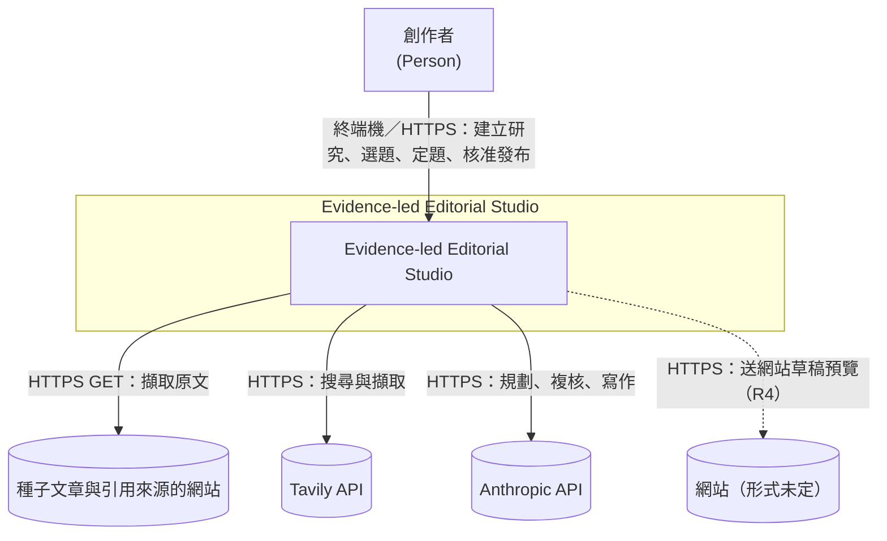
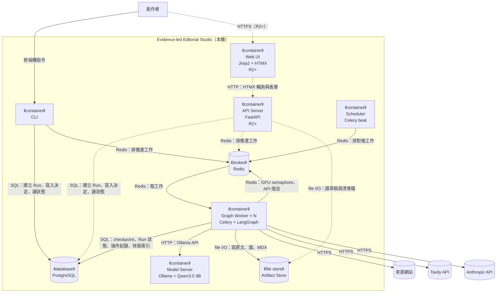
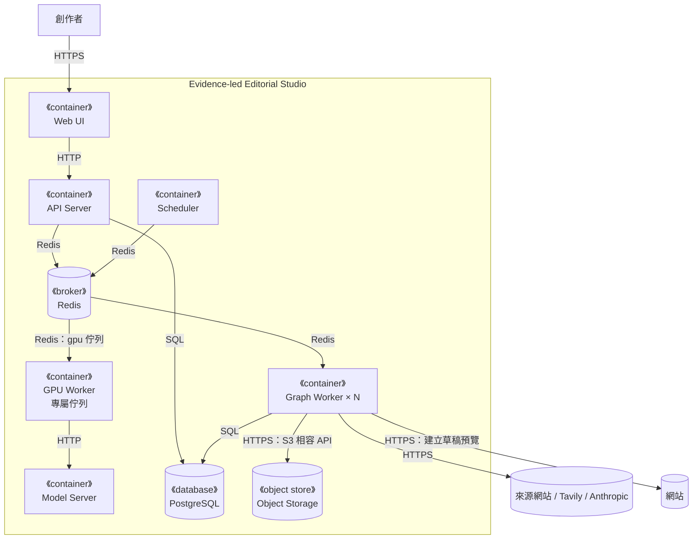
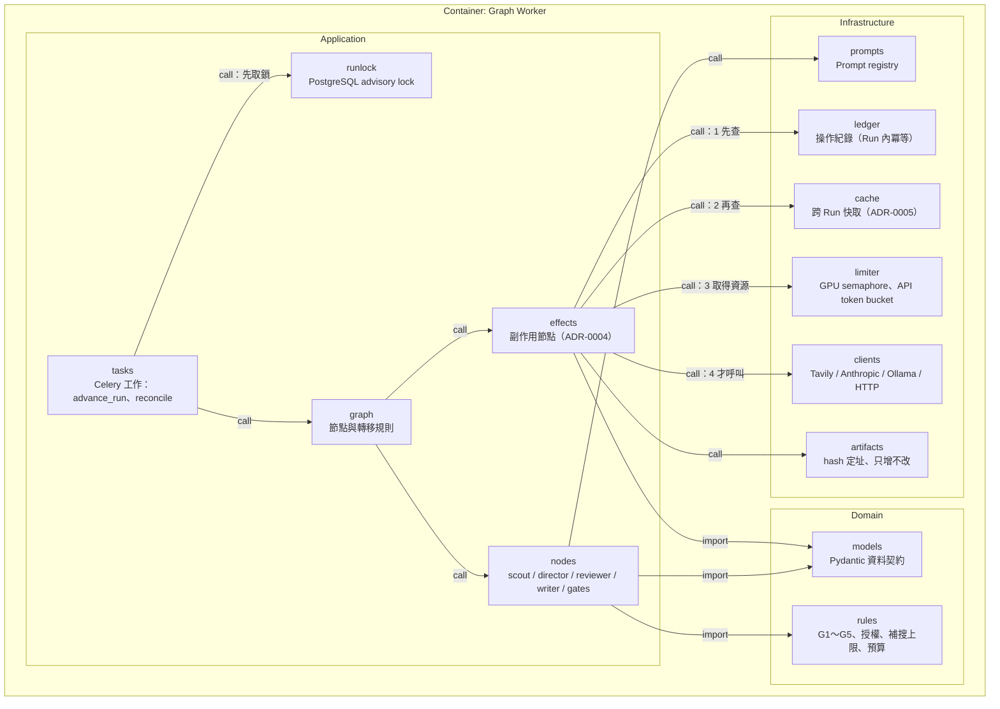
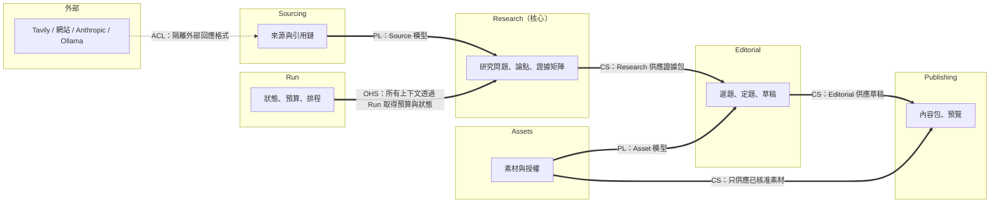
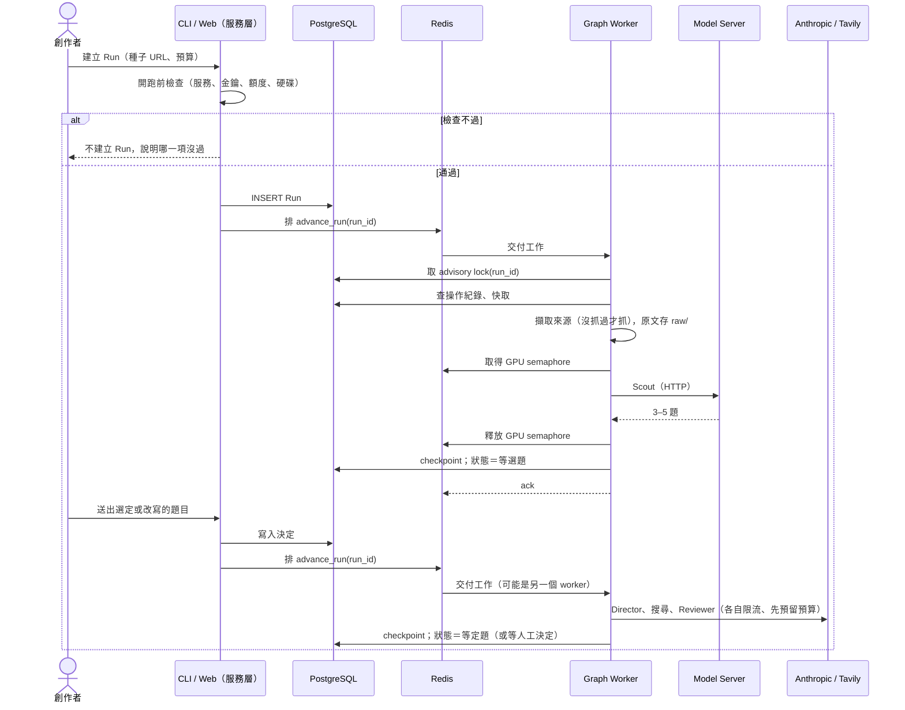
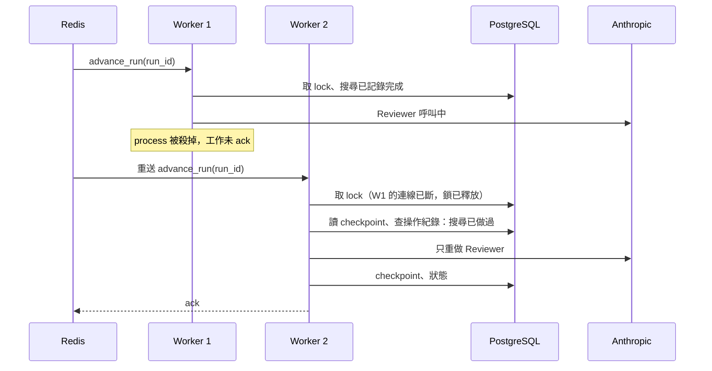
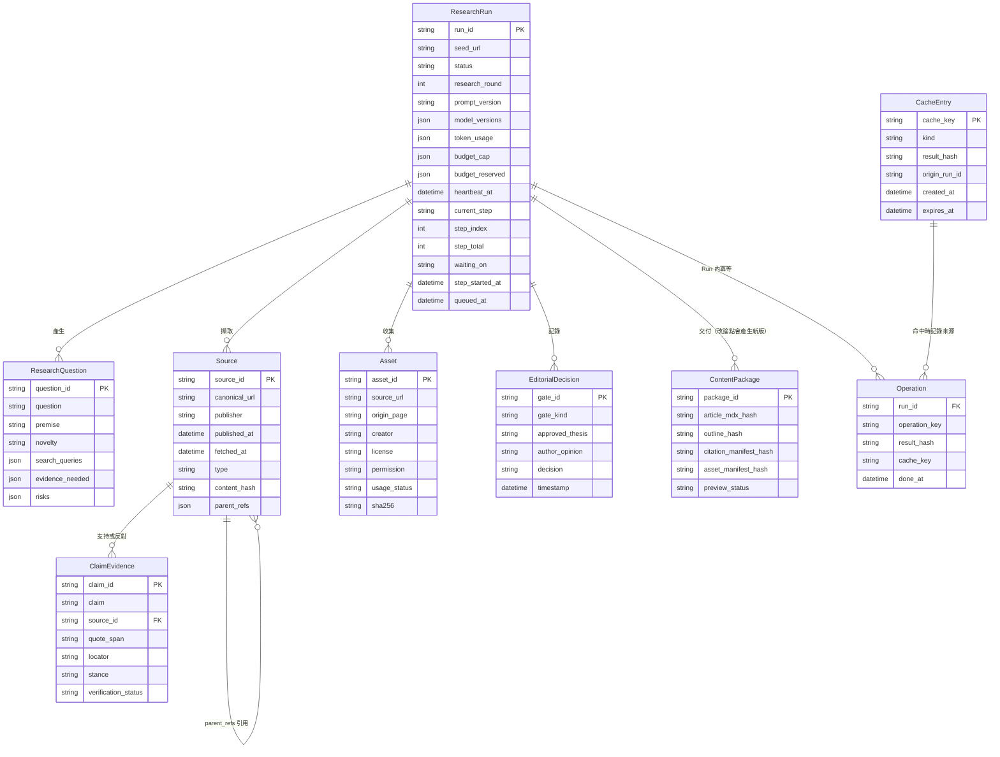
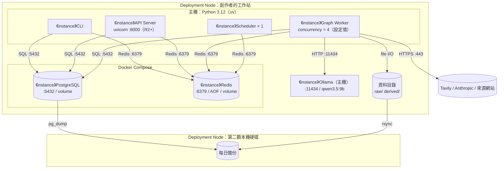

# 架構草案 v0.2 — Evidence-led Editorial Studio

> **版本：** v0.2 草案 | **日期：** 2026-10-10 | **狀態：** 規劃參考，**不是事實層**
> 依 `docs/templates/vibecoding/05_architecture_and_design_document.md`（v2.0）撰寫。前一版：`2026-10-10-architecture-draft.md`（v0.1，不再改）。
>
> **和 v0.1 的差異：**
> 1. 多個 Run 並行：Celery＋Redis 排工作、PostgreSQL 存狀態、依資源限流（ADR-0006）。v0.1 的「一次一個 Run、SQLite」作廢。
> 2. 不重做、跑得動、留得住：跨 Run 快取、只增不改的檔案儲存區、開跑前檢查（PRD §8、ADR-0005）。
> 3. 資料模型只存檔案參照，不存全文（ADR-0003）。
> 4. v0.1 §9 的七個問題已拍板，見 §9（編號照 `20-state/open-questions.md`）。
>
> **這份為什麼在 `30-snapshot/`：** `docs/README.md` 規定架構跟實作它的程式一起進來。哪一段做出來，就把那一段寫進 `10-truth/architecture.md`，章節標題標出它實作的需求編號。
> 需求 → `10-truth/requirements/prd.md`；決策理由 → `10-truth/adr/`；詞 → `CONTEXT.md`；Run 狀態 → `2026-10-10-run-state-machine-draft.md`；畫面 → `design/`。

---

## 第 1 部分：架構總覽

### 1.1 C4 模型

#### 1.1.0 命名防呆

| 術語 | 指什麼 | 勿混淆 |
| :--- | :--- | :--- |
| C4 System Context／Container／Component | 架構圖的縮放層級 | ≠ 路線圖的 R0～R5 |
| C4 Container | 可獨立執行的 runtime（process、資料庫、檔案儲存） | ≠ Python package、≠ LangGraph 節點、≠ Docker container（Docker 是部署方式，見 §5） |
| LangGraph 節點 | Graph 裡的一個步驟函式，在 Celery worker 裡執行 | ≠ C4 Component |
| Worker | Celery worker process | ≠ Ollama（模型服務是另一個 Container） |
| 推進工作（Job） | 佇列裡的一則訊息：把某個 Run 往前推到下一個停點 | ≠ Run（`CONTEXT.md`） |

#### 1.1.1 外部系統清單

| 類別 | 外部系統 | 何時 | 用途 |
| :--- | :--- | :---: | :--- |
| 資料源 | 種子文章與引用來源的網站 | R1 | HTTP 擷取原文 |
| 資料源 | Tavily Search／Extract API | R2 | 定向搜尋、擷取 |
| 模型 | Anthropic API（Opus 5.5、Sonnet 5.5） | R2 | 規劃、複核、寫作（ADR-0002） |
| 交易 | 無 | — | 不涉及交易 |
| 推送 | 無 | — | 不發通知；Run 停在 Gate 時創作者自己回來看（Q-05） |
| 發布 | 網站（形式未定） | R4 | 網站草稿預覽（FR-12）；網站還沒架，R3 結束前決定（Q-06） |
| 備份 | 第二顆本機硬碟（不是外部服務） | R0 | 每天備份資料庫與檔案儲存區（Q-03） |
| 雲端 IaaS | 無 | — | 全部跑在創作者的工作站 |

#### 1.1.2 Container 清單

| Container | 類型 | 技術 | 何時 | L3 |
| :--- | :--- | :--- | :---: | :---: |
| CLI | 命令列 | Python，同一個套件 | R1 | 略：薄殼，呼叫服務層 |
| Web UI | 使用者介面 | FastAPI＋Jinja2 伺服器端頁面＋HTMX，套用設計系統（§6.3） | R2 | 見 `design/2026-10-10-frontend-architecture-draft.md` |
| API Server | process | FastAPI | R2 | 表代圖（§3.3） |
| Graph Worker | process × N | Celery worker＋LangGraph | R0 | ✅ L3 |
| Scheduler | process × 1 | Celery beat（對帳工作、備份排程） | R0 | 略：只排兩個週期工作 |
| Model Server | process | Ollama＋Qwen3.5 9B（主力就是 9B，Q-02） | R1 | 略：第三方 |
| PostgreSQL | 資料庫 | PostgreSQL＋LangGraph `PostgresSaver` | R0 | 表代圖：§4.1 ER |
| Redis | 訊息 broker | Redis（AOF） | R0 | 略：只放待辦與限流計數器 |
| Artifact Store | 檔案儲存 | 本機檔案系統，hash 定址、只增不改，`raw/`、`derived/` 分開 | R0 | 略：沒有內部元件 |
| Object Storage | 檔案儲存 | 未定 | Later | 略 |

#### L1 — System Context

#### L2 — Container（MVP：R0～R3）

CLI 從 R1 就有；Web UI 與 API Server 從 R2 開始（虛線）。

規則（ADR-0006）：

- **PostgreSQL 是唯一的狀態來源。** Redis 只放待辦工作與限流計數器，資料遺失可從 PostgreSQL 重建。
- **只有 worker 寫 Run 的流程狀態。** CLI／API 只建立 Run、寫入創作者的決定、排推進工作。
- CLI／API 與 worker 不直接通話。

#### L2 — Container（Target：全部階段完成後）

Target 和 MVP 的差別：Qwen 呼叫拆成專屬佇列與 GPU worker（ADR-0006 的重評觸發），內容改放物件儲存，接上網站。

#### L3 — Component（zoom：Graph Worker）

副作用節點的順序固定：**這個 Run 做過沒（ledger）→ 別的 Run 做過沒（cache）→ 扣預算（rules）→ 取得資源（limiter）→ 真的呼叫（clients）→ 結果存檔（artifacts）並記錄**。Domain 層不指向 Infrastructure。

#### 1.1.3 C4 自檢

- [x] L1～L3 各一張以上，一圖一層級；L3 只對應 Graph Worker
- [x] 每個 Container 都有 L3 或跳過理由
- [x] 外部系統五類都列了，沒有的明寫
- [x] 有 Target 圖；有 Sequence（§3.4）與 Deployment（§5.1）

### 1.2 DDD 戰略設計

| 限界上下文 | 主要落在 | 需求 |
| :--- | :--- | :--- |
| 來源（Sourcing） | Graph Worker | FR-01、FR-04 |
| 研究（Research，核心） | Graph Worker | FR-02、FR-03、FR-05、FR-11 |
| 編輯（Editorial） | Graph Worker、Web UI | FR-06、FR-07 |
| 素材（Assets） | Graph Worker | FR-08 |
| 發布（Publishing） | Graph Worker、API Server | FR-09、FR-12 |
| 執行（Run） | Graph Worker、Scheduler、PostgreSQL | FR-10、NFR-20～23 |

| DDD 元素 | 預計位置 | 說明 |
| :--- | :--- | :--- |
| Aggregate Root | `ResearchRun` | 一致性邊界：狀態轉移、預算、Gate 決定都經過它；轉移規格見狀態機草案 |
| Entity | `Source`、`Asset`、`ResearchQuestion` | 有身分，狀態會變 |
| Value Object | `ClaimEvidence`、`QuoteSpan`、`Budget` | 不可變 |
| Domain Event | `ThesisApproved`、`ThesisRejected`、`BudgetExhausted` | 記在審核紀錄與執行紀錄 |
| Domain Service | `rules` | G1～G5、授權、預算判斷，純函式 |
| Repository | `artifacts`、PostgreSQL 存取 | 持久化抽象 |
| Anti-Corruption Layer | `clients` | 外部回應轉成本專案的模型 |
| Specification | `rules` 裡的授權規則 | `license in {unknown, denied}` → 擋下 |

### 1.3 分層

| 層 | 預計位置 | 職責 |
| :--- | :--- | :--- |
| Domain | `src/evidence_forge/domain/` | 資料契約、品質關卡、授權與預算規則 |
| Application | `src/evidence_forge/graph/`、`src/evidence_forge/services/` | LangGraph 圖、節點、副作用節點；CLI／API／Web 共用的服務層（建立 Run、寫入決定、排工作） |
| Infrastructure | `src/evidence_forge/infra/` | client、限流、Prompt registry、操作紀錄、快取、檔案儲存、Celery 設定 |
| Interface | `src/evidence_forge/cli/`、`api/`、`web/` | 三個入口都只呼叫服務層（Q-16） |

### 1.4 技術選型

| 分類 | 選用 | 理由 | 備選 | ADR |
| :--- | :--- | :--- | :--- | :--- |
| 語言與套件管理 | Python 3.12、uv | repo 已有骨架 | — | — |
| 工作流引擎 | LangGraph StateGraph | interrupt＋checkpoint 內建 | Prefect 3、Pydantic Graph | 0001 |
| 任務佇列 | Celery＋Redis | 業界標準；重試、確認、路由、排程都現成 | PostgreSQL `SKIP LOCKED`、Dramatiq、RQ | 0006 |
| 狀態與 checkpoint | PostgreSQL＋`PostgresSaver` | 多 worker 同時寫；官方正式環境方案 | SQLite | 0006 |
| 內容 | 本機檔案，hash 定址、只增不改 | 可回溯、自動去重 | 物件儲存（Later） | 0003、0005 |
| 資料契約 | Pydantic | schema 驗證 | — | — |
| API／Web | FastAPI＋Jinja2＋HTMX | 不引入 Node 建置鏈；與 Pydantic 同一套模型 | SPA | — |
| 本機模型 | Ollama＋Qwen3.5 9B | 3090 可跑 | — | 0002 |
| 雲端模型 | Opus 5.5、Sonnet 5.5 | 判斷力／長文 | — | 0002 |
| 搜尋 | Tavily | 單一搜尋商 | — | — |
| 外部服務部署 | Docker Compose（PostgreSQL、Redis） | 專案規則：外部服務一律 Docker | — | 0006 |

---

## 第 2 部分：需求摘要

功能需求見 PRD §4，非功能需求見 PRD §8。架構上最吃重的：

| 需求 | 架構上怎麼接 |
| :--- | :--- |
| FR-06 中斷恢復 | `interrupt()`＋`PostgresSaver`，`thread_id`＝`run_id`；送出決定＝排一個推進工作 |
| NFR-01 不重複收費 | 副作用節點＋操作紀錄（ADR-0004） |
| NFR-02、03 不重做 | 跨 Run 快取（ADR-0005）；改論點只從寫作節點恢復 |
| NFR-04 預算 | 呼叫前從 `ResearchRun.budget` 預留，不足就停在等人調預算 |
| NFR-08 跑得動 | 建立 Run 前檢查一次（不過就不建立）；worker 推進前再查一次 |
| NFR-20 多篇同時 | Celery worker × N；advisory lock 保證同一 Run 只有一個 worker 在推進 |
| NFR-21 限資源 | `limiter`：GPU semaphore＝1，API token bucket |
| NFR-22、23 不掉工作 | `acks_late`＋`task_reject_on_worker_lost`；beat 對帳工作從 PostgreSQL 重排 |

---

## 第 3 部分：系統設計

### 3.1 架構模式

模組化單體＋任務佇列＋獨立的模型服務。CLI、API、Web、worker 是同一個程式碼庫的不同入口。

**工作單位（ADR-0006 §3.2）：** 一個推進工作＝載入某個 Run 的 checkpoint，跑到下一個 interrupt、結束或預算停止點。

### 3.3 元件職責

| 元件 | 職責 | 依賴 |
| :--- | :--- | :--- |
| CLI | 建立 Run、看狀態、在終端機選題與定題（R1） | 服務層 |
| API Server | 給 Web UI：建立 Run、寫入決定、讀狀態與草稿（R2 起） | 服務層、Artifact Store |
| 服務層 | 建立 Run（含開跑前檢查）、寫入決定、排推進工作。三個入口共用 | PostgreSQL、Redis |
| Graph Worker | 取工作、取鎖、推進 Run、寫 Run 狀態 | 全部外部系統、Model Server、PostgreSQL、Redis、Artifact Store |
| Scheduler | 每分鐘對帳（心跳逾時或佇列遺失的 Run 重排）；每天觸發備份 | Redis、PostgreSQL |

### 3.4 關鍵流程

#### 建立 Run 到定題 Gate

#### worker 中途死掉

Reviewer 呼叫在 W1 死掉前若已回應但沒記錄，會被重做一次——這是唯一可能多付的錢，上限是一次呼叫。

### 3.5 進度回報（NFR-24）

進度一律由 worker 寫進 PostgreSQL，畫面只讀（Q-12：HTMX 每幾秒輪詢）。沒有假動畫。

| 畫面要顯示的 | 資料從哪來 | 誰寫 |
| :--- | :--- | :--- |
| 排在第幾位 | `status`＝排隊中的 Run，依 `queued_at` 排序後的名次 | 服務層建立 Run 時寫 `queued_at`；名次在讀取時算 |
| 第幾步、共幾步 | `step_index`／`step_total` | worker 每進一個節點時寫 |
| 這一步跑了多久 | 現在時間 − `step_started_at` | worker 每進一個節點時寫 |
| 在等什麼 | `waiting_on`：`gpu`／`anthropic_rate`／`tavily_rate`／`model_response`／空 | `limiter` 開始等待與取得資源時寫；呼叫雲端模型前後寫 |

- `step_total` 依這次 Run 實際會走的路徑估算（例：補搜多一輪就加一步），所以會變動；畫面顯示「第 5 步／約 9 步」。
- 等人的狀態（等選題、等人工決定、等定題、等人調預算、等發布審核）不顯示進度條，改顯示「輪到你了」與要做的事。
- 寫進度和寫 checkpoint 分開：進度是頻繁的小更新，不放進 checkpoint 的交易裡，免得拖慢流程。

---

## 第 4 部分：資料架構

### 4.1 資料模型（PostgreSQL）

和 v1.0 資料契約的差異：

- `ContentPackage` 只存檔案 hash 參照，不存全文（ADR-0003）；一個 Run 可以有多版（回到 Gate 改論點時舊版保留）。
- 新增 `Operation`（ADR-0004）、`CacheEntry`（ADR-0005）。
- `ResearchRun` 加 `research_round`（補搜輪數）、`budget_reserved`（NFR-04）、`heartbeat_at`（對帳用），以及進度欄位（NFR-24，見 §3.5）。
- `EditorialDecision` 加 `gate_kind`：選題、補搜超限、定題、發布審核共用一張表。
- `status` 的列舉照 PRD NFR-09（Q-17、Q-22 已拍板），轉換規格照狀態機草案。LangGraph checkpoint 由 `PostgresSaver` 自己管理的資料表存放，不畫在這裡。

### 4.2 一致性

- **強一致：** 同一個 Run 的 checkpoint、狀態、操作紀錄寫在同一個 PostgreSQL 交易裡。
- **最終一致：** 檔案先寫、再在資料庫記指標；指到但檔案不存在時視為未完成、重做（內容 hash 相同，重做安全）。Redis 的待辦與 PostgreSQL 的狀態不一致時，以 PostgreSQL 為準，由對帳工作修正。

### 4.3 資料分類與保留

- 不處理 PII。API key 放環境變數，不進 State、不進日誌。
- MVP 期間全部保留，只有創作者明確下指令才刪（Q-03）。資料目錄由環境變數指定，不在 repo 裡。

---

## 第 5 部分：部署

### 5.1 MVP Deployment

| 屬性 | 值 |
| :--- | :--- |
| 模式 | 外部服務（PostgreSQL、Redis）用 Docker；Ollama 在主機上直接用 GPU；應用程式在主機用 uv 跑 |
| 並行 | worker 併發數起始 4；GPU 同時 1 個呼叫；API 依速率上限（ADR-0006 §3.3） |
| 高可用 | 不做；靠 checkpoint、操作紀錄、重送與對帳恢復 |
| 備份 | 每天：`pg_dump` 與資料目錄 `rsync` 到第二顆硬碟；Redis 不備份（可從 PostgreSQL 重建）；每月實際還原一次 |
| 監控 | 執行紀錄（FR-10）；不另設監控系統；不發通知 |

Qwen3.5 9B 的 Ollama 預設版本（Q4）約需 6–7 GB VRAM（第三方估算），3090 足夠。記憶體不足時縮短 context，不換模型、不改用付費模型。

### 5.2 CI

沿用 repo 現有的 CI：`pytest`、`mypy --strict`、`ruff`。另外：

- 外部 API 一律重播錄好的回應，不花錢（NFR-07）。
- 整條流程測試（NFR-11）跑兩種：Celery eager 模式（快，不起服務）與真的起 PostgreSQL＋Redis（驗並行、重送、advisory lock）。
- 手動觸發、預算很小的真實冒煙測試。

### 5.3 成本

見 `00-intent/brief.md` §5.1。

---

## 第 6 部分：跨領域考量

### 6.1 Prompt-as-Code

每個節點有 system 指令、輸入／輸出 schema、禁止事項、評分標準、版本 ID；版本 ID 與 prompt hash 記進執行紀錄。行為規則在 PRD §5。

### 6.2 安全

| 威脅 | 對策 |
| :--- | :--- |
| 網頁內容夾帶指令 | 擷取內容包成資料區塊；系統指令明說資料區塊內的指令不執行；Reviewer 再查 |
| SSRF | URL 解析後擋私有 IP 與非 http(s) |
| 金鑰外洩 | 環境變數；日誌與執行紀錄過濾 |
| PostgreSQL／Redis 被外部連 | Docker 只綁 `127.0.0.1`；Redis 設密碼 |

### 6.3 設計系統

- R2 起的 Web UI 套用創作者提供的設計系統（claude.ai/design 上的設計系統專案，連結不寫進 repo），只管工作室的操作介面，不管發布網站。
- 唯一的家：`docs/10-truth/design/`。匯入方式未定（匯出成檔案，或用 `/design-sync` 同步），R2 開工前決定。
- 前端細節見 `design/2026-10-10-frontend-architecture-draft.md`。

---

## 第 7 部分：風險與演進

風險表在 PRD §10，階段在 `00-intent/roadmap.md`。架構層多出來的：

| 風險 | 緩解 |
| :--- | :--- |
| LangGraph 升版，等在 Gate 的 checkpoint 格式不相容 | 鎖版本；升版前先跑完或清空等待中的 Run |
| worker 名額都卡在等 GPU，並行度被吃掉 | 監控等待時間；超過門檻就拆 GPU 專屬佇列（Target 圖） |
| Redis 與 PostgreSQL 狀態不一致 | 以 PostgreSQL 為準；對帳工作每分鐘修正 |

---

## 9. 問題的處理（編號照 `20-state/open-questions.md`）

### 已拍板

| ID | 決定 | 落在哪 |
| :--- | :--- | :--- |
| Q-01、Q-15 | R1 用 CLI；R2 起 Web UI（FastAPI＋Jinja2＋HTMX），套用設計系統 | `roadmap.md`、本文 §1.1.2、§6.3 |
| Q-02 | 主力就是 9B；記憶體不足時縮短 context | PRD NFR-13、本文 §5.1 |
| Q-03 | 每天備份到第二顆本機硬碟；MVP 期間全部保留 | PRD NFR-19、本文 §5.1 |
| Q-04 | Celery＋Redis 排工作、PostgreSQL 存狀態，多 worker 並行 | ADR-0006 |
| Q-05 | 不通知 | 本文 §1.1.1 |
| Q-06 | 網站還沒架，R3 結束前決定形式 | `roadmap.md`、PRD US-10 |
| Q-07 | 不需拍板，R0 實測 | `brief.md` §5.1 |
| Q-20 | 只有 worker 寫 Run 的流程狀態 | ADR-0006 §3.5 |

### 本輪也拍板了（2026-10-10，創作者同意全部照建議）

| ID | 決定 | 落在哪 |
| :--- | :--- | :--- |
| Q-08 | 產完候選問題後停下等選題 | PRD v1.4 FR-02、`research-proposal.feature` |
| Q-11 | Director 輸出原作者立場，且論點不得與它實質相同 | PRD v1.4 FR-03 |
| Q-12 | 畫面用 HTMX 輪詢 PostgreSQL | 本文 §3.5 |
| Q-13 | 匯出後可回 Gate 改論點，產生新版，舊版保留 | PRD v1.4 FR-06 |
| Q-14 | Writer 只輸出受限 MDX，本機預覽用 Python 渲染 | PRD v1.4 FR-07 |
| Q-16 | Web UI 放 `web/`，與 `api/`、`cli/` 共用服務層 | 本文 §1.3 |
| Q-17、Q-22 | Run 狀態補上排隊中、等選題、等人工決定、等發布審核、已取消 | PRD v1.4 NFR-09 |
| Q-18 | 人工授權的補搜最多再 2 輪 | PRD v1.4 FR-11 |
| Q-19 | 發表前檢查沒過不自動重寫，進發布審核列出原因 | PRD v1.4 §7 |
| （新） | 排隊中與執行中顯示真實進度；等人的狀態顯示「輪到你了」 | PRD v1.4 NFR-24、本文 §3.5 |

### 還要創作者決定的

Q-09（補搜超限時還有哪些選項；目前已定：用現有證據進 Gate、加預算再補、取消）、Q-10（沒有通知時怎麼提醒有 Run 在等）、Q-21（R0 的 Tavily 實測與 R2 的順序）。出處見 `20-state/open-questions.md`。
