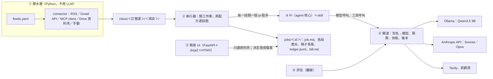
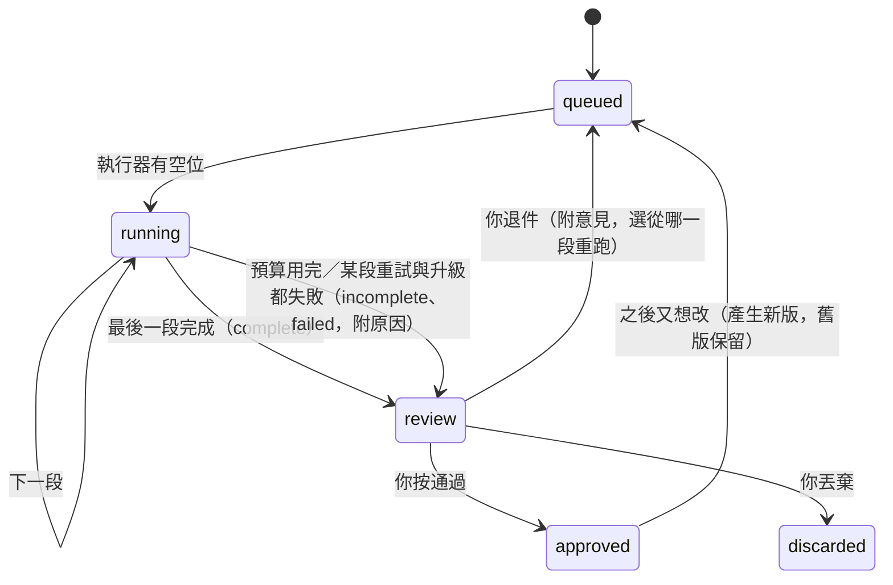

# 架構草案 v0.3：agent 核心＋資料夾狀態

> 規劃階段的草案，只是參考；哪一段做出來，就跟那段程式一起寫進 `10-truth/architecture.md`（`docs/README.md`〈一件事只有一個家〉）。
> 取代 v0.2（`2026-10-10-architecture-draft-v0.2.md`，保留不改）。決策本身在 ADR-0009～0013，這裡只寫元件、資料格式與流程。
> 依 `docs/templates/vibecoding/05_architecture_and_design_document.md` 的結構裁剪。日期：2026-10-10。

## 0. 為什麼換

v0.1、v0.2 的設計是「固定節點圖＋中間多處停下等人」：選研究問題要停、定題要停、發布要停，R0 還要先蓋 Celery、Redis、PostgreSQL。創作者實際想要的是另一種用法：

```
我給目標（或排程自動丟素材進來）
  → AI 自己做完：整理別人的文章 → 補資料 → 用我的風格二創
  → 我只審結果：通過，或寫一句意見打回重跑
```

中間停下等人，就沒辦法全自動；流程寫死在程式裡，要加一種做法就得改程式。v0.3 把兩件事反過來：

- **流程寫在 Markdown 裡**（配方與 skill），agent 讀了自己做；換流程是改文件，不是改程式。
- **人只出現在最後的待審**。中間原本要人把關的事，改成自動檢查加預算上限。

## 1. 全貌



| 元件 | 做什麼 | 不做什麼 | 語言 |
| :--- | :--- | :--- | :--- |
| 膠水層 | 照排程從各訂閱源抓文章與圖，整理成統一格式放進 `inbox/` | 不呼叫 LLM；不把任何帳號授權交給 agent | Python |
| 執行器 | 掃 `inbox/`、依訂閱源設定開工作單；照配方一段一段叫 Pi；驗證每段產出；維護工作單狀態 | 不自己判斷內容好壞（交給 skill 與檢查） | Python |
| Pi | 讀 skill，在工作單資料夾裡用指定工具把這一段做完 | 不碰工作單資料夾以外的檔案；沒有 shell | TypeScript（只寫一個薄擴充） |
| 閘道 | 所有花錢或對外的呼叫都經過這裡：模型別名對照、預算預留與結算、快取、帳本、本機 GPU 一次一個 | 不決定流程 | Python |
| 簡易 UI | 看板、工作單詳情、審稿（通過／退件／丟棄）、新增工作單、帳單 | 不直接改狀態；決定寫成檔案，由執行器套用 | Python（伺服器端產生頁面） |
| 評估 | 同一批凍結的案例，比較兩個組合的品質、花費、延遲 | 不在正式流程裡跑 | Python |

執行器、閘道、UI、排程在 S0 先放在**同一個常駐程序** `ef serve` 裡，分成不同模組；之後真的需要再拆。

## 2. 資料夾就是狀態

### 2.1 位置

- **資料目錄**由環境變數 `EF_DATA` 指定，不在 repo 裡（裡面有別人的文章、你的帳單、私人設定）。
- **skill、配方、Pi 設定、程式**在 repo 裡，進版控。

```
repo/
  src/evidence_forge/
    glue/          connector 與排程
    runner/        執行器：掃描、開單、叫 Pi、驗證產出、狀態
    gateway/       閘道：模型代理、工具端點、預算、快取、帳本、價目表
    ui/            簡易 UI
    evals/         評估
  harness/
    pi/            models.json 範本、system-prompt.md、extensions/ef-tools/（TS）
    skills/<名稱>/SKILL.md（＋scripts/、templates/、schema.json）
    recipes/<名稱>.md

$EF_DATA/
  feeds.yaml                        訂閱源設定（私人：信箱 label、Drive 資料夾 ID…）
  secrets/                          各 connector 的授權（只有膠水層讀；權限 600）
  inbox/<訂閱源>/<項目 id>/
    item.json                       出處、標題、作者、發佈時間、抓取時間、內容 hash
    content.md                      抽出的正文
    raw/                            原始檔（HTML、PDF、信件 .eml），只增不改
    images/                         原文的圖（另附 images.json：網址、出處頁、alt）
  jobs/<job id>/
    job.md                          工作單：目標、配方、預算、狀態（frontmatter）＋給 agent 的補充說明
    input/                          指向 inbox 項目（複製一份，之後 inbox 清掉也不影響）
    stages/<段>/<第幾次>/            每段每次嘗試的產出，例如 digest/1/digest.md、claims.json
    drafts/draft.v1.md、draft.v2.md 每一版稿子，永不覆寫
    checks/checks.v1.json
    assets/assets.json＋圖檔        素材與授權狀態
    review/decision.v1.json         你在 UI 做的決定（通過／退件意見／丟棄）
    events.jsonl                    狀態轉換紀錄（只有執行器寫）
    ledger.jsonl                    帳本：每次模型與工具呼叫一筆（只有閘道寫）
    bill.md                         帳單（每段結束時重新產生）
  cache/fetch/、cache/search/       跨工作單共用的抓取與搜尋快取（有有效期限）
  blobs/<hash>                      模型原始回應與送出的請求，依 hash 存，只增不改
  evals/                            見 §7
```

### 2.2 只增不改

- 產出一律是「新增一個版本」：`draft.v2.md`，不是覆寫 `draft.md`。
- 每個檔案只有一個寫入者：`events.jsonl` 與 `job.md` 的狀態只有執行器寫；`ledger.jsonl` 只有閘道寫；`review/` 只有 UI 寫；`stages/` 只有 Pi（經由閘道的寫檔工具）寫。兩個程式不會同時改同一個檔。
- 資料夾不搬家。狀態寫在 `job.md` 的 frontmatter，看板是讀出來畫的，不是靠把資料夾搬來搬去。

### 2.3 `job.md`

```markdown
---
id: 2026-10-10-substack-abc123
recipe: restructure
feed: { connector: rss, name: some-newsletter, item: inbox/some-newsletter/abc123 }
goal: 把這篇的核心主張整理成給台灣 PM 看的 1,500 字觀點文，補一個反例
budget: { usd: 0.50, tavily_credits: 20 }
status: running            # queued | running | review | approved | discarded
stage: { id: compose, index: 3, total: 4, attempt: 1, started_at: 2026-10-10T14:03:11+08:00 }
result: null               # 進待審時填：complete | incomplete | failed，並附原因
versions: { draft: 1 }
---

（可選）給 agent 的補充說明。UI 的「新增工作單」表單會把你打的字放在這裡。
```

### 2.4 工作單狀態



只有五個狀態。不管是做完、預算用完還是出錯，**都進同一個待審清單**，用 `result` 和原因區分，你只需要看一個地方。系統錯誤（Ollama 沒開、網路斷）不算「做完」，也不會偷偷改用付費模型，而是停在 `review`，標 `failed` 並寫原因。

## 3. skill 與配方

### 3.1 配方：整條流程寫在一份 Markdown

```markdown
---
name: restructure
description: 把一篇別人的文章整理成主張與研究方向，再用我的風格二創
stages:
  - { id: digest,   skill: digest,   tier: local,  output: [digest.md, claims.json] }
  - { id: research, skill: research, tier: local,  output: [research.md, sources.json], tavily_credits: 10 }
  - { id: compose,  skill: compose,  tier: strong, output: [draft.md], uses: [my-style] }
  - { id: verify,   skill: verify,   tier: local,  output: [checks.json], escalate_to: strong }
on_feedback: compose        # 退件時預設從哪一段重跑
max_attempts: 2             # 每段最多試幾次（含升級前）
auto_fix: 1                 # 檢查沒過時，自動回寫作段修幾次
---
（給人看的說明：這個配方適合什麼素材、產出什麼）
```

- 這份 frontmatter 就是「agent 讀了就知道怎麼驅動」的 metadata；執行器照它開段，Pi 照段裡的 skill 做事。
- 要做一種新產出，就新增一份配方（例如 `explainer.md`、`newsletter-digest.md`），不改程式。
- S0 先只有 `digest`、`compose`、`verify` 三段；`research` 在 S3 加進來。

### 3.2 skill

- 格式照 Agent Skills 標準：`SKILL.md`（frontmatter 有 `name`、`description`）加上可選的 `scripts/`、`templates/`、`schema.json`。Pi 原生讀這個格式。
- 每段只載入這段要用的 skill（`pi --no-skills --skill harness/skills/<名稱>`），上下文保持短，9B 模型才撐得住。
- `schema.json` 定義這段的產出格式；執行器用它驗證，不合格就算這次失敗。
- 粗活放 `scripts/`（解析 HTML、切段、算重疊率），由閘道的 `run_script` 工具執行，只准跑 skill 自己目錄裡的腳本。

| skill | 用在哪段 | 產出 |
| :--- | :--- | :--- |
| `digest` | 整理 | 作者的主張（每條附**逐字原文引句**與段落位置）、觀點、文章結構、素材清單、可延伸的研究方向 |
| `research` | 補料（S3） | 每個研究方向找到的補充來源與摘要 |
| `compose` | 二創 | 照目標寫的新文章；事實附引用編號；圖用素材 ID |
| `my-style` | 二創時一起載入 | 你的語氣、結構、用字習慣；附你提供的 3～5 篇範本 |
| `verify` | 檢查 | 逐條檢查結果（見 §6） |

### 3.3 Pi 怎麼被叫

執行器每一段開一個 Pi 程序：

```bash
pi --print --mode json --no-session \
   --model ef/<tier 別名> --api-key "job:<job id>:<段>:<第幾次>" \
   --system-prompt harness/pi/system-prompt.md \
   --no-skills --skill harness/skills/<skill> \
   --no-builtin-tools -e harness/pi/extensions/ef-tools \
   "<這一段的任務說明：讀 job.md 與上一段的產出，照 skill 完成，產出寫到 stages/<段>/<次>/>"
```

- `--no-builtin-tools`：關掉 Pi 內建的讀寫檔與 shell。Pi 本身不做沙箱（它的安全文件明說工具以 Pi 程序的權限執行），所以**工具全部由我們的擴充提供**，而且都只能碰這張工作單的資料夾。
- `--api-key "job:…"`：閘道看這把「鑰匙」就知道是哪張單、哪一段、第幾次，帳本因此能分到每一段。真正的 Anthropic 金鑰只放在閘道。
- `--mode json`：Pi 每個事件輸出一行 JSON，執行器用它更新進度（目前在第幾段、這段跑多久、正在等什麼）。
- `models.json` 只定義一個服務商 `ef`，`baseUrl` 指向閘道，`api: anthropic-messages`，模型只有三個別名：`local`、`strong`、`max`。

### 3.4 Pi 的擴充 `ef-tools`（薄的一層）

每個工具都只是把參數轉送到閘道的 `/tools/<名稱>`，規則全在閘道（Python）那邊：

| 工具 | 做什麼 | 限制 |
| :--- | :--- | :--- |
| `read_file`、`list_files` | 讀這張工作單資料夾裡的檔 | 路徑解析後必須在工作單資料夾內 |
| `write_file` | 寫到這一段的輸出目錄 | 已存在就拒絕（只增不改） |
| `fetch_url` | 抓網頁並抽出正文 | URL 白名單規則、擋內網位址（SSRF）；不繞過付費牆與 robots；結果進快取 |
| `web_search` | Tavily 搜尋 | 先查快取；先扣這張單的 credits 額度，不夠就拒絕 |
| `download_image` | 下載圖片，記出處與授權欄位 | 授權不明照樣存，但標 `unknown` |
| `run_script` | 執行這個 skill 的 `scripts/` 裡的腳本 | 只准該 skill 目錄內、清單上的腳本 |

## 4. 閘道

閘道是**唯一**會花錢、會對外連線的地方，所以「做過的不重付、先扣預算、全部記帳」只要在這裡做一次。

### 4.1 模型代理

- 對 Pi 提供 Anthropic Messages 格式（`/v1/messages`，含串流）。Ollama 從 v0.14 起也支援同一個格式，所以本機與雲端走同一種請求，閘道只換轉送目的地。
- 別名對照表（`gateway/models.yaml`）：

  ```yaml
  local:  { backend: ollama,    model: qwen3.5:9b,          concurrency: 1 }   # 本機 GPU 一次一個
  strong: { backend: anthropic, model: claude-sonnet-5-5 }
  max:    { backend: anthropic, model: claude-opus-5-5 }
  ```

  換模型、換服務商、之後試學習型派發器（例如 Sakana Fugu），都只改這份對照表或在這裡多接一個後端，Pi 與 skill 不動。
- 價目表（`gateway/prices.yaml`）一處維護，帳本的金額由它算。

### 4.2 預算

1. 雲端呼叫送出前先**預留**：依請求的輸入 token 數與 `max_tokens` 估最高花費。
2. 這張單剩下的預算不夠就**直接拒絕**，回一個 Anthropic 格式的錯誤（`budget_exceeded`）。Pi 收到後結束這段，執行器把單子送進待審，標 `incomplete: 預算用完`。
3. 回應結束後依實際用量**結算**，多預留的退回。
4. Tavily 額度同樣先扣後用。
5. 本機模型不設金額上限，但記 GPU 秒數。

### 4.3 快取與重播

- **抓取與搜尋**：跨工作單共用，依網址或查詢字串的 hash 存，有有效期限。
- **模型呼叫**：每次請求與回應依 hash 存進 `blobs/`。同一張單、同一段、同一次嘗試裡，送出完全相同的請求，直接回存好的回應，不再付費。
  - 這讓「中途當機」變成便宜的事：執行器重開這一段時，Pi 會送出跟上次一模一樣的前幾個請求，全部命中快取，一路重播到當機的地方才開始真的花錢。不需要 checkpoint 機制。
- **重播模式**（`EF_GATEWAY_MODE=replay`）：只回存好的回應，沒存過就報錯。自動化測試與評估的重跑都用這個，花費為零。

### 4.4 帳本（`ledger.jsonl`，一筆一行，只增不改）

| 欄位 | 用途 |
| :--- | :--- |
| `ts`、`job_id`、`stage`、`attempt` | 是哪一張、哪一段、第幾次 |
| `kind` | `llm`、`search`、`fetch`、`image`、`script` |
| `tier`、`model`、`escalated_from` | 用了哪一級、實際哪個模型、是不是升級上來的 |
| `input_tokens`、`output_tokens`、`cache_read_tokens`、`cache_write_tokens` | 用量 |
| `credits`、`cost_usd`、`gpu_seconds` | 花費（本機記 GPU 秒數，金額 0） |
| `ttft_ms`、`latency_ms`、`queue_ms` | 第一個字的時間、總延遲、排隊等 GPU／等限流的時間 |
| `status` | `ok`、`cache_hit`、`budget_exceeded`、`rate_limited`、`timeout`、`error` |
| `request_hash`、`response_hash` | 對回 `blobs/` 的原文，重播與評估用 |

`bill.md` 由帳本產生：這張單總共花多少、每段花多少、用了哪些模型、升級幾次、退件重跑多花多少、每段的時間。每月總表依 skill、模型、訂閱源、本機和雲端的比例統計，並算出**每篇通過的文章平均成本**。

### 4.5 並行與限流

- 執行器同時跑幾張單是設定值（S0 預設 2）。
- 本機模型由閘道的旗號控制，一次只服務一個請求，其他排隊；排隊時間記在 `queue_ms`，UI 顯示「等 GPU」。
- 雲端遇到 429 由閘道退避重試，等待時間記在帳本，UI 顯示「等限流」。
- 不需要 Celery、Redis、PostgreSQL：工作單本身就是佇列，閘道的旗號就是資源鎖。

## 5. 執行器

```
每 N 秒：
  1. 套用 UI 寫進 review/ 的新決定：通過 → approved；退件 → queued（記下從哪段重跑）；丟棄 → discarded
  2. 依 feeds.yaml，把 inbox 裡還沒開單的項目開成工作單（同一個內容 hash 只開一次）
  3. 有空位就拿最舊的 queued 單，從它該開始的那段跑起
每一段：
  開 Pi → 讀 JSON 事件更新進度 → Pi 結束 → 用 schema.json 驗證產出
    通過 → 下一段
    不通過 → 同一級再試，直到 max_attempts；還不行且有 escalate_to → 升一級再試；
             再不行 → review（failed，附最後一次的錯誤）
  verify 段的硬檢查沒過 → 帶著檢查結果回 compose 段重寫，最多 auto_fix 次；
                         還沒過 → review（incomplete，列出沒過的檢查）
開工前檢查（每次 ef serve 啟動、每張單開跑前）：
  Ollama 在跑且模型已載入、閘道可連、Anthropic 金鑰有效、Tavily 額度、硬碟空間、EF_DATA 可寫
  任何一項不過就不開跑，並寫明是哪一項
```

- 程序重啟時：`running` 的單一律從它所在那段重跑（快取讓重跑的前段幾乎不花錢，§4.3）。
- 退件時，`on_feedback` 決定預設從哪段重跑（通常是 compose）；UI 讓你改選「重新整理」或「重新補料」。上游的產出照樣沿用，不重付。
- 執行器只依配方走，不判斷內容好壞。

## 6. 自動檢查（取代原本的人工關卡）

| 編號 | 檢查 | 怎麼查 | 沒過時 |
| :--- | :--- | :--- | :--- |
| C1 引句真實 | digest 的每條主張附的原文引句，真的出現在原文裡 | 程式比對（空白與標點正規化後做子字串比對） | 該段重試；不准帶著捏造的引句往下走 |
| C2 引用完整 | 稿子裡的每個事實都有引用編號，而且編號對得到來源 | 程式 | 回 compose 自動修 |
| C3 不照抄 | 稿子跟原文的逐字重疊低於門檻 | 程式（最長共同片段、n-gram 重疊率） | 回 compose 自動修 |
| C4 圖片授權 | 稿子裡嵌入的圖只能是授權 `ok` 的；其他只能列為「參考圖」 | 程式比對 `assets.json` | 回 compose 自動修 |
| C5 格式 | 每段產出符合 `schema.json`；稿子是標準 Markdown | 程式 | 該段重試 |
| C6 引用撐得住 | 被引用的來源真的支持那句話 | 本機模型逐條判斷，不確定的升級 `strong` 複判 | 列進待審的提醒，不擋 |
| C7 符合目標 | 稿子有照 `goal` 寫 | 本機模型依評分表判斷 | 列進待審的提醒，不擋 |

C1～C5 是硬性的，程式判斷，不靠模型。C6、C7 是軟性的，結果放在待審畫面給你參考。**任何檢查都不會讓稿子自動公開**，公開永遠要你按。

## 7. 評估

```
$EF_DATA/evals/
  cases/<id>/          凍結的輸入：inbox 項目的完整複本（不再重抓）
  labels/<id>.yaml     人工標註：這篇的關鍵主張（先標 10 篇；格式見 repo 的 harness/templates/eval-label.yaml）
  configs/<名稱>.yaml   要比較的組合：models.yaml 對照＋skill 版本（git sha）＋配方
  runs/<日期>-<組合>/   每次評估的產出、帳本、report.md
  feedback.jsonl       正式流程裡每一次審稿決定（通過／退件意見）
```

- **只重跑某一段**：上游產出凍結，只換這一段的模型或 skill。換寫稿模型時，整理那段完全不用重跑。
- **硬指標**（程式算，退步就擋）：C1 捏造引句率必須是 0；C5 格式通過率 100%；C2 引用完整率；C3 照抄率；花費、延遲、升級率、失敗率。
- **軟指標**（評審模型）：digest 跟人工標註比的召回與誤報；稿子的目標符合度、風格相似度、引用支持度。兩兩比較、對調順序判兩次；評審模型固定版本、盡量不跟受測模型同一家；走 Batch API 半價。
- **評審要先校準**：創作者先判 20 組，評審的一致率達 80% 以上才採信。
- **真實回饋**：每次審稿決定寫進 `feedback.jsonl`；退件的案例自動變成新的評估案例；長期追蹤一次通過率與平均退件次數。
- 每份產出都記下組合版本（模型對照、skill 的 git sha），重跑時用同一套。

## 8. 簡易 UI

S0 就做，因為實驗要驗證的正是「審稿 → 退件 → 重跑」這個迴圈，以及每篇花多少錢。用伺服器端產生頁面（FastAPI＋Jinja2＋HTMX 輪詢），不需要 Node 前端建置。外觀先陽春，套 ADR-0007 的 token 名稱，細部設計之後再補。

| 頁面 | 要有的功能 | 階段 |
| :--- | :--- | :--- |
| 看板 | 依狀態分欄（排隊／執行中／待審／通過／丟棄）；卡片顯示標題、訂閱源、第幾段／共幾段、這段跑了多久、正在等什麼（GPU、限流、模型回應）、目前花費、待審的 `result` 與原因；每幾秒自動更新 | S0 |
| 工作單詳情 | 分頁：稿子（各版切換）、整理結果（主張與研究方向）、來源與圖（授權狀態）、檢查結果、帳單、事件紀錄 | S0 |
| 審稿動作 | 通過／退件（填意見，選從哪段重跑，預設依配方）／丟棄；失敗的單可以「重試」 | S0 |
| 新增工作單 | 貼網址、貼文字或上傳檔案；填目標；選配方；可調預算 | S0 |
| 帳單 | 本月總表與分項；每篇通過的文章平均成本 | S0 |
| 訂閱源 | 每個訂閱源最後抓取時間、抓到幾篇、錯誤；「立即抓取」按鈕（設定先改 `feeds.yaml`） | S2 |
| 評估 | 評估紀錄與報告 | S1 |

UI 只讀資料夾，唯一會寫的是 `review/decision.vN.json` 與新增工作單時的 `inbox/manual/…`；狀態一律由執行器套用。

## 9. 膠水層（S2）

- 每個 connector 只做一件事：照 `feeds.yaml` 的設定抓東西，寫成 `inbox/` 的統一格式。

  ```yaml
  - name: some-newsletter
    connector: rss                  # rss | gmail | mcp | drive | manual
    params: { url: https://example.substack.com/feed }
    schedule: "0 7 * * *"
    recipe: restructure
    goal: 整理成給台灣 PM 看的觀點文
    budget: { usd: 0.50, tavily_credits: 20 }
  ```

- **Gmail**：用 Gmail API，唯讀權限，只抓指定 label。
- **有 MCP 的 app**：程式直接當 MCP client 呼叫（官方 Python SDK），不經過 LLM。
- **沒有接口的 app**：外部工具（computer use 等）把文章放進 Google Drive 的指定資料夾，膠水層只認 `drive` 這個 connector。外部那段壞了，不會拖垮這條流程。
- **授權只在膠水層**：`$EF_DATA/secrets/` 只有膠水層讀。agent 讀的是外人寫的內容，可能藏著指令，所以它碰不到任何帳號。
- 同一個內容 hash 只進 inbox 一次。
- 排程在 `ef serve` 裡用 APScheduler。WSL 關機時排程不會跑；要固定時段跑，就讓 Windows 工作排程器在那之前把 WSL 與 `ef serve` 叫起來。

## 10. 部署（單機）

| 東西 | 跑在哪 |
| :--- | :--- |
| `ef serve`（執行器＋閘道＋UI＋排程） | WSL 主機，`uv run` |
| Pi | WSL 主機，Node 用 nvm 裝；版本鎖在 `harness/pi/` |
| Ollama＋Qwen3.5 9B | 主機（3090） |
| 資料 | `$EF_DATA`，每天備份到第二顆本機硬碟（rsync）；MVP 期間全部保留 |
| 資料庫、佇列 | **沒有**。之後真的需要查詢跨工作單的資料，再加 SQLite 索引（從資料夾重建得出來） |

## 11. 跟舊設計的對照

| 舊 | 新 | 依據 |
| :--- | :--- | :--- |
| LangGraph 固定節點圖、interrupt 停點 | 配方＋skill，每段一個 Pi 程序；人只在最後待審 | ADR-0009、ADR-0013 |
| Celery＋Redis＋PostgreSQL | 工作單資料夾就是佇列；閘道旗號就是資源鎖 | ADR-0010 |
| 冪等鍵 `run_id + operation_key`、跨 Run 快取 | 閘道的請求 hash 快取＋重播；抓取與搜尋快取 | ADR-0010、ADR-0011 |
| Qwen 產問題、Opus 規劃複核、Sonnet 寫 | 本機 Qwen 整理與檢查；Sonnet 二創；Opus 只在升級時 | ADR-0011 |
| 種子文章只能是一個 URL | 膠水層：任何訂閱源，統一成 inbox 格式 | ADR-0012 |
| 選題停點、定題 Gate、論點必須不同於原作者 | 拿掉；給目標，自動做完，人審結果 | ADR-0013 |
| Web UI 在 R2 | 簡易 UI 在 S0 | 路線圖 |

## 12. 還沒定的事

| 項目 | 誰決定 | 什麼時候 |
| :--- | :--- | :--- |
| 第一批接哪兩個訂閱源（可能是部落格）；它們有沒有 RSS、API、MCP | 創作者 | S2 開工前 |
| `my-style` 的範本：3～5 篇創作者自己的文章，放 `$EF_DATA/style/`（格式見 `harness/templates/style-sample.md`） | 創作者 | S0 開工前 |
| 評估用的 10 篇案例與人工標註，放 `$EF_DATA/evals/`（格式見 `harness/templates/eval-label.yaml`、`eval-case-meta.yaml`） | 創作者 | S1 開工前 |
| C3 照抄門檻的數值 | 架構＋創作者 | S0 用實際稿子量出來 |
| Qwen 9B 的整理品質夠不夠，`digest` 要不要預設 `strong` | 依 S0、S1 的實測 | S1 結束 |
| Pi 的 `--api-key` 帶工作單資訊在實際版本是否可行；不行就改成每段一把臨時金鑰 | 架構 | S0 第一天 |

## 13. 參考

- Pi CLI 參數：<https://pi.dev/docs/latest/cli>；自訂模型與服務商：<https://pi.dev/docs/latest/models>
- Ollama Anthropic 相容 API：<https://docs.ollama.com/api/anthropic-compatibility>
- MCP Python SDK：<https://github.com/modelcontextprotocol/python-sdk>
- Anthropic〈Building effective agents〉：<https://www.anthropic.com/engineering/building-effective-agents>
- Thoughtworks 對 Sakana Fugu 的評論：<https://www.thoughtworks.com/insights/blog/generative-ai/sakana-ai-fugu-is-this-where-model-routing-should-live>
