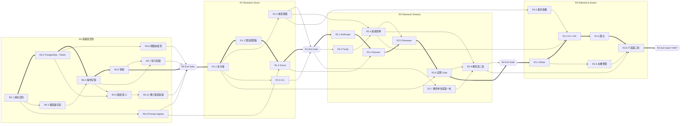

# 開發排程計畫（WBS 與 DAG）— Evidence-led Editorial Studio

> **版本：** v0.1 | **日期：** 2026-10-10 | **狀態：** 草案，待創作者確認
> 依 `docs/templates/vibecoding/16_wbs_development_plan_template.md` 的結構撰寫，加上範本沒有的依賴圖（DAG）。這份就是 `.claude/skills/PIPELINE.md` 第 5 行說的「排程計畫」。
> **上游：** 階段與 Exit Gate → `00-intent/roadmap.md`；需求 → `10-truth/requirements/prd.md`（v1.3）；決策 → `10-truth/adr/`（到 ADR-0006）
> **下游：** 每個工作包現在做到哪 → `20-state/progress.md`；開票之後，票與依賴的家是 GitHub issue（`docs/agents/issue-tracker.md`）
>
> 這份是 10/10 當天的規劃快照，之後不回寫。工作包拆法或依賴改了，就寫一份新日期的排程計畫，`progress.md` 改引用新的那份。

---

## 1. 為什麼要先有這份

家規第 26 條：「專案先出 WBS，從相依關係收斂出任務 DAG。」沒有這張圖就開票，會出現兩種浪費：

1. **派錯順序**：還沒有資料契約就開始寫節點，之後整批改。
2. **並行過頭**：這個 repo 在 `/mnt/d`（慢的檔案系統），同時跑測試、安裝、重 git 操作的線最多 1～2 條，主 session 也算一條（`PIPELINE.md`〈慢檔案系統的 I/O 上限〉）。開三條線並行，只會讓每一條都變慢、甚至卡死。

所以這份先回答：要做哪些事、誰擋誰、一次做幾件、哪幾件要你親手按。

---

## 2. 專案總覽

| 項目 | 內容 |
| :--- | :--- |
| 範圍 | MVP＝R0～R3（`roadmap.md`）；R4、R5 只列大項，R3 結束前再拆 |
| 時程 | 照 roadmap 的建議週次（R0 第 1 週 … R3 第 6～7 週）；**這份不估工時**——還沒有任何實測數字，估了也是猜。R0 結束後用帳本（`MODEL-ROUTING.md`）的實際數字再估 |
| 角色 | 創作者（你）：PM、拍板、UAT、T3／T4 合併。Claude（主 session）：派工、審查、T1／T2 合併。子代理：實作（格 1～3） |
| 里程碑 | 每個 R 階段的 Exit Gate 就是一個里程碑；每個里程碑由你做一次 UAT，沒過不進下一階段（`PIPELINE.md` 第 40 行） |

---

## 3. 工作方式設定

規則本身都已經寫在工作方法文件裡，這裡**只寫這個專案要填的值**，不重述規則。

| 主題 | 規則在哪 | 這個專案的設定 |
| :--- | :--- | :--- |
| PR 分級 T1～T4 | `Ai-coding-principle/GRANULARITY.md`、家規第 39 條、`guard-git.sh` | 依檔案路徑判定。範本內建的高風險路徑之外，這個專案要加的見 §3.1，寫進 `.claude/hooks/human-only-paths.conf` |
| 誰按合併 | `PIPELINE.md`〈審查與合併〉 | T1／T2：檢查全綠後 Claude 合併。T3／T4、任何刪除檔案的 PR：你按 |
| Worktree | `LESSONS.md` L-006、L-017、L-019；`PIPELINE.md` | 會產生 commit 的工作一律開在 `.claude/worktrees/<工作包>-<短名>`；**同時最多 2 條跑測試的線，主 session 算一條** |
| 派模型 | `Ai-coding-principle/MODEL-ROUTING.md`、家規第 43 條 | 每個工作包的起始格寫在 §4；每張票結束時在 `MODEL-ROUTING.md` 的帳本記一列 |
| Codex 交叉審查 | `PIPELINE.md` 第 33～35 行 | 只審 §4 標成 T3 的工作包；中等推理強度、只報必修、最多 5 條、最多 2 輪 |
| 分支模型 | `Ai-coding-principle/GIT-FLOW.md` | **還沒選**：單線（只有 `main`）或 `main`＋`dev`。由 `/init-from-template` 第 3 題決定 |
| 停點 | `PIPELINE.md` | 設計站、接縫站、鞏固站、UAT 放在哪裡，見 §6 |

### 3.1 建議加進 `human-only-paths.conf` 的高風險路徑

這些路徑還不存在（目錄名照架構草案 §1.3 的建議，第一張票開工時才定），所以用**跟位置無關的寫法**先擋住，比漏掉便宜（`human-only-paths.conf` 第 19 行）。

| 樣式 | 擋的是什麼 | 依據 |
| :--- | :--- | :--- |
| `src/evidence_forge/domain/*` | 資料契約、品質關卡 G1～G5、授權規則。改錯不會當場紅，會在之後某份內容包上出事 | PRD §6、§7；架構草案 §1.3 |
| `*/migrations/*` | 資料庫結構變更 | 範本建議 |
| `compose.yaml`、`docker-compose*.yml` | PostgreSQL 與 Redis 的部署設定。改錯會讓狀態或佇列消失 | ADR-0006 |
| `*limiter*`、`*reconcil*` | 資源限流與佇列對帳。錯了會搶 GPU、超過 API 速率上限、或讓 Run 永遠卡在佇列 | NFR-21、NFR-23；ADR-0006 |
| `*budget*`、`*cost*` | 預算預留與花費計算。錯了就是真的花錢 | NFR-04 |
| `*operation_log*`、`*idempot*` | 「做過的不重做」的機制。錯了會重複扣費、重複發布 | NFR-01、ADR-0004 |
| `*artifact*` | 只增不改的檔案儲存區。錯了會覆寫原始證據 | NFR-14、ADR-0005 |
| `*gate*` | 定題 Gate 與發布審核：人類否決權本身 | FR-06、G3；`guard-git.sh` 把「Human Gate」列為不能由受審者改的一類 |
| `*publish*`、`*site_draft*` | 送到網站的那一步 | FR-12 |
| `*url_guard*`、`*ssrf*` | 擋 SSRF 的網址檢查 | PRD §8.4 資料安全 |

> 寧可多擋（`init-from-template` 第 2 步第 5 題）。檔名定下來之後，把萬用字元換成真的路徑。

---

## 4. 工作包（WBS）

**編號規則**：工作包從路線圖階段往下編（`R1` → `R1.2`），開票之後對應到 GitHub issue `#nn`。只有這一套，不另編代碼。

**欄位說明**

- **等級**：預計會碰到的 PR 分級。T3 的工作包由你合併，並加 Codex 交叉審查。
- **起始格**：派給哪一格的子代理先做（1＝Sonnet high、2＝Opus high、3＝Opus xhigh）。
- **人**：HITL＝需要你在場（給資料、拍板、做 UAT）；AFK＝子代理可以自己做完。
- **依賴**：要等哪些工作包合併之後才能開工。

### R0 基線與契約（第 1 週）

| 工作包 | 交付 | 需求 | 等級 | 起始格 | 人 | 依賴 |
| :--- | :--- | :--- | :---: | :---: | :---: | :--- |
| R0.1 | 資料契約：Run、來源、研究問題、主張證據、素材、編輯決定、內容包的 Pydantic 模型，加 Run 狀態列舉 | NFR-09、NFR-12；架構草案 §4 | T3 | 2 | AFK | — |
| R0.2 | 本機服務：Docker Compose 起 PostgreSQL 與 Redis（Redis 開 AOF）；資料庫結構與遷移 | NFR-18、NFR-23；ADR-0006 | T3 | 2 | AFK | R0.1 |
| R0.3 | 檔案儲存區：依內容 hash 只增不改 | NFR-14～16；ADR-0003、0005 | T3 | 2 | AFK | R0.1 |
| R0.4 | 操作紀錄與冪等：`run_id + operation_key`，恢復時不重做；跨 Run 快取索引 | NFR-01、NFR-02；ADR-0004、0005 | T3 | 2 | AFK | R0.2、R0.3 |
| R0.5 | 預算預留與成本計量：三種上限、先預留再花錢 | NFR-04、FR-10 | T3 | 2 | AFK | R0.1、R0.4 |
| R0.6 | Prompt registry 與版本鎖定 | NFR-12 | T2 | 1 | AFK | R0.1 |
| R0.7 | 執行紀錄：每個節點的耗時、模型、prompt 版本、hash、費用、錯誤碼 | FR-10 | T2 | 1 | AFK | R0.4、R0.5 |
| R0.8 | 開跑前檢查：Ollama、PostgreSQL、Redis、API key、Tavily 額度、硬碟、資料庫版本 | NFR-08 | T2 | 1 | AFK | R0.2 |
| R0.9 | 錄放測試與 CI 重播骨架：自動化測試不打付費 API；CI 起 PostgreSQL 與 Redis，或用 Celery eager 模式（兩種都要有） | NFR-07、NFR-11；ADR-0006 §4 | **T4**（改 CI） | 2 | AFK | R0.2、R0.4 |
| R0.10 | 20 篇種子測試集與基線報告（Tavily 用量實測移到 R2 的 Exit Gate，Q-21） | brief §4 | T1 | — | **HITL** | R0.9 |

### R1 Research Scout（第 2～3 週）

| 工作包 | 交付 | 需求 | 等級 | 起始格 | 人 | 依賴 |
| :--- | :--- | :--- | :---: | :---: | :---: | :--- |
| R1.1 | **曳光彈**：LangGraph 圖骨架＋`PostgresSaver`＋Celery「推進一個 Run」的工作＋advisory lock，用假節點從建立 Run 走到「等選題」，再從決定恢復 | ADR-0001、0006；NFR-20、NFR-22 | T3 | 2 | AFK | R0 Exit Gate |
| R1.2 | 資源限流與對帳：GPU 全域 semaphore、Anthropic／Tavily 的 token bucket、Celery beat 對帳把卡住的 Run 排回 | NFR-21、NFR-23；ADR-0006 §3.3、§3.4 | T3 | 2 | AFK | R1.1 |
| R1.3 | 來源擷取：canonical 去重、不可驗證標記、手動貼內容、擋 SSRF | FR-01 | T3 | 2 | AFK | R1.1 |
| R1.4 | Ollama 轉接器與 Scout 節點：3～5 個候選問題 | FR-02 | T2 | 2 | AFK | R1.2、R0.6 |
| R1.5 | CLI：建立 Run、看狀態與進度、選題（R1 只有 CLI，Q-01、Q-15） | FR-01、FR-02、NFR-24 | T2 | 1 | AFK | R1.1 |

### R2 Research Director（第 4～5 週）

| 工作包 | 交付 | 需求 | 等級 | 起始格 | 人 | 依賴 |
| :--- | :--- | :--- | :---: | :---: | :---: | :--- |
| R2.1 | Anthropic 轉接器：prompt caching、Batch API 介面、接上限流 | NFR-05、NFR-21 | T2 | 2 | AFK | R1 Exit Gate |
| R2.2 | Director 節點：研究計畫、格式驗證與有限次重試 | FR-03、NFR-10 | T2 | 2 | AFK | R2.1、R1.4 |
| R2.3 | Tavily 轉接器與定向搜尋：每輪上限、呼叫前查預算、接上限流 | FR-04、NFR-21 | T3 | 2 | AFK | R1 Exit Gate |
| R2.4 | 證據矩陣與引用鏈：主張對照、同組原始證據、UNVERIFIED | FR-05 | T3 | 2 | AFK | R2.3、R1.3 |
| R2.5 | Reviewer 與反證迴圈：最多 2 輪，超過交給人 | FR-11 | T2 | 2 | AFK | R2.2、R2.4 |
| R2.6 | 定題 Gate：核准、改寫、否決，決定紀錄，重啟後恢復 | FR-06、G3 | T3 | 2 | AFK | R2.5、R1.1 |
| R2.7 | 網頁骨架與第一批：AppShell、設計 token、Run 總覽、新研究、Run 工作區、研究提案（FastAPI＋Jinja2＋HTMX） | FR-01、FR-02、NFR-24 | T2 | 1 | **HITL**（設計站） | R1 Exit Gate |
| R2.8 | 網頁第二批：證據審查、定題 Gate、執行紀錄 | FR-05、FR-06、FR-10 | T2 | 1 | **HITL**（設計站） | R2.4、R2.6、R2.7 |

### R3 Editorial & Assets（第 6～7 週）

| 工作包 | 交付 | 需求 | 等級 | 起始格 | 人 | 依賴 |
| :--- | :--- | :--- | :---: | :---: | :---: | :--- |
| R3.1 | Writer 節點：大綱與草稿、受限的 MDX、改論點只重跑寫作 | FR-07、NFR-03 | T2 | 1 | AFK | R2.6 |
| R3.2 | 素材擷取與授權判定：授權不明的預設擋下，擋下的也存檔 | FR-08、NFR-17 | T3 | 2 | AFK | R1.3 |
| R3.3 | 發表前檢查 G1～G5 | PRD §7 | T3 | 2 | AFK | R3.1、R3.2、R2.4 |
| R3.4 | 匯出內容包：`article.mdx`、`sources.json`、`assets.json`、`run.json` 與格式驗證 | FR-09 | T2 | 1 | AFK | R3.3 |
| R3.5 | 本機預覽：受限 MDX 渲染、隔離框架 | FR-09；Q-14 | T2 | 1 | AFK | R3.1 |
| R3.6 | 介面第三批：草稿預覽、素材、發布審核 | FR-07～09 | T2 | 1 | **HITL**（設計站） | R3.4、R3.5、R2.8 |

### R4、R5（R3 結束前再拆）

| 工作包 | 交付 | 需求 | 備註 |
| :--- | :--- | :--- | :--- |
| R4.1 | 網站草稿預覽整合 | FR-12 | 等 Q-06（網站是 Git repo 還是 CMS） |
| R5.1 | A／B／C 模型組合實驗 | brief §5.2、NFR-06 | 等 R3 完成 |

---

## 5. 依賴圖（DAG）

每個方框是一個工作包，箭頭是「做完才能開始」。粗線是關鍵路徑：這條線上任何一個工作包延誤，整個 MVP 就延誤。

**關鍵路徑**：R0.1 → R0.2 → R0.4 → R0.5 →〔R0 Exit〕→ R1.1 → R1.2 → R1.4 →〔R1 Exit〕→ R2.1 → R2.2 → R2.5 → R2.6 →〔R2 Exit〕→ R3.1 → R3.3 → R3.4 → R3.6 →〔MVP〕

> 每個階段的工作包都等上一階段的 Exit Gate：roadmap 規定「過不了 Exit Gate 就不進下一階段」。

---

## 6. 波次與停點

一波＝同時派出去的一組工作包。**每波最多 2 個會跑測試的工作包**（慢檔案系統上限，主 session 算一條，所以實際常常是 1＋審查）。

| 波 | 工作包 | 這一波開工前的停點 | 這一波結束後 |
| :--- | :--- | :--- | :--- |
| 0 | — | `/init-from-template`（已完成）；建 `dev` 分支 | — |
| 1 | R0.1 | 派工前的資源盤點 | — |
| 2 | R0.2、R0.3 | — | — |
| 3 | R0.4、R0.6 | — | — |
| 4 | R0.5、R0.8 | — | — |
| 5 | R0.7、R0.9 | — | — |
| 6 | R0.10（你挑種子，不佔測試線） | — | **鞏固站＋R0 UAT** |
| 7 | R1.1（曳光彈，單獨一波） | 接縫站：從建立 Run 走到「等選題」，含 worker 中途被殺掉、重送 | — |
| 8 | R1.2、R1.3 | — | — |
| 9 | R1.4 | — | — |
| 10 | R1.5 | — | **鞏固站＋R1 UAT**（用 CLI 走完建立 Run → 選題） |
| 11 | R2.1、R2.3 | — | — |
| 11b | R2.7 | **設計站**：網頁第一批的設計稿你確認過才派票 | — |
| 12 | R2.2、R2.4 | — | — |
| 13 | R2.5 | — | — |
| 14 | R2.6 | 接縫站：從選題走到定題，含程式重啟 | — |
| 15 | R2.8 | **設計站**：網頁第二批 | **鞏固站＋R2 UAT**（含 Tavily 用量實測，Q-21） |
| 16 | R3.1、R3.2 | — | — |
| 17 | R3.3、R3.5 | — | — |
| 18 | R3.4 | 接縫站：從定題走到匯出 | — |
| 19 | R3.6 | **設計站**：網頁第三批 | **鞏固站＋MVP UAT** |

除了上表，鞏固站在這些情況也會提早觸發：累積合併 10 個 PR、e2e 或單一 CI 分片超過 4 分鐘、單元測試超過 90 秒、同一條測試不穩定兩次（`PIPELINE.md`〈鞏固站〉）。

---

## 7. 開票前要準備好的事

| 項目 | 現況 | 誰做 |
| :--- | :--- | :--- |
| `/init-from-template` | 沒跑過：`CLAUDE.md` 標題還是 `your-project`，`docs/agents/issue-tracker.md` 還是 `<owner>/<repo>` | 你輸入指令啟動；第 5 題可以直接用 §3.1 的清單 |
| GitHub 標籤 `ticket`、`spec`、`in-progress` | 沒建 | `/init-from-template` 第 5 步（問過你才建） |
| 分支模型 | 沒選 | `/init-from-template` 第 3 題 |
| Q-01、Q-15（前端技術與開始的階段） | 已決：R1 CLI、R2 起網頁 | — |
| Q-21（R0 基線要不要含 Tavily 實測） | 已決：移到 R2 Exit Gate | — |
| Docker | PostgreSQL 與 Redis 用 Docker 跑（ADR-0006） | 確認本機 Docker 可用；開跑前檢查（R0.8）會驗 |
| 帳本 | `MODEL-ROUTING.md` 的帳本是空的 | 每張票結束時記 |

開票順序照 `PIPELINE.md`：`/to-spec` 收成規格 →（選用）`/to-architecture`、`/frontend-spec` → `/test-blueprint` → `/uat-cases` → `/to-tickets`。開票時，每張票的等級、起始格、HITL／AFK 照 §4 這張表填，依賴照 §5 掛成 GitHub 的 `blocked_by`。

---

## 8. 風險

| 風險 | 影響 | 對策 |
| :--- | :--- | :--- |
| R0 的 Exit Gate 要求基線報告含 Tavily 實測，但搜尋在 R2 才做 | R0 過不了門，或基線報告是空的 | Q-21：改成 R0 只量 Tavily 的單次呼叫成本，完整基線移到 R2 結束 |
| 慢檔案系統讓並行反而變慢 | 波次拖長、檢查卡死 | 每波最多 2 條測試線；派工前先量資源。PostgreSQL、Redis 的 Docker volume 不要放在 `/mnt/d` |
| 網頁的設計稿晚到 | R2.7 卡在設計站 | 視覺設計在 R1 期間先畫第一批的四頁 |
| 高風險路徑在檔名定下來之前用萬用字元 | 擋太多，或擋到不該擋的 | 第一批程式合併後，把萬用字元換成真的路徑 |
| T3 工作包很多（R0 有 5 個、R1 有 3 個） | 你要按很多次合併 | 這是刻意的：R0 是地基，錯了最貴。R1 之後 T3 比例下降 |
