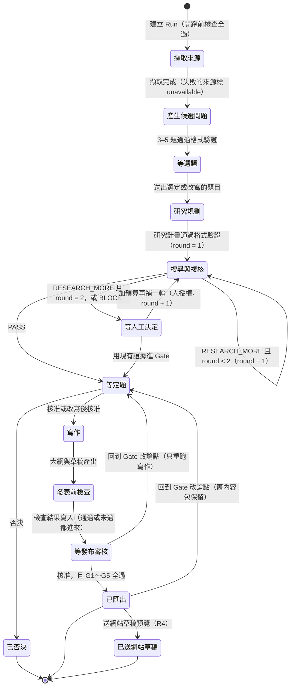
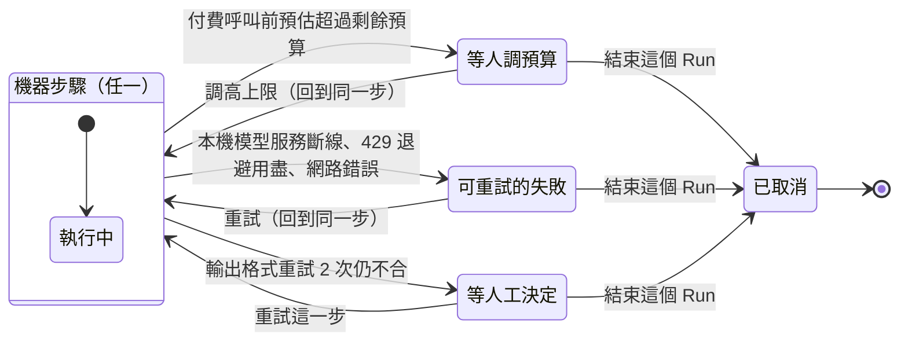
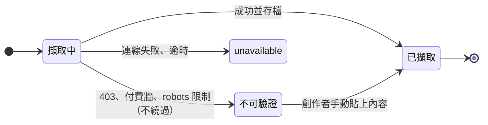
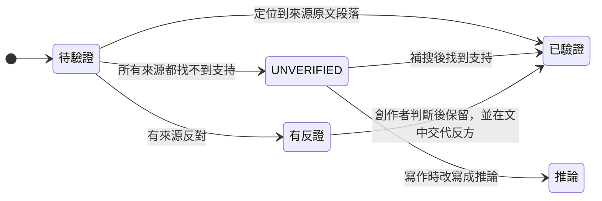
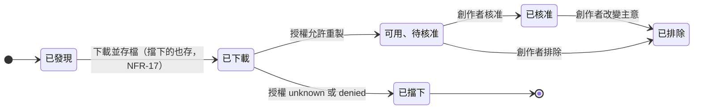

# 狀態機草案：研究執行（Run）的狀態轉換 — Evidence-led Editorial Studio

> **版本：** v0.1 | **日期：** 2026-10-10 | **狀態：** 草案，待創作者與架構 session 確認
> 依 `docs/templates/vibecoding/07_module_specification_and_tests.md` 撰寫（契約式設計＋測試案例）。範本 00 §1 把「狀態機」列為 SD（系統設計）的產出，INDEX 對應 SD 的範本是 00、06、07，這份用 07 的格式。
> **對應架構文件：** `30-snapshot/plans/2026-10-10-architecture-draft-v0.2.md`（`ResearchRun` 是 Aggregate Root，§1.2 戰術設計；流程見 §3.4）
> **對應 BDD Feature：** `10-truth/requirements/features/` 的 `source-intake`、`research-proposal`、`evidence`、`thesis-gate`、`editorial-draft`、`asset-rights`、`export`、`run-reliability`、`run-trace`
> **對應 UI：** `design/2026-10-10-frontend-ia-draft.md`（每個狀態在畫面上怎麼呈現，見第 6 節）
>
> 這是規劃快照，不是事實層。狀態名稱與轉換規則要先跟架構 session 對齊，實作時再寫進 `10-truth/architecture.md`。

---

## 1. 為什麼要先把狀態機畫清楚

PRD NFR-09 已經規定 Run 只有七種狀態、每種都有明確的下一步。但把 PRD、BDD、架構草案的循序圖放在一起看，有三個地方對不起來：

1. **選題要停下來等人**（`research-proposal.feature`〈創作者可以改寫候選問題〉），NFR-09 的七種狀態裡沒有這一種。
2. **補搜 2 輪後仍不足、節點輸出格式重試失敗**，BDD 都說「停下等待人工」，但 NFR-09 沒有「等人工決定」。
3. **發布前的人工核准**（PRD 畫面 06），也是一個等人的狀態。

畫面要依狀態決定「顯示什麼、讓人按什麼」，所以這份把所有狀態與轉換列完整，並把它們對回 NFR-09 的七種（第 3 節）。

---

## 2. 主狀態圖

### 2.1 正常路徑與人工停點

機器做事的狀態用一般方框，等人的狀態名稱以「等」開頭。

**開跑前檢查不是 Run 的狀態。** 檢查沒過就不建立 Run（`run-reliability.feature`〈本機模型服務沒在跑時…〉：「研究執行不會開始」），創作者留在新研究頁。

### 2.2 例外：任何機器步驟都可能中途停下

這四條轉換適用於所有機器做事的狀態（擷取、產題、規劃、搜尋與複核、寫作、檢查），畫在一起避免主圖變成一團線。

所有非終點的等待狀態（等選題、等定題、等發布審核等）也都可以由創作者「結束這個 Run」進入已取消，圖上省略。

---

## 3. 狀態清單

| 狀態 ID | 名稱 | 類型 | 誰在動 | 對應 NFR-09 | 離開的條件 |
| :--- | :--- | :--- | :--- | :--- | :--- |
| `INTAKE` | 擷取來源 | 機器 | Graph Worker | 執行中 | 擷取完成 |
| `SCOUTING` | 產生候選問題 | 機器 | Qwen（本機） | 執行中 | 題目通過格式驗證 |
| `AWAITING_QUESTION` | 等選題 | 等人 | 創作者 | **新增** | 送出題目 |
| `PLANNING` | 研究規劃 | 機器 | Opus（Director） | 執行中 | 研究計畫通過格式驗證 |
| `RESEARCHING` | 搜尋與複核 | 機器 | Tavily＋Opus（Reviewer） | 執行中 | Reviewer 判定 |
| `AWAITING_DECISION` | 等人工決定 | 等人 | 創作者 | **新增** | 創作者選一個動作 |
| `AWAITING_THESIS` | 等定題 | 等人 | 創作者 | 等定題 | 核准或否決 |
| `WRITING` | 寫作 | 機器 | Sonnet（Writer） | 執行中 | 草稿產出 |
| `CHECKING` | 發表前檢查 | 機器 | 規則（G1～G5、授權） | 執行中 | 檢查結果寫入 |
| `AWAITING_PUBLISH` | 等發布審核 | 等人 | 創作者 | **新增** | 核准匯出，或回到 Gate |
| `AWAITING_BUDGET` | 等人調預算 | 等人 | 創作者 | 等人調預算 | 調高上限或結束 |
| `RETRYABLE` | 可重試的失敗 | 等人 | 創作者 | 可重試的失敗 | 重試或結束 |
| `EXPORTED` | 已匯出 | 終點（可重開） | — | 完成／部分完成 | 回到 Gate，或送網站草稿 |
| `SITE_DRAFT_SENT` | 已送網站草稿 | 終點 | — | 完成／部分完成 | — |
| `REJECTED` | 已否決 | 終點 | — | 已否決 | — |
| `CANCELLED` | 已取消 | 終點 | — | **新增** | — |

**「部分完成」是旗標，不是獨立狀態。** 只要有任何來源是 unavailable，Run 帶 `partial = true`；走到 `EXPORTED` 時，畫面顯示「部分完成」而不是「完成」（`run-trace.feature`〈部分成功不算完成〉）。這樣不必為每個狀態各做一個「部分」版本。

**和 NFR-09 的差異**：新增 `AWAITING_QUESTION`、`AWAITING_DECISION`、`AWAITING_PUBLISH`、`CANCELLED` 四種，理由在第 1 節。要不要把它們寫進 PRD NFR-09，見第 8 節 Q-17。

---

## 4. 模組：ResearchRun（Aggregate Root）

狀態轉換只能經過 `ResearchRun`（架構草案 §1.2）。LangGraph 的 `interrupt()` 對應所有「等」開頭的狀態，恢復時用 `Command(resume=…)`，`thread_id = run_id`（ADR-0001、0003）。`status` 另外寫進 Metadata DB，讓畫面輪詢時不必讀 checkpoint（`design/2026-10-10-frontend-ia-draft.md` Q-12）。

### 4.1 不變性（任何時候都成立）

| # | 不變性 | 依據 |
| :--- | :--- | :--- |
| 1 | 已花費 ≤ 上限（美元、token、credits 三種都是）；付費呼叫前先預留，預留不夠就不送出 | NFR-04 |
| 2 | 處於任何「等」開頭或終點狀態時，不會發出付費呼叫 | NFR-04、`thesis-gate.feature` |
| 3 | 進入 `WRITING` 之前，一定有一筆 `ThesisApproved` 的 `EditorialDecision` | FR-06、G3 |
| 4 | 自動補搜 round ≤ 2；超過只能由創作者在 `AWAITING_DECISION` 授權 | FR-11 |
| 5 | 同一個 `run_id + operation_key` 的副作用只執行一次；恢復時取回結果 | NFR-01、ADR-0004 |
| 6 | 授權 unknown／denied 或未核准的素材，不會出現在 `EXPORTED` 的內容包裡 | FR-08、G4 |
| 7 | 每一次狀態轉換都記一筆執行紀錄（從哪到哪、觸發事件、時間） | FR-10 |

### 4.2 規格：每一條轉換

| 轉換 | 前置條件 | 後置條件 |
| :--- | :--- | :--- |
| 建立 → `INTAKE` | 開跑前檢查全過（NFR-08）；種子文章可讀取，或已手動貼上內容 | 有 `run_id`；版本鎖定（NFR-12）；預算上限寫入 |
| `INTAKE` → `SCOUTING` | 種子文章已存檔 | 每個來源有 URL、擷取時間、狀態；同一 canonical 只一筆；有失敗就 `partial = true` |
| `SCOUTING` → `AWAITING_QUESTION` | 3～5 題通過 schema（NFR-10） | 每題有 premise、why_now、evidence_needed、risk、source_ids；缺證據標 UNKNOWN |
| `AWAITING_QUESTION` → `PLANNING` | 創作者送出一題（可改寫） | 選定的題目與是否改寫記入紀錄 |
| `PLANNING` → `RESEARCHING` | 研究計畫通過 schema，含 stop_rules 與至少一個競爭假說 | round = 1 |
| `RESEARCHING` → `RESEARCHING` | Reviewer = RESEARCH_MORE 且 round < 2 | round + 1；這一輪的查詢數與 credits 記錄下來 |
| `RESEARCHING` → `AWAITING_THESIS` | Reviewer = PASS | 證據矩陣完成；找不到來源的主張標 UNVERIFIED |
| `RESEARCHING` → `AWAITING_DECISION` | Reviewer = RESEARCH_MORE 且 round = 2，或 BLOCK | 記下原因與未被支持的主張 |
| `AWAITING_DECISION` → `AWAITING_THESIS` | 創作者選「用現有證據進 Gate」 | 決定記入紀錄 |
| `AWAITING_DECISION` → `RESEARCHING` | 創作者選「加預算再補一輪」且預算已調高 | round + 1；標記為人工授權 |
| `AWAITING_THESIS` → `WRITING` | 創作者核准（或改寫後核准） | `ThesisApproved` 事件；論點、創作者觀點、時間記入 `EditorialDecision` |
| `AWAITING_THESIS` → `REJECTED` | 創作者否決 | `ThesisRejected` 事件；沒有任何草稿 |
| `WRITING` → `CHECKING` | 大綱與草稿產出 | 草稿以內容 hash 存檔（NFR-14），舊版保留 |
| `CHECKING` → `AWAITING_PUBLISH` | G1～G5 與授權檢查跑完 | 每道關卡的結果與未過項目的位置寫入 |
| `AWAITING_PUBLISH` → `EXPORTED` | 創作者核准；G1～G5 全過；所有入包素材都已核准 | `article.mdx`、`sources.json`、`assets.json`、`run.json` 通過 schema 驗證 |
| `EXPORTED` → `SITE_DRAFT_SENT` | 創作者再按一次送出（R4） | 網站上有草稿預覽，文章沒有公開 |
| `AWAITING_PUBLISH`／`EXPORTED` → `AWAITING_THESIS` | 創作者選「回到 Gate 改論點」 | 上游（擷取、搜尋、複核）結果沿用；舊草稿與舊內容包保留 |
| 機器步驟 → `AWAITING_BUDGET` | 下一個付費呼叫的預估 > 剩餘預算 | 呼叫沒有送出；記下是哪一種上限、差多少；記住停在哪一步 |
| 機器步驟 → `RETRYABLE` | 本機模型服務沒回應、429 退避用盡、網路錯誤 | 沒有改用付費模型代替本機模型（NFR-13）；記下錯誤碼 |
| 機器步驟 → `AWAITING_DECISION` | 輸出格式連續 3 次不合（重試 2 次） | 記下哪個節點、哪個欄位不合 |
| 等待狀態 → 原步驟 | 預算已調高／創作者按重試 | 從同一步接著走；做過的副作用不重做（不變性第 5 條） |
| 任何非終點狀態 → `CANCELLED` | 創作者結束這個 Run | 已產出的檔案保留，不刪除（NFR-14） |

---

## 5. 子實體的狀態

Run 底下的三種實體也有自己的狀態，畫面上的標記（`design/2026-10-10-frontend-architecture-draft.md` 第 3 部分的語意 token）直接對應這些值。

### 5.1 來源（Source）

### 5.2 主張（Claim）

### 5.3 素材（Asset）

`blocked` 沒有通往 `approved` 的路，這就是 G4 在狀態層面的保證。

---

## 6. 狀態在畫面上的呈現

每個狀態在 Run 總覽顯示的文字、Run 工作區的決策卡、主要按鈕，以及會帶到哪一頁。頁面規格見 `design/2026-10-10-frontend-ia-draft.md` §6。

| 狀態 | Run 總覽的文字 | 決策卡 | 主要按鈕 | 帶到 |
| :--- | :--- | :--- | :--- | :--- |
| 機器步驟（任一） | 執行中：<步驟名>（第 n 輪） | 無，顯示節點進度與預算條 | — | Run 工作區 |
| `AWAITING_QUESTION` | 等你選題（n 題） | 「候選問題已產生」 | 去選題 | 研究提案 |
| `AWAITING_DECISION`（補搜超限） | 等你決定：證據仍不足 | 未被支持的主張＋Reviewer 理由 | 用現有證據進 Gate／加預算再補一輪／結束 | 證據審查 |
| `AWAITING_DECISION`（格式失敗） | 等你決定：<節點>輸出格式不合 | 哪個欄位不合 | 重試／結束 | Run 工作區 |
| `AWAITING_THESIS` | 等你定題 | 「證據審查完成」 | 去定題 | 定題 Gate |
| `AWAITING_PUBLISH` | 等你審稿（未過 n 項） | 擋下原因清單 | 去發布審核 | 發布審核 |
| `AWAITING_BUDGET` | 預算不足，還差 US$x | 哪一種上限、差多少 | 調整預算 | Run 工作區 |
| `RETRYABLE` | 可重試：<原因> | 錯誤原因與停在哪一步 | 重試 | Run 工作區 |
| `EXPORTED` | 完成／部分完成 | 內容包檔案清單 | 送網站草稿預覽（R4） | 發布審核 |
| `SITE_DRAFT_SENT` | 已送網站草稿 | 草稿預覽連結 | — | 發布審核 |
| `REJECTED` | 已否決 | 決定紀錄 | — | 定題 Gate（唯讀） |
| `CANCELLED` | 已取消 | 停在哪一步 | — | Run 工作區（唯讀） |

Run 總覽的「等你處理」區，收的就是所有「等」開頭的狀態加上 `RETRYABLE`。

---

## 7. 測試案例

每條以它驗證的 BDD 情境識別，不另編號；測試一律重播錄好的回應，不打付費 API（NFR-07）。

| 情境 | Arrange | Act | Assert | BDD |
| :--- | :--- | :--- | :--- | :--- |
| 正常路徑走到定題 | 可讀取的種子文章、Reviewer 第 1 輪 PASS | 建立 Run、送出題目 | 停在 `AWAITING_THESIS`；沒有自動往下 | `thesis-gate`〈還沒決定時…〉 |
| 選題可改寫 | 停在 `AWAITING_QUESTION` | 改寫第 2 題後送出 | `PLANNING` 收到的是改寫後的題目 | `research-proposal`〈創作者可以改寫候選問題〉 |
| 補搜上限 | Reviewer 連續 RESEARCH_MORE | 跑完第 2 輪 | 進入 `AWAITING_DECISION`；沒有第 3 輪搜尋 | `evidence`〈補搜超過 2 輪…〉 |
| 預算不足先停 | 剩餘美元只夠 Reviewer 的一半 | 進入 Reviewer 前 | 進入 `AWAITING_BUDGET`；沒有送出呼叫 | `run-reliability`〈預算不夠時…〉 |
| 本機模型斷線 | Scout 進行中，Ollama 停止回應 | — | 進入 `RETRYABLE`；沒有呼叫雲端模型 | `run-reliability`〈本機模型服務中途斷掉…〉 |
| 否決不寫稿 | 停在 `AWAITING_THESIS` | 否決 | 進入 `REJECTED`；沒有任何草稿 | `thesis-gate`〈否決論點後…〉 |
| 重啟後接著走 | 停在 `AWAITING_THESIS` 時重啟程式 | 核准 | 進入 `WRITING`；搜尋沒有重跑、沒有重複扣費 | `thesis-gate`〈程式重啟後…〉 |
| 改論點只重跑寫作 | 已在 `AWAITING_PUBLISH` | 回到 Gate 改論點並核准 | 只有 Writer 發出付費呼叫；舊草稿保留 | `thesis-gate`〈修改論點後只重跑寫作…〉 |
| 關卡未過不能匯出 | `CHECKING` 結果 G5 未過 | 在 `AWAITING_PUBLISH` 按核准 | 停在 `AWAITING_PUBLISH`；沒有內容包 | `export`〈本機預覽有斷鏈時…〉 |
| 部分完成 | 一個引用來源擷取失敗 | 走到 `EXPORTED` | `partial = true`；畫面顯示「部分完成」 | `run-trace`〈部分成功不算完成〉 |
| 被擋的素材到不了核准 | 素材授權 unknown | 嘗試核准 | 狀態維持 `blocked`；不進內容包 | `asset-rights`〈授權不明…〉 |
| 等待中不花錢 | 停在任一「等」開頭的狀態 | 等待 | 操作紀錄沒有新的付費呼叫 | 無對應情境（不變性第 2 條） |

---

## 8. 待決事項

| ID | 問題 | 建議 | 要跟誰對齊 |
| :--- | :--- | :--- | :--- |
| Q-17 | NFR-09 要不要補上 `AWAITING_QUESTION`、`AWAITING_DECISION`、`AWAITING_PUBLISH`、`CANCELLED`？ | 要。BDD 已經描述了這些停下的情況，NFR-09 只是沒列名字；改 PRD 是 PM 的決定 | 創作者（PRD）＋架構 |
| Q-18 | `AWAITING_DECISION` 的「加預算再補一輪」要不要上限？ | 要，人工授權的補搜也設上限（例：最多再 2 輪），避免一路按下去 | 創作者＋PRD FR-11 |
| Q-19 | `CHECKING` 未過時，要直接進 `AWAITING_PUBLISH` 還是自動回到 `WRITING` 重寫？ | 進 `AWAITING_PUBLISH`，讓人看到原因再決定；自動重寫會在人不知情時花錢 | 架構 |
| Q-20 | `status` 欄位由誰寫？LangGraph 節點還是 API Server？ | 由 Graph Worker 在每次轉換時寫入 Metadata DB，API Server 只讀 | 架構（ADR-0003） |
| Q-22 | ADR-0006 之後，建立好但還沒有 worker 接手的 Run，要不要有「排隊中」狀態？ | 要。worker 併發有上限（預設 4），第 5 篇會在佇列裡等；沒有這個狀態，畫面會把它顯示成「執行中」卻不動 | 架構（ADR-0006） |
