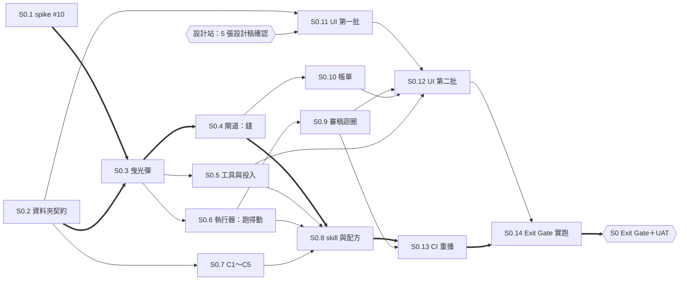

# S0 開發排程計畫（WBS 與 DAG）— Evidence Forge

> **版本：** v0.1 | **日期：** 2026-10-11 | **狀態：** 草案，待創作者確認
> 依 `docs/templates/vibecoding/16_wbs_development_plan_template.md` 的結構裁剪，加上依賴圖（DAG）。這份就是 `.claude/skills/PIPELINE.md` 說的「排程計畫」。
> **取代：** `2026-10-10-development-plan.md`（R0～R3，舊設計，保留不改）。
> **上游：** 階段與 Exit Gate → `00-intent/roadmap.md`（S0～S4）；需求 → `10-truth/requirements/prd.md` v2.0；決策 → ADR-0009～0016；元件與資料格式 → `2026-10-10-architecture-draft-v0.3.md`
> **下游：** 進度 → `20-state/progress.md`；開票之後，票與依賴的家是 GitHub issue。
>
> 只拆 S0。S1～S3 等 S0 的 Exit Gate 過了、有實測數字再拆。#10（S0.1 spike）的結論如果推翻 v0.3 的假設，就寫一份新日期的計畫，不改這份。

---

## 1. 為什麼這樣切

S0 要回答的只有一件事：**「Pi＋本機 Qwen＋skill」能不能把一篇別人的文章變成能用的二創稿，花多少錢**（`roadmap.md` S0）。所以切法照兩條原則：

1. **先打穿，再加寬。** 第一張實作票（S0.3）是曳光彈：貼一段文字 → 開工作單 → 一段 Pi 經過閘道打本機 Qwen → 進待審。整條路先通，每個元件都只做最薄的一層；後面的票各自把一個元件加厚。這樣任何一張票卡住，都不會讓其他元件的介面白做。
2. **錢與安全的地基比較貴。** 閘道（預算、帳本、金鑰、SSRF）與自動檢查（C1～C5，取代原本的人工關卡）錯了不會當場紅，是在某份稿子或某張帳單上出事，所以列 T3，由你合併、加 Codex 交叉審查。

## 2. 專案總覽

| 項目 | 內容 |
| :--- | :--- |
| 範圍 | S0 實驗：核心迴路＋簡易 UI（`roadmap.md` S0 的交付欄） |
| 時程 | roadmap 建議第 1～2 週；**不估工時**，S0 跑完用帳本實際數字再估 S1 |
| 角色 | 創作者：拍板、設計站確認、UAT、T3／T4 合併、提供範本與 5 篇電子報。Product session：計畫、開票、派票、T1／T2 合併。系統架構 session：spike、審 PR 是否違反 ADR。視覺設計 session：UI 設計稿。子代理：實作（格 1～3） |
| 里程碑 | 一個：**S0 Exit Gate**（GitHub milestone「S0 實驗」）。過了由你做一次 UAT，沒過不進 S1 |

## 3. 工作方式設定

規則本身在工作方法文件裡，這裡只寫這個專案要填的值。

| 主題 | 規則在哪 | S0 的設定 |
| :--- | :--- | :--- |
| PR 分級 | 家規第 39 條、`guard-git.sh` | 依路徑判定；`human-only-paths.conf` 照 §3.1 換成新設計的路徑 |
| 誰按合併 | `PIPELINE.md`〈審查與合併〉 | T1／T2：檢查全綠後 Product 合併。T3／T4、刪檔的 PR：你按 |
| 誰實作、誰審 | 家規第 43 條；`relay.md`「開發班派票，審查班只審不派」 | 實作由 Product 派子代理；系統架構審 T3 有沒有違反 ADR，**不審自己寫的程式**。例外：#10 spike 由系統架構本人做（技術判斷，不合併程式） |
| Worktree | `PIPELINE.md`、L-006、L-017、L-019 | 會產生 commit 的票一律開在 `.claude/worktrees/<票>-<短名>`；**同時最多 2 條跑測試的線，主 session 算一條** |
| 派模型 | `Ai-coding-principle/MODEL-ROUTING.md` | 起始格寫在 §4；每張票結束時記帳本一列 |
| Codex 交叉審查 | `PIPELINE.md` 第 33～35 行 | 只審 T3；只報必修、最多 5 條、最多 2 輪 |
| 測試花費 | NFR-COST-06 | 自動化測試一律用閘道的重播模式；真的打付費 API 只在 S0.14 手動觸發 |

### 3.1 `human-only-paths.conf` 換成新設計的路徑

舊清單是照 v0.2（PostgreSQL、Celery、定題 Gate）寫的，大半已經沒有對應的東西；新設計裡真正「錯了會花錢、洩密或放過捏造」的地方換了位置。改這份檔本身是 T3，跟這份計畫放在同一顆 PR，由你一起按。

| 動作 | 樣式 | 理由 |
| :--- | :--- | :--- |
| 新增 | `src/evidence_forge/gateway/*` | 唯一會花錢、對外連線、拿得到雲端金鑰的地方（ADR-0011、NFR-SEC-04） |
| 新增 | `src/evidence_forge/checks/*` | C1～C5 硬檢查，取代了人工關卡；放過捏造引句或照抄不會當場紅（PRD §7） |
| 新增 | `harness/pi/*` | agent 能用哪些工具、有沒有 shell，全由這裡決定（NFR-SEC-02） |
| 新增 | `*ledger*` | 帳本只增不改、只有閘道寫（NFR-KEEP-02） |
| 新增 | `*secret*` | 帳號授權與金鑰的讀取（NFR-SEC-01） |
| 保留 | `*budget*`、`*cost*`、`*url_guard*`、`*ssrf*`、`*publish*`、`*site_draft*`、`compose.yaml`、`docker-compose*.yml` | 預算、SSRF、對外發布仍在；Ollama 用 Docker 跑，compose 檔仍是部署設定 |
| 移除 | `src/evidence_forge/domain/*`、`*/migrations/*`、`*operation_log*`、`*idempot*`、`*artifact*`、`*limiter*`、`*reconcil*`、`*gate*` | 對應的元件已由 ADR-0009、ADR-0010 取代；留著只會誤擋（例如 `*gate*` 會擋到 `gateway/` 以外的無關檔名） |

## 4. 工作包（WBS）

**編號**：`S0.n`，開票後對應 GitHub issue `#nn`。只有這一套。

**欄位**：等級＝預計的 PR 分級；起始格＝1 Sonnet high、2 Opus high、3 Opus xhigh；人＝HITL 需要你在場、AFK 子代理自己做完；依賴＝要等哪些合併。

| 工作包 | 交付 | 需求 | 等級 | 起始格 | 人 | 依賴 |
| :--- | :--- | :--- | :---: | :---: | :---: | :--- |
| S0.1 | **spike**（#10）：Pi 1.1.0 的 `--api-key` 透傳、自訂服務商、ef-tools 註冊、上層 CLAUDE.md 隔離、JSON 事件、Ollama＋Qwen 實測 | ADR-0009、0011；v0.3 §12 | T1 | 系統架構本人 | AFK | — |
| S0.2 | **資料夾契約**：`EF_DATA` 路徑解析；`job.md` frontmatter、配方 frontmatter、`item.json`、`events.jsonl`、`decision.vN.json`、帳本一筆的 Pydantic 模型；只增不改的寫檔工具（已存在就拒絕）；`CONTEXT.md` 補新詞 | NFR-RUN-02、NFR-KEEP-01、02；ADR-0010、0014 | T2 | 2 | AFK | — |
| S0.3 | **曳光彈**：`ef serve` 常駐程序（執行器＋閘道最薄一層）；`ef new --text` 開單；一份只有一段的測試配方；執行器開 Pi → 閘道轉送到 Ollama → ef-tools 的 `read_file`／`write_file`（限工作單資料夾）→ 進待審；錄下回應供重播 | FR-RC-01、NFR-SEC-02；ADR-0009、0010 | T3 | 2 | AFK | S0.1、S0.2 |
| S0.4 | **閘道加厚：錢**：Anthropic 後端（串流）、別名對照 `models.yaml`、價目表、預算預留與結算、帳本 `ledger.jsonl`、`blobs/` 請求快取與重播模式、GPU 旗號與 `queue_ms`、429 退避 | FR-MD-01、FR-LG-01、NFR-COST-01、02、06、NFR-PAR-02、03、NFR-OBS-01 | T3 | 2 | AFK | S0.3 |
| S0.5 | **工具與手動投入**：`fetch_url`（擋內網、尊重 robots 與付費牆、快取）、`run_script`（只准 skill 自己的腳本）；手動投入網址／文字／檔案（MD、純文字、PDF）寫進 `inbox/manual/` 並開單 | FR-IN-01、NFR-SEC-03、NFR-RUN-08、NFR-COST-03 | T3 | 2 | AFK | S0.3 |
| S0.6 | **執行器加厚：跑得動**：schema 驗證、重試與升級、基礎設施故障不升級、`auto_fix` 回二創段、重啟後從所在段重跑、同時張數上限、開跑前檢查、版本鎖在產出上、Pi 事件 → `job.md` 進度欄位 | NFR-RUN-01～06、NFR-PAR-01、NFR-OBS-02 | T2 | 2 | AFK | S0.3 |
| S0.7 | **自動檢查 C1～C5**（程式判斷）＋ C6、C7 的呼叫介面（結果只提醒、不擋） | FR-VF-01；PRD §7 | T3 | 2 | AFK | S0.2 |
| S0.8 | **skill 與配方**：`digest`（先判文類，依 `harness/genres/` 抽取；逐字引句）、`compose`（文類骨架＋作家聲音＋文類風格；未校準標示）、`verify`（呼叫 S0.7）、配方 `restructure`（S0 先三段）；執行器開段時把文類定義與作家設定複製進 `input/` | FR-DG-01、02、FR-CP-01～03；ADR-0015 | T2 | 2 | AFK | S0.4、S0.5、S0.6、S0.7 |
| S0.9 | **審稿迴圈**：執行器套用 `review/decision.vN.json`：通過、退件（意見＋重跑段，上游沿用）、丟棄、失敗重試、通過後再改；稿子永遠是新版本 | FR-RV-01、02、NFR-COST-04 | T2 | 1 | AFK | S0.6 |
| S0.10 | **帳單**：每張單的 `bill.md`（每段花費、模型、升級、退件多花的、時間）；每月總表；每篇通過文章的平均成本 | FR-LG-02 | T3（`*cost*`） | 1 | AFK | S0.4 |
| S0.11 | **UI 第一批**：FastAPI＋Jinja2＋HTMX 骨架、ADR-0007 token、看板（五欄、進度、在等什麼、花費、自動更新）、工作單詳情（六個分頁） | FR-UI-01、NFR-OBS-02 | T2 | 1 | **HITL**（設計站） | S0.2、設計稿確認 |
| S0.12 | **UI 第二批**：審稿動作（寫 `decision.vN.json`）、新增工作單表單（寫 `inbox/manual/`）、帳單頁 | FR-UI-01、FR-RV-01、FR-IN-01 | T2 | 1 | **HITL**（設計站） | S0.11、S0.9、S0.10、S0.5 |
| S0.13 | **CI 重播整條流程**：固定小案例＋錄好的回應，從投入跑到待審；CI 加這一步 | NFR-RUN-07、NFR-COST-06 | **T4**（改 CI） | 2 | AFK | S0.8、S0.9 |
| S0.14 | **Exit Gate 實跑**：5 篇真實電子報跑出稿子；退件 → 重跑 → v2；中途殺掉程序再重跑不重付；C1 捏造引句為 0；實測成本寫回 `brief.md` §5.1 | `roadmap.md` S0 Exit Gate | T1 | — | **HITL** | S0.12、S0.13 |

**S0 不做的**（PRD 標了 S0、但依賴後面階段的部分）：FR-RV-01 的「引用素材逐件核准」要等素材（FR-AS-01、02，S3）才有東西可核准，S0 的審稿畫面先不放這一塊（Q-24）。

## 5. 依賴圖（DAG）

粗線是關鍵路徑：這條線上任何一張延誤，Exit Gate 就延誤。

**關鍵路徑**：S0.1／S0.2 → S0.3 → S0.4 → S0.8 → S0.13 → S0.14 → Exit Gate

## 6. 波次與停點

一波＝同時派出去的一組票。**每波最多 2 張會跑測試的票**（repo 在 `/mnt/d`，主 session 算一條）。spike 與設計稿不佔測試線。

| 波 | 票 | 開工前的停點 | 結束後 |
| :--- | :--- | :--- | :--- |
| 1 | S0.1（系統架構）、S0.2 | 派工前的資源盤點 | — |
| 1′ | 設計站：IA → 視覺設計畫 5 張設計稿（4 頁，詳情頁分執行中與待審兩張） → 你確認 | 不佔測試線，跟第 1～3 波並行 | — |
| 2 | S0.3（單獨一波） | 照 #10 結論調整 S0.3 的票 | **接縫站**：貼文字 → 開單 → 跑完 → 待審，含中途殺掉 `ef serve` 再重開 |
| 3 | S0.4、S0.7 | — | — |
| 4 | S0.5、S0.6 | — | — |
| 5 | S0.8、S0.11 | S0.11 要設計站已確認 | — |
| 6 | S0.9、S0.10 | — | **鞏固站**（到這裡約合併 10 顆 PR） |
| 7 | S0.12、S0.13 | S0.12 要設計站已確認；**接縫站**：看板 → 詳情 → 退件 → 重跑 → v2 | — |
| 8 | S0.14（你在場） | 你準備好 5 篇電子報、作家設定、Anthropic 金鑰 | **鞏固站＋S0 UAT** |

鞏固站另外照 `PIPELINE.md`〈鞏固站〉的觸發條件提早停。

## 7. 開工前要準備好的事

| 項目 | 什麼時候要 | 誰 | 現況 |
| :--- | :--- | :--- | :--- |
| `human-only-paths.conf` 換新路徑（§3.1） | 第 1 波之前 | 你按合併（跟這份計畫同一顆 PR） | 這顆 PR 裡 |
| Ollama＋`qwen3.5:9b` 起來 | 第 2 波之前 | 系統架構（#10） | 進行中 |
| 作家設定：`voice.md`＋至少 1 份文類風格（`$EF_DATA/authors/<你>/`，範本在 `harness/templates/`） | 第 5 波（S0.8）之前 | 你 | 還沒有 |
| Anthropic API 金鑰（`~/.config/evidence-forge/secrets/anthropic`） | 第 3 波（S0.4）的手動驗證；S0.14 一定要 | 你 | 還沒存。S0.4 之前可以先用本機 Qwen 加假模型 |
| 5 篇真實電子報 | 第 8 波 | 你 | 還沒挑 |
| GitHub milestone「S0 實驗」 | 開票時 | Product | 待這份計畫確認後建 |

開票順序照 `PIPELINE.md`：你下 `/to-spec`（S0 收成一張規格）→ `/test-blueprint` → `/uat-cases` → `/to-tickets`。開票時等級、起始格、HITL／AFK 照 §4 填，依賴照 §5 掛 `blocked_by`。#10 已先開，因為它不依賴規格、而且擋住 S0.3。

## 8. 風險

| 風險 | 影響 | 對策 |
| :--- | :--- | :--- |
| #10 推翻 `--api-key` 透傳或 ef-tools 的假設 | S0.3、S0.4 的介面要改 | 曳光彈排在 spike 之後；推翻就寫新日期的計畫 |
| Qwen 9B 整理品質不夠，S0.14 跑不出能用的稿子 | Exit Gate 過不了 | 配方把 `digest` 改成 `strong` 只改一行（PRD §10）；S0.14 允許兩種配方各跑一次比較 |
| 作家設定晚到 | S0.8 只能用「未校準」寫，稿子不像你 | S0.8 先用未校準跑通，範本到了再補 |
| 慢檔案系統讓並行變慢 | 波次拖長、檢查卡死 | 每波最多 2 條測試線；`EF_DATA` 測試資料放在 WSL 原生路徑 |
| T3 票多（S0.3、0.4、0.5、0.7、0.10） | 你要按很多次合併 | 刻意的：這幾張是錢、安全與防捏造的地基 |
