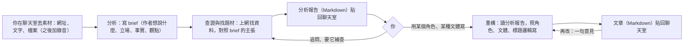

# 改版規劃：從「自動產線＋待審」改成「聊天室：先分析，再重構」

> **日期：** 2026-10-13 | **狀態：** 草案，等創作者確認 | **取代的方向：** PRD v2.0 的產線定位、ADR-0013「給目標就自動做完，人只審結果」
> **為什麼放在 `30-snapshot/`：** 這是一次改版的規劃，確認後拆成 ADR、PRD v3.0、`CONTEXT.md` 與路線圖的修改；這份之後只留作紀錄，不再改。

## 1. 為什麼要改

**2026-10-12 用 ihower 的六篇文章跑完整條流程後，創作者判斷產品方向錯了。** 證據與判斷：

1. **逐句拆解是在錯的地方下功夫。** 整理段把文章拆成一條條主張，每條都附逐字引句，用 C1 比對原文。在本機 9b 上，六篇全部卡在這一段（JSON 壞掉、用「…」拼接引句），升級到 strong 才過。但創作者要的不是逐句清單，而是**讀懂作者整篇想說什麼**：他的論點、立場、用了哪些事實、哪些只是觀點。
2. **稿後檢查在檢查錯的東西。** C2 要求每句事實句都掛引用編號，C3 比逐字重疊，計畫中的 C6、C7 要逐句判斷來源撐不撐得住。創作者的看法：文章最終是觀點的闡述，要看整體，不逐句計較。有疑慮的地方**在寫之前查清楚、寫成報告給人看**就好，不必在稿子裡標註，也不必在稿子寫完後再檢查一輪。
3. **工單不是重點。** 工單、看板、通過／退件／丟棄，是為「無人看管自動跑完」設計的。創作者實際想要的是**像 ChatGPT 那樣的聊天室**：丟文章、錄音或檔案進去，系統自己分析，給一份研究題材的報告；看完之後，再叫它用設定好的角色、文體重構。工單只是每次對話的累積，可以是一個對話、一個上傳的地方。
4. **長期目標是知識體系。** 一篇篇分析累積下來，要能慢慢長成一套技術基本功的知識體系。這一點決定了分析報告要好查、可以累積，不能只是一次性的中間產物。

舊版（v1，2026-10-10）也有中途停下等人的設計，那次被否決是因為停點是**固定的表單關卡**（選研究問題、定題），整條流程被綁死。這次的停點是**對話**：分析報告出來之後，你可以追問、要它換個方向查，或直接叫它寫；不想停，也可以一句話叫它分析完直接寫。

## 2. 新的樣子

**一句話：** 一個聊天室。丟素材進去，它讀懂作者、查證、找可以借題發揮的題材，交一份分析報告；你看完，叫它用你的角色和文體重構成一篇新文章。

| | 舊版（PRD v2.0） | 新版 |
| :--- | :--- | :--- |
| 主畫面 | 看板：排隊、執行中、待審、通過、丟棄 | 聊天室：左邊是對話清單，中間是對話，右邊看報告、文章與花費 |
| 人什麼時候出手 | 只在最後審稿 | 看分析報告的時候（可以追問、補查、決定要不要寫），以及看文章的時候 |
| 讀文章的方式 | 逐句拆成主張＋逐字引句（`claims.json`） | 寫一份 brief：整篇的論點、立場、事實與觀點，用自己的話寫 |
| 查證放在哪 | 稿子寫完之後（C2～C7） | 寫稿之前，針對 brief 的主張上網查；結果寫進分析報告 |
| 有疑慮的說法 | 稿子裡每句事實掛引用編號 | 只寫在分析報告裡給你看，稿子不標 |
| 稿子寫完後 | C2～C5 沒過自動修，再進待審 | 直接交給你看；要改就在聊天室說一句 |
| 產出 | 二創稿 | 分析報告（每份都留著，之後累積成知識庫）＋文章 |

## 3. 兩條配方

執行器、配方、skill、閘道的做法都不變（ADR-0009～0011）；變的是配方的內容與 skill。

### 3.1 分析（`analyze`）

| 段 | skill | 等級 | 產出 | 做什麼 |
| :--- | :--- | :--- | :--- | :--- |
| brief | `brief` | `local`，失敗升級 `strong`（`escalate_to`） | `brief.md` | 讀懂整篇：作者想表達什麼、立場、用了哪些事實與數據、哪些是觀點、文章屬於哪一種文類、可以往哪些方向延伸。用自己的話寫，不逐句抄引句 |
| 查證與找題材 | `investigate` | `strong`，有 Tavily 額度 | `report.md`、`sources.json` | 對 brief 裡關鍵的事實主張上網查：有佐證、有爭議、查不到、過時；順便找可以借題發揮的相關文章。交一份完整的分析報告 |

**分析報告（`report.md`）的幾節**，固定標題，方便之後累積成知識庫：

1. 作者在說什麼：一段話講核心論點與立場。
2. 事實與觀點：作者用來撐論點的事實、數據與觀點，各一句說明。
3. 查證：查過的主張與結果；**有疑慮的放最前面**，每一條附找到的來源。
4. 研究題材：可以借題發揮的方向，每個附一兩篇找到的相關文章與它們補了什麼。
5. 來源清單：原文與每份補充來源的標題、網址、抓取時間。

報告的格式只用程式檢查「這五節都在、來源網址都是這一段真的抓過的」，不用模型檢查。

### 3.2 重構（`rewrite`）

| 段 | skill | 等級 | 產出 | 做什麼 |
| :--- | :--- | :--- | :--- | :--- |
| 重構 | `rewrite` | `strong` | `article.md` | 讀分析報告與補充來源，照你指定的角色、文體骨架、作家聲音、標題邏輯寫一篇新文章。結尾附參考來源清單，必定列原文出處 |

- **重構不讀原文全文**，只讀分析報告與補充來源的正文。逐字照抄原文的可能從結構上就消失了，所以不需要 C3 擋。重疊率仍由程式算出來、顯示在畫面上，只當參考，不擋。
- 文章裡不掛逐句引用編號，也不標哪一句有疑慮（創作者 2026-10-13 的決定）。
- 要再改：在聊天室說一句，重構段帶著這句意見再跑一次，產生新版本，舊版不覆寫（沿用 FR-RV-02）。

## 4. 聊天室怎麼接到底層

**做法：每個對話是一個 Pi 的 RPC 程序**（Pi 文件 `docs/rpc.md`、`docs/sessions.md`）。瀏覽器的訊息送給 Pi，Pi 的事件串流回瀏覽器。Pi 在對話裡能用的工具是 ef-tools 新加的幾個：

| 工具 | 做什麼 |
| :--- | :--- |
| `analyze` | 拿你這輪丟的素材開一次分析（照 `analyze` 配方），跑完把報告貼回對話 |
| `rewrite` | 拿某份分析報告，用指定的角色、文體、一句目標開一次重構 |
| `read_report`、`read_article` | 讀這個對話已經產出的報告與文章，用來回答你的追問 |
| `list_personas` | 列出你設定好的角色與文體，讓它照你的話選對的那個 |

- 真正跑分析、重構的還是**執行器照配方開的段**，跟現在一樣有預算、帳本、重試、升級、當機重跑不重付。聊天的 Pi 只負責聽懂你要什麼、開工、把結果帶回來。
- 一次分析或重構在資料夾裡還是一張工單（ADR-0010 的資料夾狀態不變），只是你在畫面上看到的是對話，不是工單。
- 對話本身的模型呼叫也走閘道、記帳；對話預設用 `strong`。
- **這是最大的未知**：Pi 的 RPC 模式能不能長時間開著、串流到瀏覽器、在工具裡等一段跑完。要先做一次 spike 才定案（見 §7 的 P2）。

## 5. 拿掉、保留、新增

**拿掉**

- 整理段的逐句主張與逐字引句（`digest` skill、`claims.json`、C1）。
- 稿後硬檢查 C2（每句事實掛引用編號）、C3 的擋下（改成只顯示）、C4 的最小版、計畫中的 C6、C7（#62）。
- 待審狀態與審稿決定（通過、退件、丟棄、決定檔、執行器套用決定），以及看板。

**保留（已經做好、直接沿用）**

- 執行器：配方、段、嘗試、`escalate_to` 升級、寫一次的段輸入（#64）、版本紀錄、事件紀錄。
- 閘道：等級對照、預算預留與結算、快取、重播、帳本、本機 GPU 一次一個。
- Tavily 搜尋與抓網頁（#71）、來源放置與擋種子（#72）。
- 文類定義（12 種）、作家聲音與文類風格（ADR-0015）。
- 帳單（#27）。

**新增**

- `brief`、`investigate`、`rewrite` 三個 skill，`analyze`、`rewrite` 兩份配方。
- 對話（Pi RPC 程序＋對話資料夾）、ef-tools 的對話工具。
- 聊天室 UI：對話清單、對話串流、上傳、右側報告與文章面板、花費。
- 之後：知識庫、錄音轉文字。

## 6. 知識庫（之後做，但現在就照它的需要留資料）

目標：每份分析報告都變成知識體系的一塊。之後的分析先查舊知識，查過的主張不重查；你可以依主題瀏覽「這個概念各家怎麼說、哪些查證過、哪些還有爭議」。

這次先做到兩件事，讓之後做得起來：

1. 分析報告的五節標題固定，`sources.json` 有網址與抓取時間。
2. 每份報告記下它的主題標籤（由 `brief` 段給）。

知識庫本身（跨對話的索引、主題頁、先查舊知識）放到 P4，等分析報告實際累積十幾份、看得出該怎麼分類時再設計。

## 7. 階段

先證明「新流程寫得出好東西」，再換介面。這次 E2E 學到的是：**內容品質才是最大的未知**，UI 改得再好，報告和文章不行也沒用。

| 階段 | 交付 | 怎麼算過關 |
| :--- | :--- | :--- |
| **P0 決策與文件** | ADR-0019（聊天室與分兩步，取代 ADR-0013）、ADR-0020（分析報告取代逐句拆解與稿後檢查，修正 ADR-0015 的轉換說法與 PRD §7）、PRD v3.0、`brief.md` v3、`CONTEXT.md`、路線圖、票的整理 | 創作者確認 |
| **P1 分析配方** | `brief`、`investigate` skill，`analyze` 配方，CLI 跑得動（`ef new --recipe analyze`），錄一份重播給 CI | ihower 六篇的分析報告，創作者讀完覺得「讀懂了作者、查證有用、題材值得寫」；每份花費記下來 |
| **P1b 重構配方**（緊接 P1） | `rewrite` skill，`rewrite` 配方；CLI 可以指定分析報告、角色、文體 | 用 P1 的報告寫出六篇，創作者覺得像自己寫的、不是原文的改寫 |
| **P2 對話 spike**（可跟 P1 並行） | Pi RPC 開著一個對話、用 `analyze` 工具開一段、等它跑完、把結果貼回；事件串流到一個最小網頁 | 一次對話從丟網址到拿到報告；中途關掉瀏覽器再打開，對話還在 |
| **P3 聊天室 UI** | 取代看板與工單詳情：對話清單、串流、上傳（網址、文字、Markdown、PDF）、右側報告與文章、花費；帳單頁保留 | 創作者在瀏覽器裡完整走一次：丟文章 → 讀報告 → 追問 → 叫它寫 → 再改一次 |
| **P4 知識庫** | 跨對話的索引、主題頁、分析前先查舊知識 | 另訂（等報告累積後再設計） |
| **Later** | 錄音轉文字、訂閱源自動投入（原 S2 膠水層）、評估（原 S1） | 依需要 |

P1、P1b 只動 skill 與配方，不改執行器與閘道，應該是 T1、T2 的票；P2、P3 會碰閘道的工作鑰匙（對話不是一段，鑰匙的有效範圍要重新定義），是 T3，由創作者合併。

## 8. 現有的票怎麼處理

| 票 | 處理 |
| :--- | :--- |
| #77 整理段升級與引句規則 | 關閉：`digest` 不再用 |
| #62 verify（C6、C7） | 關閉：查證移到寫稿之前 |
| #26 套用審稿決定、#29 審稿動作與新增工單、#48 詳情頁補完 | 關閉：看板與待審由聊天室取代；#29 的帳單頁部分併入 P3 |
| #31 S0 Exit Gate、#18 S0 規格 | 改寫成新階段的過關條件 |
| #65 已校準由執行器判斷、#68 `ef new` 預設配方 | 改寫：預設配方改成 `analyze`；已校準的判斷搬到 `rewrite` |
| #75 補料段收尾缺口 | 保留：`investigate` 照樣用搜尋與來源放置，這些缺口都還在 |
| #74 agent 讀得到執行器的檔、#56 抓網頁總時間上限、#61 開跑前檢查 | 保留 |
| #73 補料段改回本機 | 保留，改成 `investigate` |
| #27 帳單、#30 CI 重播 | 保留，CI 改跑 `analyze` 與 `rewrite` |
| #49、#51 開發流程 | 不受影響 |

## 9. 花費預估

照 2026-10-12 的實測（整理＋補料＋二創每篇 US$0.43～0.90）粗估，P1 實測後更新：

- 分析：brief 在本機 US$0，升級到 strong 約 US$0.05～0.15；查證與找題材約 US$0.2～0.4，加 4～8 個 Tavily credits。
- 重構：約 US$0.15～0.3；再改一次約同價。
- 對話本身：每輪 strong 一次，看長度，約 US$0.01～0.05。

## 10. 還沒決定的事

1. **「金句標題的邏輯」**（2026-10-13 創作者回覆）：之前沒有寫下來；`data/authors/me/voice.md` 只有「小標直接寫成問題或結論」一條。改成先研究國內外寫手與編輯怎麼做標題與金句的轉換（含創作者點名的周家恩），整理成一份跨角色共用的規則，放 `harness/`，由 `rewrite` skill 載入；各角色自己的偏好仍寫在自己的聲音裡。研究結果與來源附在 P1b 的票上。
2. **角色**（2026-10-13 創作者回覆）：一個角色就是一種說話方式的 DNA，可以是創作者自己（`me`），也可以是其他作者。每個角色一個資料夾 `data/authors/<角色>/`，裡面是聲音（`voice.md`）與各文類風格（`genres/`），就是 ADR-0015 現有的作家結構，不新增格式；`list_personas` 列的就是這些資料夾。
3. **一個對話放幾篇素材。** 一篇一個對話最簡單；同一個對話丟好幾篇、叫它綜合，報告與重構都要改成多份種子。建議 P1 先一篇一個對話。
4. **查證要查多少條。** 建議只查 brief 標為「關鍵」的事實主張，每篇 3～6 條，Tavily 額度上限沿用每篇 12。
5. **舊的工單與看板程式碼**：直接刪，還是留著到 P3 完成？建議留到 P3，聊天室上線後一次刪。
