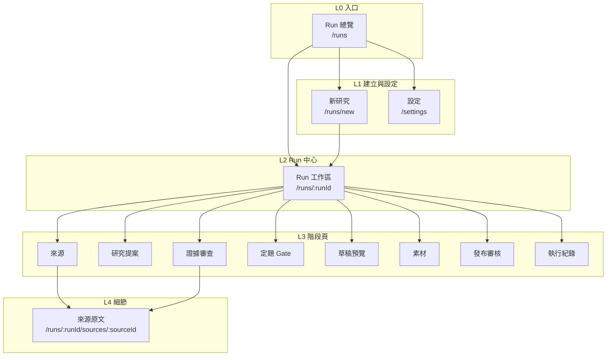
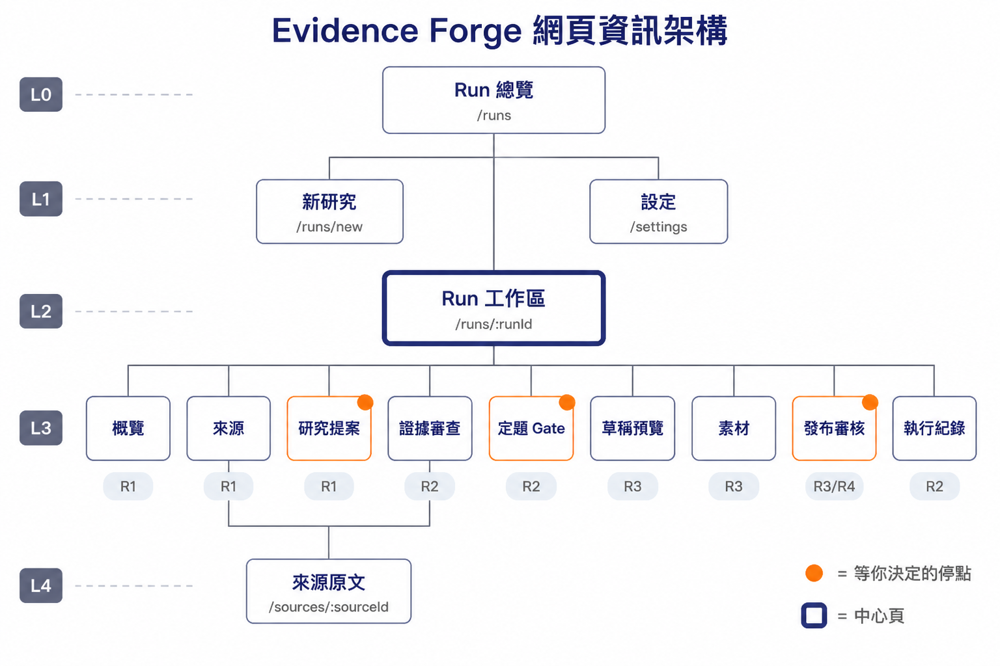
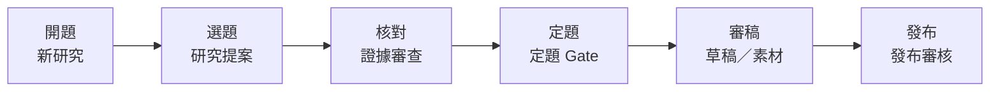

# 前端資訊架構草案 — Evidence-led Editorial Studio

> **版本：** v0.1 | **日期：** 2026-10-10 | **狀態：** 草案，待創作者確認
> 依 `docs/templates/vibecoding/17_frontend_information_architecture_template.md`（v2.0）撰寫，章節編號照範本。
> **上游：** `2026-10-10-ux-persona-journey.md`（persona、旅程、五條設計原則）、`10-truth/requirements/prd.md`（v1.2）
> **相關：** 前端技術 → `2026-10-10-frontend-architecture-draft.md`（範本 12）
>
> **邊界**：這份只談使用者與內容視角（頁面、旅程、導航、URL、跨頁資料）。框架、效能數字、無障礙標準、元件分層在範本 12 那份。
> 依 `docs/README.md`，規劃階段的內容留在 `30-snapshot/plans/`；哪一頁做出來，就跟那段程式一起寫進 `10-truth/`。

---

## 1. 目的與範圍

**目的**：定義 Web UI 有哪些頁面、每頁負責什麼、創作者怎麼在頁面之間移動，作為設計稿與實作票的共同依據。

| 範圍 | 說明 |
| :--- | :--- |
| **包含** | 頁面職責、旅程對應、導航、URL 與路由、跨頁資料、每頁的四種狀態（載入／空／錯誤／成功） |
| **不包含** | 視覺細節（在設計稿）、元件與 token（範本 12 §3）、後端 API 形狀（架構草案）、CLI 指令 |

**和 PRD 畫面編號的對應**：PRD §2 的 01～06 六個畫面都在這份裡，另外補了五個 PRD 沒列、但旅程需要的頁面（Run 總覽、Run 工作區、來源、素材、執行紀錄）與一個設定頁。

---

## 2. 設計原則

**核心價值主張**：「每句話都找得到出處，立場由我決定。」

| 原則 | 說明 |
| :--- | :--- |
| 簡化 | 保留：研究流程的四個停點與證據核對／移除：多使用者、權限、團隊協作、全文編輯器（草稿在自己的編輯器裡改）／專注：讓創作者在停點做出有根據的決定 |
| 認知負荷 | 每頁一個主要目標。Run 工作區的概覽只回答「現在在哪一步、要我做什麼」，細節在各階段頁 |
| 一致性 | 階段導覽列固定在 Run 工作區頂端，位置與順序永遠一樣；主張、來源、素材的標記在每頁長得一樣（原則：狀態不只用顏色） |
| 架構模式 | **混合：中心輻射＋層級**。中心是 Run 工作區，輻射出各階段頁；Run 總覽 → Run → 階段 → 來源原文是層級 |
| 漸進揭露 | 還沒到的階段在導覽列顯示但不能點，寫「還沒到這一步」；執行紀錄的節點細節預設收合 |

**一頁一個主要動作的例外**：定題 Gate 與發布審核的「核准／否決」是一組決定，兩個按鈕同等份量（原則：決定不催促）。這是刻意的，不是違反原則。

---

## 3. 資訊架構總覽

### 系統層次結構



### 樹狀結構

橘色是等創作者做決定的停點，粗框是中心頁；每個階段頁下方標的是它在哪一個 roadmap 階段做出來。圖是 Q-01 定案前畫的，圖上的 R1 現在都改成 R2（以下方文字樹為準）。



```text
Run 總覽  /runs                                   L0
├── 新研究  /runs/new                             L1
├── 設定  /settings                               L1
└── Run 工作區  /runs/:runId                      L2（中心頁）
    ├── 概覽                                      L3  R2
    ├── 來源  /sources                            L3  R2
    │   └── 來源原文  /sources/:sourceId          L4  R2
    ├── 研究提案  /proposal          ● 停點：選題  L3  R2
    ├── 證據審查  /evidence                       L3  R2
    │   └── （同上）來源原文                       L4
    ├── 定題 Gate  /gate             ● 停點：定題  L3  R2
    ├── 草稿預覽  /draft                          L3  R3
    ├── 素材  /assets                             L3  R3
    ├── 發布審核  /publish           ● 停點：發布  L3  R3／R4
    └── 執行紀錄  /trace                          L3  R2
```

### 頁面總覽

| 路由 | 頁面 | 主要職責 | 創作者的目標 | 層級 | PRD 畫面 | 階段 |
| :--- | :--- | :--- | :--- | :--- | :--- | :--- |
| `/runs` | Run 總覽 | 列出所有 Run，等人處理的排最前面 | 一眼看出哪個 Run 在等我 | L0 | — | R2 |
| `/runs/new` | 新研究 | 貼 URL、設定範圍與預算、通過開跑前檢查 | 快點開始 | L1 | 01 | R2 |
| `/settings` | 設定 | 預設預算、預設語言與讀者、系統檢查 | 設一次就不用每次填 | L1 | — | R2 |
| `/runs/:runId` | Run 工作區 | 這個 Run 在哪一步、要我做什麼、花了多少 | 知道下一步 | L2 | — | R2 |
| `/runs/:runId/sources` | 來源 | 種子文章與引用來源清單、狀態、引用鏈 | 確認來源齊全 | L3 | — | R2 |
| `/runs/:runId/sources/:sourceId` | 來源原文 | 擷取當時存下的原文，標出被引用的段落 | 自己核對原文 | L4 | — | R2 |
| `/runs/:runId/proposal` | 研究提案 | 候選問題比較、選題或改寫 | 挑一個值得寫的切角 | L3 | 02 | R2 |
| `/runs/:runId/evidence` | 證據審查 | 證據矩陣、補搜紀錄、未驗證主張 | 確認論點撐得住 | L3 | 03 | R2 |
| `/runs/:runId/gate` | 定題 Gate | 核准、改寫或否決論點，寫下自己的觀點 | 決定立場 | L3 | 04 | R2 |
| `/runs/:runId/draft` | 草稿預覽 | 大綱與文章的本機預覽，引用可點回證據 | 讀起來像我會寫的文章 | L3 | 05 | R3 |
| `/runs/:runId/assets` | 素材 | 每張圖的出處、授權、使用狀態，核准或排除 | 只用能用的圖 | L3 | 05 | R3 |
| `/runs/:runId/publish` | 發布審核 | 擋下發布的原因清單、匯出內容包、送網站草稿預覽 | 放心掛名 | L3 | 06 | R3（匯出）／R4（送網站） |
| `/runs/:runId/trace` | 執行紀錄 | 每個節點的耗時、模型、prompt 版本、費用、快取命中 | 知道錢花在哪 | L3 | — | R2 |

**總計：** 13 頁（另有 404 與錯誤頁）

> 「階段」欄依 `00-intent/roadmap.md`。R1 只有 CLI，網頁從 R2 開始（Q-01、Q-15 已決）。

---

## 4. 核心使用者旅程

### 主要旅程



### 旅程映射表

單人工具沒有「轉換率」，改成追蹤每個停點**有沒有完成、花多久**。目標值是 R2～R5 要驗證的門檻，數字依據在 `2026-10-10-ux-persona-journey.md` §4。

| 階段 | 頁面 | 創作者的心理 | 設計目標 | 主要動作 | 追蹤的業務動作 | 目標 |
| :--- | :--- | :--- | :--- | :--- | :--- | :--- |
| 開題 | 新研究 | 想快點開始；擔心花太多 | 一頁填完；預算有參考值 | 開始研究 | `run.created`、`preflight.failed`（含哪一項） | 檢查失敗都說得出是哪一項：100% |
| 選題 | 研究提案 | 想要不是老調的切角 | 候選問題並排比較 | 用這題開始研究 | `question.selected`、`question.edited` | 記錄改寫比例（驗證選題停點的必要性） |
| 核對 | 證據審查 | 不信任 AI 的結論 | 核對一條主張不超過一次點擊 | 前往定題 | `claim.source_opened` | 每個 Run 至少開過一次原文（確認有人核對） |
| 定題 | 定題 Gate | 這是我的立場嗎 | 原作者立場、建議論點、競爭假說並列 | 核准／否決 | `gate.approved`、`gate.edited`、`gate.rejected` | 每篇都能改選觀點（brief §4） |
| 審稿 | 草稿預覽、素材 | 讀起來像不像我寫的 | 引用可點回證據；授權當下可見 | 前往發布審核 | `asset.approved`、`asset.excluded` | 授權不明的素材被公開：0 件（brief §4） |
| 發布 | 發布審核 | 放心掛名嗎 | 擋下原因集中一張清單 | 匯出內容包／送網站草稿預覽 | `package.exported`、`site_draft.sent` | 任何關卡沒過都送不出去：100% |

> 這些事件在哪裡記、怎麼記，是範本 12 §8 的事；這裡只定義要追蹤哪些動作。

---

## 5. 導航結構

### 主導航（頂部，每頁都有）

| 項目 | 連結 | 顯示條件 |
| :--- | :--- | :--- |
| Run 總覽（附等待數徽章，例：`輪到你 2`；瀏覽器分頁標題同步顯示，例：`(2) Evidence Forge`，Q-10） | `/runs` | 永遠顯示 |
| 新研究 | `/runs/new` | 永遠顯示 |
| 設定 | `/settings` | 永遠顯示 |
| 系統狀態指示（本機模型服務、API key、Tavily 額度） | `/settings#system` | 永遠顯示；任一項異常時變成警示 |

### Run 工作區的階段導覽列

在 `/runs/:runId` 及其下所有頁面頂端，固定順序：

`概覽 · 來源 · 研究提案 · 證據審查 · 定題 Gate · 草稿預覽 · 素材 · 發布審核 · 執行紀錄`

- 每一格顯示狀態：已完成、進行中、輪到你了、還沒到。輪到你了的那一格醒目標示，且同時有圖示與文字（原則：狀態不只用顏色）。
- 還沒到的階段可見、不可點，滑過去顯示「還沒到這一步」。
- 「執行紀錄」永遠可點，因為任何時候都可能想看花費。
- 階段導覽列旁固定顯示預算條（已用／上限，三種上限中最接近用完的那個）。

### 輔助導航

- **麵包屑**：L3 以下才顯示，格式 `Run 總覽 / <種子文章標題> / <階段>`；L4 加上 `/ <來源標題>`。
- **返回**：瀏覽器上一頁必須可用（狀態放在 URL，見 §8）；來源原文頁另有「回到剛才的主張」按鈕，帶回原本的證據審查位置。
- **側邊欄**：證據審查與草稿預覽使用右側原文面板（點主張或引用時打開），不另開頁面，維持「出處一鍵可達」的原則。
- **Footer**：不需要。

---

## 6. 頁面規格

> 每頁都要畫出四種狀態：載入、空、錯誤、成功（`.claude/skills/frontend-spec/SKILL.md`）。下表的「空／錯誤狀態」欄只寫空與錯誤；載入狀態統一是骨架畫面，Run 執行中的頁面另外顯示節點進度。

### Run 狀態在畫面上的呈現

Run 的狀態定義在架構那邊（PRD NFR-09；狀態機草案 `../2026-10-10-run-state-machine-draft.md` 由架構 session 維護）。這一節只管每個狀態在畫面上長什麼樣。

| 狀態 | Run 總覽的文字 | 進度顯示（NFR-24） | 決策卡 | 主要按鈕 | 帶到 |
| :--- | :--- | :--- | :--- | :--- | :--- |
| 排隊中 | 排隊中：第 n 位 | 「排在第 n 位」（依 `queued_at` 算） | 無 | — | Run 工作區 |
| 機器步驟（任一） | 執行中：<步驟名>（第 n 輪） | 進度條：第 `step_index`／約 `step_total` 步、這一步已跑多久（`step_started_at`）、在等什麼（`waiting_on`，見下） | 無，顯示預算條 | — | Run 工作區 |
| 等選題 | 輪到你了：選題（n 題） | 不顯示進度條，顯示「輪到你了」 | 「候選問題已產生」 | 去選題 | 研究提案 |
| 等人工決定（補搜超限） | 輪到你了：證據仍不足 | 同上 | 未被支持的主張＋Reviewer 理由 | 用現有證據進 Gate／加預算再補一輪／取消（Q-09） | 證據審查 |
| 等人工決定（格式失敗） | 輪到你了：<節點>輸出格式不合 | 同上 | 哪個欄位不合 | 重試／取消 | Run 工作區 |
| 等定題 | 輪到你了：定題 | 同上 | 「證據審查完成」 | 去定題 | 定題 Gate |
| 等發布審核 | 輪到你了：審稿（未過 n 項） | 同上 | 擋下原因清單 | 去發布審核 | 發布審核 |
| 等人調預算 | 輪到你了：預算不足，還差 US$x | 同上 | 哪一種上限、差多少 | 調整預算 | Run 工作區 |
| 可重試的失敗 | 可重試：<原因> | 停在第幾步 | 錯誤原因與停在哪一步 | 重試 | Run 工作區 |
| 完成 | 完成 | — | 內容包檔案清單 | 送網站草稿預覽（R4） | 發布審核 |
| 部分完成 | 部分完成：n 個來源 unavailable | — | 哪些來源沒取到 | 同完成 | 發布審核 |
| 已送網站草稿 | 已送網站草稿 | — | 草稿預覽連結 | — | 發布審核 |
| 已否決 | 已否決 | — | 決定紀錄 | — | 定題 Gate（唯讀） |
| 已取消 | 已取消 | — | 停在哪一步 | — | Run 工作區（唯讀） |

**「在等什麼」的白話文字**（`waiting_on`）：`gpu` →「等本機 GPU（另一篇正在用）」；`anthropic_rate` →「等 Anthropic 速率限制」；`tavily_rate` →「等 Tavily 速率限制」；`model_response` →「等模型回應」。只在等待超過幾秒時才顯示，避免文字一直閃。

**「輪到你了」**＝所有等人的狀態加上「可重試的失敗」。這些 Run 排在 Run 總覽最上方的「輪到你了」區，數量同步到主導航徽章與瀏覽器分頁標題（Q-10）。

### Run 總覽

| 項目 | 內容 |
| :--- | :--- |
| **路由** | `/runs`（`/` 轉址到這裡） |
| **職責** | 列出所有 Run，分四區，由上而下：輪到你了、執行中、排隊中、已結束（Q-10） |
| **使用者目標** | 回來時一眼看出要處理什麼（原則：等我的事放最前面） |
| **資料需求** | Run 清單：種子文章標題、狀態、等待原因、已用預算、建立時間、最後更新時間；執行中與排隊中的進度欄位（NFR-24：`step_index`、`step_total`、`waiting_on`、`step_started_at`、`queued_at`） |
| **主要動作** | 「輪到你了」第一列的動作按鈕（文字依狀態，例：「去選題」「調整預算」） |
| **次要行動** | 新研究、依狀態篩選、搜尋種子文章標題 |
| **導航入口** | 主導航、首頁轉址 |
| **導航出口** | Run 工作區、新研究 |
| **空狀態** | 還沒有任何 Run：說明這個工具做什麼，一個「開始第一個研究」按鈕 |
| **錯誤狀態** | 資料庫讀不到：說明原因與「重新整理」；不顯示空清單冒充沒有資料 |

### 新研究（PRD 01）

| 項目 | 內容 |
| :--- | :--- |
| **路由** | `/runs/new` |
| **職責** | 收集開跑需要的輸入，通過開跑前檢查後建立 Run |
| **使用者目標** | 快點開始，同時知道大概會花多少（原則：錢先講清楚） |
| **資料需求** | 設定的預設值（語言、目標讀者、搜尋上限、三種預算上限）；開跑前檢查結果；類似 Run 的歷史花費（有的話） |
| **主要動作** | 開始研究 |
| **次要行動** | 展開進階設定（每輪查詢上限、credits 上限）、沿用快取的開關（`run-reliability.feature`） |
| **導航入口** | 主導航、Run 總覽 |
| **導航出口** | 建立成功 → Run 工作區；取消 → Run 總覽 |
| **空狀態** | 不適用（表單） |
| **錯誤狀態** | 開跑前檢查沒過：逐項列出，沒過的那一項寫原因與修法，「開始研究」停用；種子文章讀不到：顯示「來源無法讀取」與「手動貼上內容」區塊（`source-intake.feature`） |

### 設定

| 項目 | 內容 |
| :--- | :--- |
| **路由** | `/settings`（錨點 `#defaults`、`#budget`、`#appearance`、`#system`） |
| **職責** | 預設值、外觀與系統檢查 |
| **使用者目標** | 設一次，之後新研究不用每次填 |
| **資料需求** | 預設值；外觀偏好（主題三選一：跟隨系統、淺色、深色，預設跟隨系統，全部頁面一起切）；系統檢查各項狀態（本機模型服務、模型是否載入、API key、Tavily 剩餘額度、硬碟空間、資料庫版本，NFR-08） |
| **主要動作** | 儲存 |
| **次要行動** | 重新執行系統檢查 |
| **導航入口** | 主導航、系統狀態指示 |
| **導航出口** | 任意 |
| **空狀態** | 第一次使用：顯示建議預設值，標明「尚未儲存」 |
| **錯誤狀態** | 系統檢查某項失敗：該項標紅並附修法；不擋儲存 |

### Run 工作區（概覽）

| 項目 | 內容 |
| :--- | :--- |
| **路由** | `/runs/:runId` |
| **職責** | 回答三件事：現在在哪一步（進度條或「輪到你了」）、要我做什麼、花了多少 |
| **使用者目標** | 知道下一步 |
| **資料需求** | Run 狀態（NFR-09）、進度欄位（NFR-24）、等待原因、預算已用／上限、種子文章摘要 |
| **主要動作** | 決策卡上的動作（依狀態：去選題、去定題、調整預算、重試節點、決定補搜超限怎麼辦） |
| **次要行動** | 結束這個 Run、看執行紀錄 |
| **導航入口** | Run 總覽、新研究建立後 |
| **導航出口** | 所有階段頁 |
| **空狀態** | 不適用（Run 一定有狀態） |
| **錯誤狀態** | 每種例外狀態都是一張決策卡，內容照 `2026-10-10-ux-persona-journey.md` §3.5；Run 不存在 → 404 頁並回到 Run 總覽 |

### 來源

| 項目 | 內容 |
| :--- | :--- |
| **路由** | `/runs/:runId/sources`（篩選 `?status=unavailable`） |
| **職責** | 種子文章與引用來源的清單、擷取狀態、引用鏈分組 |
| **使用者目標** | 確認來源齊全，知道哪些讀不到 |
| **資料需求** | 來源清單：標題、canonical URL、發布者、發布日期、擷取時間、狀態（已擷取／不可驗證／unavailable）、屬於哪一組原始證據 |
| **主要動作** | 前往研究提案（候選問題產好之後） |
| **次要行動** | 開來源原文、依狀態篩選、對讀不到的來源手動貼上內容 |
| **導航入口** | 階段導覽列、Run 工作區 |
| **導航出口** | 來源原文、研究提案 |
| **空狀態** | 擷取中：逐筆出現，顯示已擷取數／預計數 |
| **錯誤狀態** | 種子文章讀不到：同〈新研究〉；個別來源讀不到：該列標狀態與原因，不從清單消失 |

### 來源原文

| 項目 | 內容 |
| :--- | :--- |
| **路由** | `/runs/:runId/sources/:sourceId`（定位段落 `?quote=:quoteId`） |
| **職責** | 顯示擷取當時存下的原文（NFR-14），標出被主張引用的段落 |
| **使用者目標** | 自己核對 AI 說的是不是原文的意思 |
| **資料需求** | 存檔的原文全文、擷取時間、內容 hash、被引用段落與對應的主張 |
| **主要動作** | 回到剛才的主張 |
| **次要行動** | 開原始網址（新分頁，標明「現在的網頁可能已改版」）、複製段落 |
| **導航入口** | 來源、證據審查的原文面板「看全文」、草稿預覽的引用 |
| **導航出口** | 來源頁、證據審查（帶回原本位置） |
| **空狀態** | 來源不可驗證：說明原因（例：付費牆），沒有全文 |
| **錯誤狀態** | 存檔遺失：明確說「存檔找不到」，附內容 hash，不改顯示即時網頁冒充 |

### 研究提案（PRD 02）

| 項目 | 內容 |
| :--- | :--- |
| **路由** | `/runs/:runId/proposal`（選中的問題 `?q=:questionId`） |
| **職責** | 並排比較 3～5 個候選問題，選一題或改寫後送出；送出後顯示研究計畫 |
| **使用者目標** | 挑一個值得寫、不是原作者老調的切角 |
| **資料需求** | 候選問題：題目、原文前提、為什麼現在問、需要的證據、風險、來源編號、UNKNOWN 標記；研究計畫（送出後）：建議論點、競爭假說、查詢清單、停止條件 |
| **主要動作** | 用這題開始研究 |
| **次要行動** | 改寫題目、看前提對應的原文 |
| **導航入口** | 階段導覽列、Run 工作區決策卡「去選題」 |
| **導航出口** | Run 工作區（研究開始後）、來源原文 |
| **空狀態** | 問題還在產生：顯示 Scout 節點進度 |
| **錯誤狀態** | 研究計畫格式不合（`research-proposal.feature`）：顯示缺哪個欄位，搜尋不會開始，可重試 |

### 證據審查（PRD 03）

| 項目 | 內容 |
| :--- | :--- |
| **路由** | `/runs/:runId/evidence`（篩選 `?verdict=unverified`、選中主張 `?claim=:claimId`） |
| **職責** | 證據矩陣：主張 × 來源，每格是支持／反對／無關；點主張打開原文面板 |
| **使用者目標** | 確認論點撐得住，找出沒被支持的主張 |
| **資料需求** | 主張清單與驗證狀態（已驗證／UNVERIFIED）、證據矩陣、原文定位、來源日期與版本、原始證據分組、補搜紀錄（每輪原因、查詢數、credits）、Reviewer 判定 |
| **主要動作** | 前往定題 |
| **次要行動** | 依驗證狀態篩選、打開原文面板、看補搜紀錄 |
| **導航入口** | 階段導覽列、定題 Gate 的「看證據」 |
| **導航出口** | 定題 Gate、來源原文 |
| **空狀態** | 研究還在進行：顯示目前第幾輪補搜與預算用量 |
| **錯誤狀態** | 補搜 2 輪後仍不足：頂部決策卡（用現有證據進 Gate／加預算再補一輪／結束），列出未被支持的主張 |

### 定題 Gate（PRD 04）

| 項目 | 內容 |
| :--- | :--- |
| **路由** | `/runs/:runId/gate` |
| **職責** | 並列原作者立場、建議論點、競爭假說，讓創作者核准、改寫或否決，並寫下自己的觀點 |
| **使用者目標** | 決定這篇文章的立場（原則：決定不催促） |
| **資料需求** | 原作者立場（Q-11）、建議論點、競爭假說、支持論點的關鍵主張與驗證狀態、創作者的觀點草稿（之前存過的話） |
| **主要動作** | 核准／否決（同等份量） |
| **次要行動** | 改寫論點（改寫後再核准）、回證據審查 |
| **導航入口** | 階段導覽列、Run 工作區決策卡「去定題」、證據審查「前往定題」 |
| **導航出口** | Run 工作區（決定送出後） |
| **空狀態** | 還沒到 Gate：不可進入（導覽列停用） |
| **錯誤狀態** | 決定送出失敗：保留已填的內容，說明原因；已經決定過：顯示決定紀錄（論點、觀點、決定、時間），提供「回到 Gate 改論點」（只重跑寫作，`thesis-gate.feature`） |

### 草稿預覽（PRD 05）

| 項目 | 內容 |
| :--- | :--- |
| **路由** | `/runs/:runId/draft`（`?view=outline`／`?view=article`，選中引用 `?claim=:claimId`） |
| **職責** | 本機預覽大綱與文章；每個引用標記可點回證據；推論段落有標記 |
| **使用者目標** | 確認讀起來像自己會寫的文章，事實都有出處 |
| **資料需求** | 大綱、渲染後的文章、引用標記對應的主張與來源、推論段落、字數、G5 檢查結果 |
| **主要動作** | 前往發布審核 |
| **次要行動** | 切換大綱／文章、打開原文面板、下載 `article.mdx` |
| **導航入口** | 階段導覽列 |
| **導航出口** | 發布審核、素材、來源原文 |
| **空狀態** | 寫作中：顯示 Writer 節點進度 |
| **錯誤狀態** | 渲染有遺失的圖或斷鏈（`export.feature`）：在文章該處標出，頂部列出清單 |

### 素材

| 項目 | 內容 |
| :--- | :--- |
| **路由** | `/runs/:runId/assets`（篩選 `?license=unknown`） |
| **職責** | 每張圖的出處、作者、授權、使用狀態；核准或排除 |
| **使用者目標** | 只用能合法使用的圖 |
| **資料需求** | 素材清單：縮圖（本機存檔，不熱連結外部）、來源網址、出處頁、作者、授權、使用狀態、在文章中的位置 |
| **主要動作** | 核准（只對授權允許重製的圖開放） |
| **次要行動** | 排除、依授權篩選、看出處頁 |
| **導航入口** | 階段導覽列、草稿預覽、發布審核的擋下清單 |
| **導航出口** | 草稿預覽、發布審核 |
| **空狀態** | 文章沒有用圖：說明「這篇沒有圖片素材」 |
| **錯誤狀態** | 授權 unknown／denied：核准按鈕停用，寫明原因與「仍保存在本機」（NFR-17） |

### 發布審核（PRD 06）

| 項目 | 內容 |
| :--- | :--- |
| **路由** | `/runs/:runId/publish` |
| **職責** | 集中列出擋下發布的原因（G1～G5、未核准素材）；全過時匯出內容包，R4 起送網站草稿預覽 |
| **使用者目標** | 放心掛名 |
| **資料需求** | 五道關卡結果與每條未過項目的位置、素材核准狀態、內容包檔案清單與 schema 驗證結果 |
| **主要動作** | 匯出內容包（R3）／送網站草稿預覽（R4） |
| **次要行動** | 點未過項目跳到出問題的位置 |
| **導航入口** | 階段導覽列、草稿預覽 |
| **導航出口** | 草稿預覽、素材、證據審查（依未過項目） |
| **空狀態** | 還沒有草稿：不可進入 |
| **錯誤狀態** | 有關卡未過：主要動作停用，清單逐條寫原因；送出失敗：說明原因，沒有任何東西公開（`export.feature`） |

### 執行紀錄

| 項目 | 內容 |
| :--- | :--- |
| **路由** | `/runs/:runId/trace`（展開節點 `?node=:nodeId`） |
| **職責** | 先給總結（總花費、最貴的節點、快取省下的花費），再列每個節點的耗時、模型、prompt 版本、輸入輸出 hash、費用、錯誤碼、快取來源 |
| **使用者目標** | 知道錢花在哪、比較兩次 Run |
| **資料需求** | FR-10 的所有欄位 |
| **主要動作** | 無固定主要動作（閱讀頁） |
| **次要行動** | 展開節點、下載 `run.json` |
| **導航入口** | 階段導覽列（永遠可點）、Run 工作區 |
| **導航出口** | Run 工作區 |
| **空狀態** | 剛建立還沒有節點完成：顯示「還沒有節點跑完」 |
| **錯誤狀態** | 某節點失敗：該列標錯誤碼與原因，不隱藏 |

---

## 7. URL 結構與路由

### 命名規範

- 小寫、連字號：`/runs/new`
- 資源 ID 用系統的 ID：`/runs/:runId`、`/sources/:sourceId`
- 選中項目與篩選用查詢參數，讓上一頁、重新整理、書籤都回到同一個畫面：`?claim=<claim_id>&verdict=unverified`
- 不在 URL 放 API key 或預算金額以外的設定值

### 路由表

這是單人本機工具，沒有登入（服務只綁 `127.0.0.1`，見範本 12 那份 §7）。「認證」欄因此全是「否」，但所有會改變狀態的動作都要防跨站請求，理由在範本 12 那份。

| 路由 | 頁面 | 認證 | 載入策略 | 狀態會不會自動更新 |
| :--- | :--- | :--- | :--- | :--- |
| `/` | 轉址到 `/runs` | 否 | — | — |
| `/runs` | Run 總覽 | 否 | 伺服器渲染 | 是（有執行中的 Run 時） |
| `/runs/new` | 新研究 | 否 | 伺服器渲染 | 否 |
| `/settings` | 設定 | 否 | 伺服器渲染 | 否 |
| `/runs/:runId` | Run 工作區 | 否 | 伺服器渲染 | 是（Run 執行中） |
| `/runs/:runId/sources` | 來源 | 否 | 伺服器渲染 | 是（擷取中） |
| `/runs/:runId/sources/:sourceId` | 來源原文 | 否 | 伺服器渲染 | 否 |
| `/runs/:runId/proposal` | 研究提案 | 否 | 伺服器渲染 | 是（問題產生中） |
| `/runs/:runId/evidence` | 證據審查 | 否 | 伺服器渲染；矩陣分段載入 | 是（研究中） |
| `/runs/:runId/gate` | 定題 Gate | 否 | 伺服器渲染 | 否 |
| `/runs/:runId/draft` | 草稿預覽 | 否 | 伺服器渲染；文章在隔離框架內渲染 | 是（寫作中） |
| `/runs/:runId/assets` | 素材 | 否 | 伺服器渲染；縮圖延遲載入 | 否 |
| `/runs/:runId/publish` | 發布審核 | 否 | 伺服器渲染 | 否 |
| `/runs/:runId/trace` | 執行紀錄 | 否 | 伺服器渲染 | 是（Run 執行中） |

> 「伺服器渲染」「隔離框架」是範本 12 那份 §2 的建議；技術還沒定（架構 Q-01）。

---

## 8. 跨頁資料模型

| 來源頁面 | 目標頁面 | 載體 | 資料內容 | 為什麼選這個載體 |
| :--- | :--- | :--- | :--- | :--- |
| Run 總覽 | Run 工作區與各階段頁 | URL 路徑 `:runId` | run_id | 可書籤；也是 LangGraph 的 thread_id，重啟後同一個網址接著走 |
| 證據審查 | 來源原文 | URL 路徑＋查詢 `?quote=` | source_id、被引用段落 | 「回到剛才的主張」與瀏覽器上一頁都能用 |
| 來源原文 | 證據審查 | URL 查詢 `?claim=` | claim_id | 帶回原本選中的主張 |
| 證據審查、素材、來源 | 同頁 | URL 查詢 | 篩選條件 | 重新整理與上一頁不會丟失 |
| 定題 Gate | 定題 Gate（下次回來） | 伺服器端草稿 | 創作者的觀點、改寫中的論點 | Gate 可能等很久，程式也可能重啟；草稿要跟 Run 一起保存，不能只放瀏覽器 |
| 新研究 | Run 工作區 | 伺服器建立 Run 後轉址 | run_id | 表單送出後的重新整理不會重複建立 Run |
| 設定 | 新研究 | 伺服器端設定 | 預設值 | 跨頁、跨次使用都不變 |

**載體選擇原則**

- 能放 URL 就放 URL（可書籤、上一頁自然）。
- 要撐過程式重啟、或是決策紀錄的一部分，放伺服器端，不放瀏覽器儲存。
- 只在單一頁面內有意義的（例：面板開合）用頁面本身的狀態。

---

## 9. IA／可用性檢查清單

### 資訊架構

- [ ] 13 頁都定義了單一職責與使用者目標（§6）
- [ ] 旅程每個停點都有追蹤的業務動作（§4）
- [ ] 階段導覽列的順序與狀態標示在每個 Run 頁面一致（§5）
- [ ] 選中項目與篩選都在 URL，重新整理不會丟失（§7、§8）
- [ ] 每個例外狀態都有決策卡與明確的下一步（§6〈Run 工作區〉）

### 可用性

- [ ] 導航深度不超過 L4（Run 總覽 → Run → 階段 → 來源原文）
- [ ] 每頁一個主要動作；Gate 與發布審核的核准／否決同等份量（§2）
- [ ] 麵包屑可回到 Run 總覽
- [ ] 404 與錯誤頁有「回到 Run 總覽」
- [ ] 空狀態都說明下一步可以做什麼
- [ ] 從任何主張或引用到原文段落只要一次點擊（原則：出處一鍵可達）
- [ ] 驗證狀態與授權狀態不只用顏色區分（原則：狀態不只用顏色）

---

## 10. 待決事項

延續 `2026-10-10-ux-persona-journey.md` §5 的 Q-08～Q-11。

| ID | 問題 | 建議 | 要跟誰對齊 |
| :--- | :--- | :--- | :--- |
| Q-12 | 執行中的頁面怎麼自動更新？ | 每 3～5 秒輪詢 Run 狀態即可（同時跑的 Run 不多，ADR-0006 預設 worker 併發 4）；需要更即時再改伺服器推送 | 架構（API 要有便宜的狀態查詢） |
| Q-13 | 「回到 Gate 改論點」在 Run 已經匯出內容包之後還能用嗎？ | 能，但會產生新版草稿，舊的內容包保留（NFR-14 只增不改） | 架構＋PRD FR-06 |
