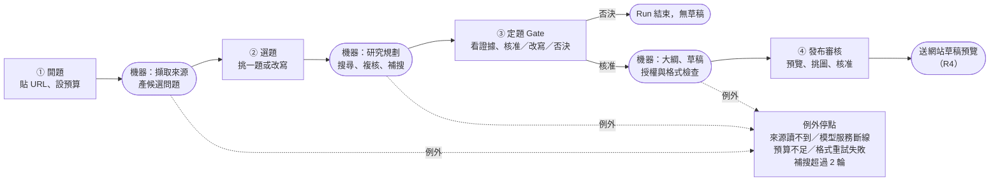
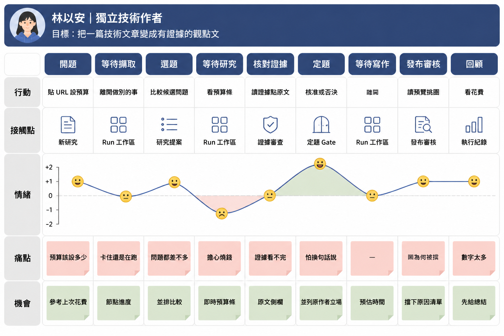
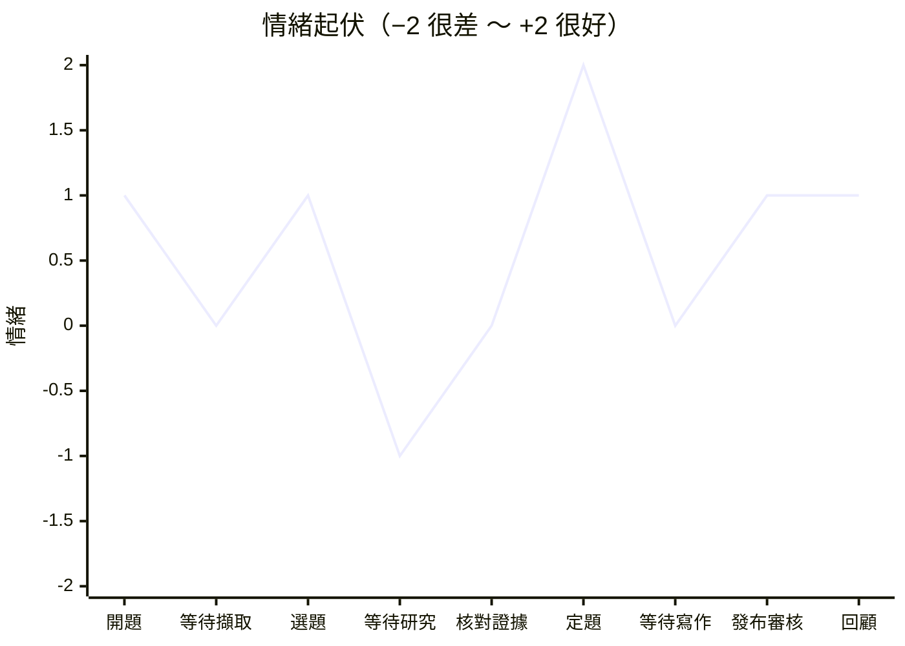

# UX 研究草案：Persona 與使用者旅程 — Evidence-led Editorial Studio

> **版本：** v0.1 | **日期：** 2026-10-10 | **狀態：** 草案，待創作者確認
> **依據：** `00-intent/brief.md`、`10-truth/requirements/prd.md`（v1.2）、`10-truth/requirements/features/*.feature`、`30-snapshot/plans/2026-10-10-architecture-draft-v0.2.md`
> **下游：** 資訊架構 → `2026-10-10-frontend-ia-draft.md`（範本 17）；前端技術 → `2026-10-10-frontend-architecture-draft.md`（範本 12）
>
> 這份是規劃快照，不是需求。Persona 是從 brief 與 PRD **推出來的假設**，沒有做過使用者訪談；第 4 節列出怎麼驗證。詞的定義照根目錄 `CONTEXT.md`。

---

## 1. 為什麼先做這份

PRD 已經定好「系統要做什麼」，但沒有回答兩件會直接決定畫面長相的事：

1. **創作者什麼時候在電腦前？** 一次研究執行（Run）要跑好幾分鐘，中間還會停下來等人好幾次。如果畫面假設人一直盯著，等待時就只能乾等；如果假設人會離開，回來時就要一眼看出「哪個 Run 在等我、等我做什麼」。
2. **創作者在哪一步最需要信任感？** 這個產品的賣點是「每句話都找得到出處、立場由我決定」。如果證據審查和定題 Gate 的畫面讓人看不懂、或核對一條主張要點五下，創作者就會跳過核對，產品承諾也就跟著失效。

所以先畫出人、再畫出旅程，最後才決定頁面與技術。

---

## 2. Persona

### 2.1 主要 Persona：林以安，獨立技術作者

> 這個產品是單人工作室用的（PRD §1），所以只有一個主要 persona。PRD 列的三種身分（技術作者、產品經理、資料科學與 AI 工程工作者）是同一個人的三種背景，不是三種使用者；差別寫在 2.2。

| 項目 | 內容 |
| :--- | :--- |
| **一句話** | 「我想寫有根據的技術觀點文，但不想把週末花在追引用上。」 |
| **角色** | 經營個人技術部落格與電子報的工程師，一個月想穩定產出 2～4 篇深度文章 |
| **技術能力** | 會讀論文與官方文件，看得懂 JSON、會用 CLI；不想為了寫文章去維運一套前端 |
| **工作環境** | 桌機或筆電，雙螢幕；本機有一張 3090 跑 Qwen；長時間閱讀，習慣邊看原文邊做筆記 |
| **對成本的態度** | 每月有固定的 API 預算，在意「這篇花了多少」；最怕的是 AI 自己繞圈燒錢 |
| **對 AI 的態度** | 會用 AI，但不信任 AI 自己下的結論；被 AI 編造過引用，所以要求每句話能點回原文 |
| **責任** | 文章掛自己的名字，錯了是自己的信用受損；用了沒授權的圖，風險也是自己扛 |

**目標（依重要性）**

1. 文章的論點是自己的，不是把原作者的框架換句話說。
2. 每個事實都能點回原文那一段，被讀者質疑時拿得出證據。
3. 研究與整理的時間從「一個週末」縮到「一個晚上」。
4. 花費可預期，每篇知道花多少、為什麼花。

**挫折（今天的做法）**

| 挫折 | 來源 | 對畫面的意義 |
| :--- | :--- | :--- |
| References 一條條手動點開、複製、記在筆記裡 | brief §2 | 來源清單要一次列全，狀態一眼可見（讀到、讀不到、付費牆） |
| 三篇文章都在轉述同一份公告，誤以為有三個證據 | CONTEXT「引用鏈」 | 證據要顯示「這幾篇其實是同一組」，不能只是平鋪一張清單 |
| AI 改寫的文章結構跟原文一樣，像換句話說 | brief §2 | 定題 Gate 要明確對比「原作者的立場」與「我的立場」 |
| 圖片找到了才發現授權不明，整段要重寫 | PRD §6 第 4 條 | 授權狀態要在挑圖當下就看到，而不是發布前才擋 |
| 不知道一篇到底花了多少錢 | brief §5.1 | 預算要在開跑前、跑的時候、跑完後都看得到 |

**不是這個人（Anti-persona）**

- **要一鍵改寫的人**：只想把英文文章變成中文文章、不在乎來源。這個產品會用 Gate 和授權擋下來，對他來說全是阻礙。不為他設計捷徑。
- **內容農場的批次產製者**：要一次丟 50 篇。MVP 可以同時跑幾篇（ADR-0006），但批次排程在 Later 階段。

### 2.2 同一個人的三種背景

| 背景 | 會特別在意 | 畫面上的影響 |
| :--- | :--- | :--- |
| 技術作者 | 文章可讀性、敘事順序不像原文 | 草稿預覽要像真的文章；大綱與原文段落順序可對照 |
| 產品經理 | 論點能不能說服人、有沒有反方說法 | 研究提案頁要把競爭假說和建議論點放在同一個視線裡 |
| 資料科學／AI 工程 | 數據版本、方法、模型與 prompt 版本 | 主張要顯示來源日期與版本；執行紀錄要能比較兩次 Run |

### 2.3 從 Persona 推出的設計原則

這五條會在資訊架構與元件設計中反覆引用，引用時直接寫原則的名字（例：「原則：狀態不只用顏色」）。

| 原則 | 為什麼 |
| :--- | :--- |
| **出處一鍵可達**：任何主張、引文、圖片，點一下就看到原文段落、擷取時間與狀態 | 信任來自能自己核對；核對成本高，人就不核對了 |
| **等我的事放最前面**：首頁先回答「哪個 Run 在等我、等我做什麼」 | Run 會跑好幾分鐘、停好幾次，創作者不會一直盯著 |
| **狀態不只用顏色**：已驗證、未驗證、未知、推論、授權擋下，每種都同時有圖示與文字 | 這些標記決定能不能發表，看錯的代價高；也符合無障礙 |
| **錢先講清楚**：開跑前看到預估，跑的時候看到已用與剩餘，停下時說明差多少 | 預算是硬上限（NFR-04），停下時人要知道該加多少 |
| **決定不催促**：Gate 與發布審核沒有倒數、沒有預設核准，否決和核准一樣容易按 | 立場決定權是產品要守住的東西（brief §2） |

---

## 3. 使用者旅程

### 3.1 一次研究執行的全貌

一個 Run 不是一路跑到底，而是「機器跑 → 停下等人 → 機器跑」交替。創作者真正要出手的點有四個固定停點，加上幾個例外停點。

> **② 選題是這份草案新提出的停點。** `research-proposal.feature` 的〈創作者可以改寫候選問題〉要求「創作者改寫其中一題並送出 → 研究規劃使用改寫後的題目」，代表 Scout 與 Director 之間必須停下等人；但架構草案 §3.4 的循序圖裡，Scout 直接接 Director。這需要跟架構對齊，列在 §5 的 Q-08。

### 3.2 旅程地圖（標準格式）

業界常見的旅程地圖格式（例：Nielsen Norman Group）：最上面是 persona 與目標，橫軸是階段，縱軸依序是行動、接觸點、情緒曲線、痛點、機會。定題 Gate 拆成「核對證據」與「定題」兩欄，因為同一個畫面裡情緒從 0 升到 +2，是整條旅程最大的起伏。

| | 開題 | 等待擷取 | 選題 | 等待研究 | 核對證據 | 定題 | 等待寫作 | 發布審核 | 回顧 |
| :--- | :--- | :--- | :--- | :--- | :--- | :--- | :--- | :--- | :--- |
| **行動** | 貼 URL、設預算 | 離開做別的事 | 比較候選問題 | 看預算條 | 讀證據、點原文 | 核准或否決 | 離開 | 讀預覽、挑圖 | 看花費 |
| **接觸點** | 新研究 | Run 工作區 | 研究提案 | Run 工作區 | 證據審查 | 定題 Gate | Run 工作區 | 發布審核 | 執行紀錄 |
| **情緒** | +1 | 0 | +1 | **−1** | 0 | **+2** | 0 | +1 | +1 |
| **痛點** | 預算該設多少 | 卡住還是在跑 | 問題都差不多 | 擔心燒錢 | 證據看不完 | 怕換句話說 | — | 圖為何被擋 | 數字太多 |
| **機會** | 參考上次花費 | 節點進度 | 並排比較 | 即時預算條 | 原文側欄 | 並列原作者立場 | 預估時間 | 擋下原因清單 | 先給總結 |

**情緒曲線**

讀這條曲線的方式：

- **最低點在「等待研究」（−1）**：等最久、又是最花錢的一段，人看不到錢花在哪就會焦慮。對策是即時預算條與每輪補搜的原因（原則：錢先講清楚）。
- **最高點在「定題」（+2）**：產品承諾「立場由我決定」在這裡兌現。前一格「核對證據」只有 0，因為證據多、核對累；核對越省力，人越可能真的核對，而不是直接按核准（原則：出處一鍵可達）。
- **三個「等待」都落在 0 以下或 0**：等待本身不會讓人開心，只能讓它可預期、可離開（原則：等我的事放最前面）。

### 3.3 各階段細節

上表的每一格展開成完整欄位，包含系統在做什麼與對應畫面。情緒用 −2（很差）～ +2（很好）表示，是推測值，用來找出最需要設計的地方。

| 階段 | 創作者想要 | 創作者做什麼 | 系統做什麼 | 畫面 | 情緒 | 風險與痛點 | 設計機會 |
| :--- | :--- | :--- | :--- | :--- | :---: | :--- | :--- |
| **① 開題** | 快點開始，別問太多 | 貼 URL；確認語言、讀者、預算 | 開跑前檢查（NFR-08）；擷取種子文章 | 新研究 | +1 | 檢查沒過卻不知道是哪一項；不知道預算該設多少 | 檢查結果逐項列出；給「上次類似的 Run 花了多少」當參考 |
| 等待：擷取與產題 | 確定它真的在跑 | 可能離開去做別的事 | 擷取引用來源；Qwen 產 3～5 題 | Run 工作區（進度） | 0 | 看不出卡住還是在跑；讀不到的來源被悄悄略過 | 節點層級的進度與耗時；讀不到的來源立刻標出來 |
| **② 選題** | 找到一個值得寫、不是原作者老調的切角 | 比較候選問題；挑一題或改寫 | 等待 | 研究提案 | +1 | 問題看起來都差不多；看不出哪題證據不夠 | 每題並排顯示前提、為什麼現在問、需要的證據、風險；UNKNOWN 明顯標出 |
| 等待：研究與複核 | 知道錢花在哪 | 離開，或看進度 | Director 規劃；Tavily 搜尋；Reviewer 複核；最多補搜 2 輪 | Run 工作區（進度、預算） | −1 | 等最久的一段；擔心燒錢 | 預算條即時更新；每輪補搜顯示原因與用量 |
| 例外：補搜超限 | 決定要不要繼續花錢 | 選「用現有證據進 Gate」或「再補一輪（加預算）」或「結束」 | 停在等待人工決定 | Run 工作區（決策卡） | −1 | 不知道缺了什麼證據 | 列出還沒被支持的主張與 Reviewer 的理由 |
| **③ 定題 Gate** | 確定論點站得住，而且是自己的 | 讀證據矩陣、核對原文；核准、改寫或否決；寫下自己的觀點 | 等待；記錄決定 | 證據審查 → 定題 Gate | 0 → +2 | 證據太多看不完；核對一條要開好幾個分頁；改寫論點後不確定證據還撐不撐得住 | 主張 × 來源矩陣＋原文側欄（原則：出處一鍵可達）；建議論點旁邊並列原作者立場與競爭假說；否決與核准同等份量（原則：決定不催促） |
| 等待：寫作 | 拿到可以改的稿 | 離開 | Sonnet 寫大綱與草稿；G4 授權、G5 格式檢查 | Run 工作區（進度） | 0 | — | 顯示預計剩餘時間 |
| **④ 發布審核** | 確定能放心掛名 | 讀預覽；點引用核對；核准或排除圖片；核准發布 | 渲染本機預覽；檢查斷鏈與授權 | 草稿預覽、素材、發布審核 | +1 | 某張圖被擋卻不知道為什麼；引用編號對不回來源 | 每個引用標記可點回證據；被擋的圖顯示原因與替代做法 |
| 回顧 | 知道這篇花了多少、哪裡可以更省 | 看執行紀錄；比較兩次 Run | 呈現每個節點的耗時、模型、prompt 版本、費用 | 執行紀錄 | +1 | 數字太多看不出重點 | 先給總結（總花費、最貴的節點、快取省了多少），細節收合 |

### 3.4 關鍵時刻（Moments of Truth）

這三個時刻做不好，產品承諾就會失效；資訊架構與元件設計的資源優先投在這裡。

1. **定題 Gate 的核對**：創作者要在一個畫面裡看到「論點 → 支持它的主張 → 每條主張的原文段落」。原文段落必須是擷取當時存下的版本（NFR-14），不是即時重抓的網頁。
2. **回來時的第一眼**：首頁的 Run 清單要先排「等我的」，每列直接寫出要做什麼（例：「等你選題（3 題）」「預算不足，還差 US$0.12」）。
3. **發布前的最後檢查**：所有擋下發布的原因（G1～G5、授權）集中在一張清單，每條都能點到出問題的那個位置。

### 3.5 例外路徑

每一個例外都有明確的下一步（NFR-09），畫面上不能只顯示「失敗」。

| 例外 | Run 狀態 | 創作者看到什麼 | 可以做什麼 | 依據 |
| :--- | :--- | :--- | :--- | :--- |
| 種子文章讀不到（403） | 不開始 | 「來源無法讀取」與原因 | 手動貼上內容後開始 | `source-intake.feature` |
| 開跑前檢查沒過 | 不開始 | 哪一項沒過（例：「本機模型服務沒有回應」），沒有任何付費呼叫 | 修好後重新檢查 | `run-reliability.feature` |
| 本機模型服務中途斷線 | 可重試的失敗 | 停在哪個節點、沒有改用付費模型 | 重試該節點 | `run-reliability.feature` |
| 預算不足 | 等人調預算 | 哪一種上限不夠（美元、token、credits）、還差多少 | 調高上限後繼續，或結束 | NFR-04 |
| 節點輸出格式重試 2 次仍不合 | 等人工處理 | 哪個節點、哪個欄位不合 | 重試、或結束 | NFR-10 |
| 補搜 2 輪後仍證據不足 | 等人工決定 | 還沒被支持的主張與 Reviewer 的理由 | 用現有證據進 Gate／加預算再補一輪／結束 | `evidence.feature` |
| 部分來源擷取失敗 | 部分完成 | 哪些來源 unavailable | 繼續（這些來源不計入證據） | `run-trace.feature` |

---

## 4. 怎麼驗證這份 Persona 與旅程

這份是推論，要用真實使用修正：

| 假設 | 驗證方式 | 時間點 |
| :--- | :--- | :--- |
| 創作者在 Run 執行時會離開，回來才處理停點 | 記錄停點從出現到被處理的時間；中位數超過 10 分鐘就成立 | R2 起 |
| 定題 Gate 是最花時間、也最有價值的一步 | 記錄每個畫面的停留時間；R5 實驗的「人工修改分鐘數」（brief §5.2） | R2～R5 |
| 選題這一步有必要 | 記錄創作者改寫候選問題的比例；長期低於 10% 就考慮改成預設選第一題、可回頭改 | R2 起 |
| 授權狀態提早顯示能減少發布前返工 | 記錄發布審核時才排除的圖片數 | R3 起 |

---

## 5. 待決事項

| ID | 問題 | 建議 | 要跟誰對齊 |
| :--- | :--- | :--- | :--- |
| Q-08 | Scout 與 Director 之間要不要停下等創作者選題？ | 要。BDD 已要求可改寫題目；做成 interrupt，跟定題 Gate 同一套機制 | 架構（§3.4 循序圖、LangGraph interrupt） |
| Q-09 | 補搜超限時，創作者能選的動作有哪些？ | 三個：用現有證據進 Gate／加預算再補一輪／結束。「再補一輪」不受 2 輪上限限制，因為是人決定的 | 架構＋PRD FR-11 |
| Q-10 | 沒有推送通知（架構 Q-05），怎麼讓人知道有 Run 在等？ | MVP 用瀏覽器分頁標題與 favicon 顯示等待數（例：`(2) Evidence Forge`），不需要通知權限 | 架構 Q-05 |
| Q-11 | 原作者的立場要不要成為一個明確欄位？ | 要。定題 Gate 要並列「原作者立場」與「建議論點」，才看得出是不是換句話說；需要 Director 輸出這個欄位 | 架構（Director 輸出 schema） |
