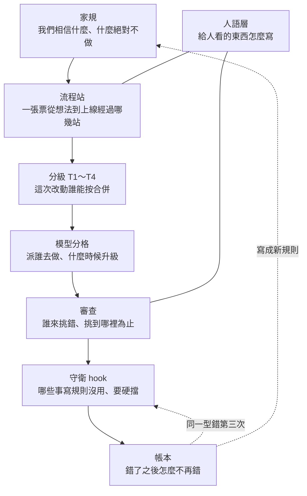

# 這套工作方式是怎麼長出來的

> 範本裡每一條規則、每一支守衛、每一本帳本，背後都有一次出過的事。這份文件把那些事按時間排好，再從上到下講清楚整套架構怎麼成形、為什麼對 AI 代理有效。範本不帶前一個專案的 git 歷史，所以來龍去脈只能在這裡查；文中的 `#數字`、`L-數字`、`P-數字` 是前一個專案的 PR／票號與本範本帶過來的帳本條號，前者查不到原始頁面時，以這份文件的引文為準。

## 一句話

**它不是事先設計的。** 2026-09-01 到 10-05 這 35 天，兩個產品（先是一個內容系統，09-11 重置後是一個寫作工具）用 Claude Code 開發，一次事故補一條規則。第一週長出守衛、家規、帳本、人語層和分級審查；重置時只留下工作方式；之後又長出模型分格、跨家審查、平行子代理、兩台電腦接力、鞏固站、設計站和接縫站。範本是把這些「工作方式」從產品裡拆出來的結果。

## 怎麼讀這份文件

1. 第一節是時間軸：每一個機制當時撞到什麼、加了什麼、後來有沒有用。
2. 第二節從高到低講架構：家規 → 流程站 → 分級 → 模型分格 → 審查 → 守衛 → 帳本 → 人語層。每一層回答一個問題。
3. 第三節講底層邏輯：為什麼這些做法對 AI 代理有效，分成代理的特性、模型的特性、工作自動化、管理方式四塊，最後收成 20 條原則。
4. 第四節列被推翻過的決定，第五節列這套東西自己還沒做好的地方。

---

## 一、時間軸

### 第一段：守衛與家規（09-01 ～ 09-09，舊系統期間）

| 日期 | 機制 | 當時撞到什麼 | 加了什麼 | 後來有沒有用 |
|---|---|---|---|---|
| 09-01 | `guard-git`、`guard-secrets` 兩支 hook | repo 剛開，規則只能靠「記得」。原文：「指標會因為上游搬家而靜默失效，複本至少是個會老但一定會跑的護欄」 | Claude Code 的 PreToolUse hook，exit 2 擋下 `git add -A`、force push、`reset --hard`、`--no-verify`、`gh pr merge` | 到最後仍是唯二註冊的 hook。起初沒有測試，09-06 才把它的測試放進 CI；後來被抓到「只擋得到排第一的檔」的洞（見 09-07） |
| 09-01 | CI | 「沒有 CI，那道關卡就只是『記得跑』」 | typecheck、test、文件檢查 | 之後停擺至少四次：帳務卡住（一百次 run 全紅、每次 0 個步驟）、免費額度用完。最後演化成「e2e 只在 PR 跑、分兩個 shard、新的 push 取消舊的 run」 |
| 09-03 | 不准堆疊 PR | 三顆疊在一起的 PR 都顯示 MERGED，主線上卻只有第一顆的內容 | 家規：每顆 PR 的 base 一律是整合分支 | **沒守住**。後來又出現堆疊，刪掉底層分支時 GitHub 把上面三顆 PR 同一秒全關（L-018）。帳本自己寫：「成文不等於硬擋」 |
| 09-04 | 文件四層（意圖／事實／狀態／快照）＋連結檢查 | 穩定的知識和會變的資訊寫在同一份檔案 | `docs/00-intent`、`10-truth`、`20-state`、`30-snapshot` | 有用。副作用：重置後連結檢查腳本不在了，守衛的本機退路指令卻還在叫它，退路永遠紅，拖了 18 天才發現 |
| 09-05 | 家規進版控＋傷疤帳本（LESSONS）＋人語層 | 「AI 產出的文件普遍認知階梯倒置……在本 repo 已確診五處」：每句都對，順序倒過來、名詞沒定義 | 家規第九章、`LANGUAGE.md`、`human-layer` 技能常駐、L-001／L-002 | L-002 的事件簿記了 13 次「使用者說沒聽懂」，同型三次就改模板，觸發三次。結論變成 P-005：「前六次的對策都是模板加一句，照樣沒套用」 |
| 09-05 | 人語層的硬 hook | 一顆 PR 漏了模板的節，事後才被使用者抓到 | 缺節的 PR、太長的票名當場擋 | **同一天就停掉**：「越表單越不像人打的」。範本不帶它 |
| 09-05 | PR 把關分級（第一版） | 文件類 PR 寫成「可以授權 AI 合併」，實際被守衛擋下 | 文件 PR 可以由獨立 AI 核對，合併仍由人按 | 一週內改了三次，最後變成「按路徑分四級」（見 09-07） |
| 09-05 | 值夜審查 | 一晚合了 17 顆、審了 12 輪，噪音浮出來 | `LOOP-REVIEW.md`：審查三級、每級有門檻、「應修」要答得出下一個人會踩到什麼 | 是後來「必修／該修／建議、每輪最多 5 條」的前身 |
| 09-06 | 獨立審查代理 | 撰寫者自己核對一次都沒抓到錯，四次裡三次是獨立代理抓到的（L-003） | 審查交給另一個乾淨的代理 | 後來換成 `/code-review` 技能加 PIPELINE 的審查規則 |
| 09-06 | 每個會動 git 的代理一個 worktree | 一個代理在共用工作目錄裡 stash，把另一個 session 沒提交的修改捲走，沒有任何訊號（L-006） | `isolation: worktree`；後來改成「第一個動作就是 `git worktree add`」 | 同一家族又長出 L-017（worktree 的基底不是你站的那條）、L-019（慢檔案系統）、L-021（暫存檔撞名） |
| 09-06 | 測試要能紅 | 把出貨的常數改回去，592 條測試照樣全綠（L-008）；六輪獨立審查全過，上線第一次就撞牆（L-010） | 照它宣稱守的行為把程式改壞一次，確認會紅；至少一發走真實工具鏈；家規第 42 條 | L-007 累犯 6、L-008 累犯 4 |
| 09-07 | T1～T4 分級，照路徑判 | 同一顆 PR 被兩個獨立代理判出相反的等級 | `GRANULARITY.md`；守衛裡的 `human_only_path`：碰到高風險路徑的 PR 只能人按 | 有洞：一段時間內只擋得到排第一的檔，L-007 第 6 次。修好後成為整套的主幹 |
| 09-07 | PR 格式收成一份 | 「三個 session、十幾顆 PR、三種風格，零違規——每個人照的都是自己讀到的那一份」 | 唯一的規定放在 `human-layer`：英文五節；`.github` 的模板只是展示 | 之後一直是五節 |
| 09-07 | 帳本「數字怎麼數」 | 審查者拿同一份文件數出不同的數字 | 首犯算第 1 次、型要寫名字 | 後來帳本自己沒遵守（見第五節），範本已重算 |
| 09-09 | 提取卡（PLAYBOOK） | 帳本記的是 AI 漏接什麼，人該想起什麼沒地方放 | `🎴` 卡，撞到訊號時先問再給答案 | 10 張卡裡 3 張被叫出來過 |
| 09-09 | 繁中 AI 腔詞表 → 去 AI 味技能 | 「材料散在七個地方，沒有一條有效力」 | `AI-TONE-ZH-TW.md`；只刪除與標記、不改寫 | 屬於內容稿，範本只帶詞表 |
| 09-09 | CI 死狀跟失敗長得一樣 | 一百次 run 全部 failure，但每次都是 0 個步驟（L-015） | 紅燈先問「跑了幾步」 | 同型停擺之後又發生兩次 |

### 第二段：重置與新產品起步（09-11 ～ 10-01）

| 日期 | 機制 | 當時撞到什麼 | 加了什麼 | 後來有沒有用 |
|---|---|---|---|---|
| 09-11 | 重置：只留工作方式 | 舊系統要整個重寫 | 「留下的是工作方式，不是系統：家規與帳本、守衛、技能」→ 這就是範本的起點 | 守衛的退路指令沒跟著改（見 09-04），所以範本那時其實跑不起來；這次補齊時修掉 |
| 09-28 | 主線與整合分支分開，舊系統封存 | 主線和開發分支已經是兩個不同的專案 | 舊系統移到封存分支加標籤；發主線一律用 merge commit | 用 squash 發主線，下一次發布每個檔都衝突，才改成 merge commit |
| 09-29 | 審查三級＋跨家審查（Codex） | 「Codex 挑出大量枝微末節，Claude 照單全收、越改越發散」 | 必修／該修／建議，每輪最多 5 條；只有高風險的 PR 加 Codex，最多兩輪；送審前先跑測試，把輸出交給審查者 | 有實例證明跨家抓得到同家漏的：外部修改覆蓋與 symlink 逃逸、兩軸都漏的請求競態、快取寫錯單價 |
| 09-29 | 模型分格（家規第 43 條、`MODEL-ROUTING.md`）＋三個子代理角色 | 使用者要「找出最省又做得完的模型與推理強度搭配」 | 原本 6 格，同一天縮成 3 格：便宜快、強、最強；每張票記帳：起始格、最終格、升級訊號、token、測試失敗次數、審查必修數 | 帳本 107 列，結果見第三節。最重要的一條：便宜那格做了六成的票、品質沒有比較差；升級訊號亮了很多次但幾乎沒升，因為審查在做完之後才跑 |
| 09-29 | GitHub Actions 帳務卡住，改本機驗證 | CI 停了 | 本機跑的輸出貼進 PR 的 Testing 一節 | 兩天後恢復 |
| 09-30 | 平行子代理，每張票一個 worktree | 三個子代理同一晚撞埠；派去「只讀」審查的 fork 自己 commit、開了 PR（L-016） | e2e 埠可以指定；審查技能寫明子代理只讀 | L-016 改完技能後**又犯一次**：fork 繼承的上下文會蓋過一句「只讀」。對策是派乾淨的子代理 |
| 09-30 | 派工單第一步寫成指令 | 三個 worktree 開起來的基底都是主線，一整張票做錯分支（L-017） | `git switch -C <分支> origin/<整合分支>` 加 sha 自核 | 之後沒再發生 |
| 10-01 | 兩台電腦接力日誌 | 兩台電腦同時開工了同四張票 | 一張接力票：開工前讀最新留言、看開著的 PR、看 `in-progress` 標籤；下班前留言 | 三天內 39 則留言，重複派工只發生那一次 |
| 10-01 | 刪分支前先改上面 PR 的 base | 見 09-03 那列 | 合併預設不帶 `--delete-branch` | 之後沒再發生 |

### 第三段：大量平行開發（10-02 ～ 10-10）

| 日期 | 機制 | 當時撞到什麼 | 加了什麼 | 後來有沒有用 |
|---|---|---|---|---|
| 10-02 | 鞏固站 | 「不要一直往前衝」：單元測試 1,855 條、e2e 260 條跑 4 分鐘、CI 8 分鐘，不穩的測試一天擋了四次合併 | 四個觸發條件（一波收完／連合 10 顆 PR／e2e 或單元超過時間上限／同一條測試不穩兩次）任一成立就停派新票，整段 review、測試取捨、文件對齊 | 跑了三次。第一次 e2e 從 4.6 分壓到 3.5 分；第二次整段審查抓到 1 條必修、14 條該修，都是逐 PR 審查看不到的；第三次第一次用多模型多角度（架構、資安、測試文件各一個代理，加跨家一輪） |
| 10-02 | 慢檔案系統上的索引延遲 | WSL 讀 Windows 磁碟時，checkout 之後 `git status` 乾淨、工作目錄卻還是舊版；`index.lock` 連撞三次（L-019） | checkout 後兩個計數都要是 0；同一個 worktree 一次只跑一個會碰索引的 git 指令 | 之後又撞幾次，最後演變成更嚴重的 EIO（見 10-09） |
| 10-03 | 六個子代理並行帶出的四條教訓 | 用 `pkill -f` 殺到別人的測試（L-020）；暫存檔撞名（L-021）；說「可以按」時 head 還不是審過的那個 commit，必修就這樣進了主線（L-022）；幾顆有順序的 PR，人按得比訊息快，整合分支 lint 紅了十幾分鐘（L-023） | 只殺自己的 PID；暫存放 `scratchpad/<票號>/`；「可以按」一律帶 head sha；有順序時一次只給一顆；資料庫遷移不佔位、不跳號，照合併順序改號 | 五張要加遷移的票同時開工時，照合併順序改號成功 |
| 10-03 | 設計站 | 要開工的一波會改很多畫面 | 先畫 23 張設計稿給使用者看，確認了才派票 | 使用者看過說「沒問題」。後來證明不夠（見接縫站） |
| 10-03 | 派工前量資源（P-010） | 「每台電腦的硬體都不一樣，派發之前先預估」；機器磁碟卡住 | 量核心、記憶體、硬碟、壓力指標；同一時刻最多兩套測試；WSL 的 load 會把 Docker 算進去，看 PSI 不看 load | 有用，但上限後來證明還要再低（見 10-09） |
| 10-03 | e2e 每個 worker 一個資料庫、CI 分兩個 shard | 免費額度一天用完；第一次分 shard 時兩個 shard 各跑了整套 | 本機 3.5 分 → 約 2 分；CI 9 分 → 4.5 分；e2e 只在 PR 跑 | 在 2 核 runner 上試 4 個 worker 反而變慢，當天退回 |
| 10-04 | 夜間自主 | 使用者去睡前要「把後面的都做完，我起床能接手」 | 先量資源；多角度唯讀審查；拍板寫進票，拆成「自己能合」與「留給人按」；驗證只做型別、lint、單元一次、動到的 e2e 一次；早上第一則訊息列要按的（帶 sha 與順序） | 一晚合了十顆 PR、留三顆給人按。代價是夜裡出事沒人能救（見 10-09） |
| 10-05 | 並行高風險票的收尾 | 五張要加遷移的票同時開工，建置者做完就閒置 | 協調者接手 rebase：先把審查輪的 commit 壓成一顆、疊到前一張的 head 上驗、前一張進主線再 `rebase --onto`；推之前確認跟驗過的內容零差異 | 三張這樣收，零衝突 |
| 10-05 | 接縫站 | 使用者驗收時發現很多畫面「沒照設計」；根因是設計稿是靜態的，講不了畫面之間的互動 | 設計站之後、派工之前：用跑起來的 app 把使用者流程走一遍，列畫面之間「現在怎麼接／該怎麼接」，規格沒寫的細節附建議答案請使用者拍板，寫回票 | 第一次走查列出 13 個接縫、15 個沒定的細節；之後的人工驗收 24 條失敗裡，4 條正是這些接縫 |
| 10-05 | 人工驗收清單（UAT） | 自動測試守的是「程式有沒有照規則做」，沒有東西守「人看不看得懂」 | 115 條手動案例，每條有前置、步驟、預期、類型；判定規則：預期少一句就是不過；結果表留著當回歸 | 第一輪 91 過、24 不過，每條不過都對到一張票 |
| 10-09～10 | 慢檔案系統的 I/O 上限 | 兩三條線同時在 WSL 讀的 Windows 磁碟上跑 git、安裝與測試，整個掛載變成 EIO，所有 session 連 shell 都起不來，只能重啟 WSL；兩天三次 | 同一時刻跑測試的線壓到一兩條（主 session 自己跑也算一條）；e2e worker 設低；能離線安裝就離線；建議把 repo 放在原生檔案系統 | 範本本身就建在原生檔案系統上 |

---

## 二、架構：從高到低，每一層回答一個問題

### 1. 家規：我們相信什麼、什麼絕對不做

`Ai-coding-principle/README.md`。43 條，從「好品味」「不破壞使用者」到「分級」「模型分格」。它是最慢變的一層：只有出過事、而且證明下面幾層兜不住，才往這裡加。每條都寫了出處（哪一次事故）。

為什麼需要它：AI 代理每個 session 都從零開始，沒有「上次我們吵過這件事」的記憶。家規就是那份記憶的壓縮版。

### 2. 流程站：一張票從想法到上線經過哪幾站

`.claude/skills/PIPELINE.md`。站的順序是：開票 →（要改畫面的）設計站 → 接縫站 → 量資源 → 派工 → 實作（每張一個 worktree）→ 確定性檢查 → 審查 → 合併 → 每 10 顆停一次鞏固站。夜間自主是同一套站，只是「人按的按鈕」改成早上一次給。

為什麼需要它：代理很會做一件事，很不會判斷「現在該做哪件事」。把順序寫死，就不用每次重新推理。

### 3. 分級：這次改動誰能按合併

`Ai-coding-principle/GRANULARITY.md`。T1 錯了不痛、T2 錯了可以修、T3 錯了代價高（地基：資料、錢、安全、守衛自己）、T4 是品味。**照改到的路徑判，不照代理的判斷**：高風險路徑寫在 `.claude/hooks/human-only-paths.conf`，碰到就只能人按。

為什麼照路徑：同一顆 PR 曾經被兩個代理判出相反的等級。代理的判斷每次會不一樣，路徑不會。

### 4. 模型分格：派誰去做、什麼時候升級

`Ai-coding-principle/MODEL-ROUTING.md` 與 `.claude/agents/`。三格：便宜快（例：Sonnet high）、強（例：Opus high）、最強（例：Opus xhigh）。從推得動那張票的最便宜一格開始，撞牆才升，每張票記帳。

為什麼這樣：模型能力有差、價格有差，但「強的模型做簡單的票」浪費、「便宜的模型做地基」會修很多輪。只有記帳才知道界線在哪。

### 5. 審查：誰來挑錯、挑到哪裡為止

確定性檢查先跑（型別、lint、測試）；然後 AI 審查只報三級（必修、該修、建議），每輪最多 5 條；高風險的再加一家不同公司的模型，最多兩輪；兩輪後由協調者自己核對，不開第三輪。

為什麼要上限：被要求找毛病的審查者一定找得到。沒有上限，修改會越改越發散。

### 6. 守衛：哪些事寫規則沒用、要硬擋

`.claude/hooks/`：`guard-git.sh`（不准 `git add -A`、force push、`reset --hard`、`--no-verify`；合併只有一種寫法，而且要 checks 全綠、碰到高風險路徑就擋）與 `guard-secrets.sh`（staged 裡有金鑰就擋 commit）。守衛自己有 69 條測試，在 CI 跑。

為什麼要 hook：規則只寫在文件裡，遵守率大約七成；寫成 exit 2 就是十成。但 hook 也會出錯（L-007：只擋一半、漏的那一半不出聲），所以守衛要有測試。

### 7. 帳本：錯了之後怎麼不再錯

三本：`LESSONS.md`（AI 漏接了什麼，24 條，每條有首犯、累犯、坑、訊號、對策）、`PLAYBOOK.md`（人該想起什麼，10 張提取卡）、`MODEL-ROUTING.md` 的帳本（每張票用了哪格、花多少、錯幾次）。

用法：踩到記過的坑，回報第一行寫 `⚠ 重複踩點：`，累犯加一。同一型第三次，就不要再加一句規則，改成一個刪除動作或一支守衛（P-005）。

### 8. 人語層：給人看的東西怎麼寫

`.claude/skills/human-layer/SKILL.md`。先講為什麼、再講做了什麼；用高中生看得懂的字；回報第一行粗體結論；PR 固定英文五節。

為什麼要它：整套系統的瓶頸不是代理產出的速度，是人的注意力和信任。生成可以平行，信任不能分片。

---

## 三、底層邏輯：為什麼這些做法對 AI 代理有效

### 代理的特性

| 特性 | 在這裡長什麼樣 | 對應的機制 |
|---|---|---|
| **上下文有限、session 之間不記得** | 每次開新 session 都要重新知道規矩；長對話會被摘要掉細節 | 家規、帳本照任務撈兩三條就好（不全灌）、接力日誌、早上的換班訊息 |
| **會很有自信地錯** | 「查不到」其實是 grep 打錯路徑（L-003、L-009）；數字憑印象報（L-012）；二手摘要當出處 | 說「不存在」之前先列查過哪些地方；數字從這次的輸出複製；讀不到原文就標未證實 |
| **作者看不到自己的盲點** | 撰寫者自核 0 次抓到，獨立代理 3 次 | 審查一定換乾淨的上下文，高風險的再換一家公司的模型 |
| **讀到規則不等於會套用** | 剛寫下的規則最不會被套用到手上這一句（L-011）；模板加一句，六次都沒用（L-002） | 寫完規則先拿它掃這次的 diff；同型第三次改成 hook 或刪除動作 |
| **會繼承上下文裡的指令** | fork 出去「只讀」的子代理自己開了 PR（L-016），因為它繼承了主 session 幾十萬 token 的「去做」 | 只讀的工作派乾淨的子代理，指令明寫不准 commit；收件時先看分支多了什麼 |
| **測試會去證明它自己寫的程式** | 斷言改成相反的主張讓測試變綠（L-013）；測試驗的是自己重打的副本（L-008） | 照宣稱守的行為把程式改壞一次，確認會紅；常數從程式 import |

### 模型的特性

- **能力和價格都有差，但界線只能量出來。** 前一個專案的帳本：

| 格 | 票數 | 平均 token | 中位數 | 第一輪必修平均 |
|---|--:|--:|--:|--:|
| 便宜快 → 便宜快 | 65 | 335k | 273k | 0.89 |
| 強 → 強 | 19 | 378k | 317k | 2.89 |
| 強 → 最強 | 1 | 678k | — | — |

  便宜那格做了六成的票、token 跟強的同一個量級、必修也沒有比較多（強那格必修多，是因為難的票才派給它）。反例：串接新的外部供應商這類票，便宜那格修了三四輪、token 是強那格的兩倍多，所以這類從強那格開始。
- **升級訊號要在途中看，不能等審完。** 第一輪必修 ≥ 3 這個訊號亮了 16 次，真的升級只有 1 次，因為審查發生在實作做完之後，訊號來得太晚。範本把「途中自評」加進升級訊號。
- **不同公司的模型盲點不同。** 跨家審查抓到過同家兩個審查軸都漏的競態條件。但跨家審查也會挑枝微末節，所以只用在高風險、最多兩輪。

### 工作自動化

- **平行的上限是共用資源，不是代理數。** 代理本身便宜（大部分時間在等模型），它跑的測試才貴。互搶資源造成的失敗看起來就像程式壞了：撞埠、殺到別人的程序、慢檔案系統整個卡死。
- **隔離：每張票一個 worktree、一個分支、一組埠、一個暫存目錄。** 「我現在在哪條分支」這個答案會過期，所以派工單第一步就用指令指定基底，收件時核對 sha。
- **CI 要省：** e2e 只在 PR 跑、分 shard、新的 push 取消舊的 run；本機跑過的輸出貼進 PR。
- **人按的按鈕要能跟上代理的速度：** 「可以按」一律帶 sha；有順序時一次只給一顆；合併後回頭核對。

### 管理方式

- **PM 與執行者分工。** 主 session 當協調者：拍板、派工、審查、合併 T1／T2；子代理和其他 session 是執行者。協調者自己有技術底，判斷哪些自己做（例如 rebase 收尾）、哪些派出去。
- **人只按幾種按鈕。** 高風險合併、刪除、發布主線。其餘由協調者負責，但每一步都留痕（票、PR、帳本、接力日誌）。
- **節奏：** 每 10 顆停一次鞏固站；要改畫面先過設計站與接縫站；夜裡可以自主，但早上第一則訊息要讓人三十秒內知道要按什麼。

### 收成 20 條原則

1. 同一型錯到第三次，改成刪除動作或程式化閘門，不要再加句子。（L-002、L-005、L-011、P-005）
2. 驗收者不能是作者：換乾淨的上下文，高風險的換一家模型。（L-003、L-007、L-008）
3. 燈號和沉默都不是證據：綠燈問漏了哪一半，紅燈問跑了幾步，閘門沒擋不等於可以做。（L-007、L-010、L-015、P-001、P-006、P-008）
4. 說「不存在」或「完全一致」之前，先列出查過哪些地方。（L-003、L-009、P-002）
5. 每個數字都從這次的輸出複製，子代理自報的數字一律重跑。（L-012、L-016、P-003）
6. 測試要能紅：照它宣稱守的行為把程式改壞一次。（L-008、L-013）
7. 只讀的工作派乾淨的子代理，收件時先看分支多了什麼。（L-016）
8. 會產生 commit 的工作，第一步就開自己的 worktree，基底用指令指定。（L-006、L-017、L-019、L-021）
9. 平行的上限是共用資源：派工前量，同時跑測試的線壓到一兩條，只殺自己的程序。（L-020、P-010）
10. 交給人按的東西帶 sha，有順序時一次只放一顆。（L-005、L-018、L-022、L-023）
11. 教訓照手上的任務撈兩三條就好，被閘門接管的就退休。（LESSONS〈怎麼用〉）
12. 寫完一條規則，下一個動作是拿它掃這次的 diff。（L-001、L-002、L-011）
13. 模型從最便宜的格開始，但成本算到票真正完成；升級判斷在途中做。（MODEL-ROUTING 帳本）
14. 回報先給「要你決定什麼」和「我建議哪個」。（L-002、human-layer）
15. 用使用者自己的詞，查得到有人在用才用，不造詞。（L-004）
16. 二手摘要不是出處，讀不到原文就說讀不到。（L-003、P-007）
17. 確定性檢查先跑，AI 審查後跑；審查只報三級、有輪數上限。（PIPELINE〈審查與合併〉、LOOP-REVIEW）
18. 風險等級照改到的路徑判，不照代理的判斷。（GRANULARITY）
19. 定期停下來看整段，不只逐 PR 審。（PIPELINE〈鞏固站〉）
20. 先讓人確認畫面長相，再把畫面之間怎麼接走一遍，然後才派工。（PIPELINE〈設計站〉〈接縫站〉）

---

## 四、被推翻過的決定

規則會錯。下面這些都是先寫下、後來改掉的；改的理由比規則本身更值得讀。

| 決定 | 怎麼變的 | 為什麼改 |
|---|---|---|
| 誰能按合併 | 全擋 → 貼標籤加全綠就放行 → 標籤綁 sha → **停用標籤** → 照路徑分四級 → `--auto` 一律擋 | 標籤貼完 84 秒後推的新 commit，閘門照樣放行；「它不再是檢查，是卡點」 |
| PR 格式 | 硬模板加 hook → 同天改成大原則、hook 停掉 → 收成一份規定（英文五節） | 三份規定互相矛盾，三個 session 各照各的 |
| 合併方式 | 一律 squash → 開放 rebase merge → 發主線一律 merge commit | squash 讓下一次發布每個檔都衝突 |
| 不准堆疊 PR | 寫進家規 → 實務又在堆疊 → 退成「刪分支前先改上面 PR 的 base」 | 實務偏離成文，查不到正式推翻的紀錄 |
| 模型組合 | 6 格（含最便宜的 Haiku）→ 同天縮成 3 格 | 「要讓專案一開始的成功率高」 |
| CI | 暫停 → 恢復 → e2e 只在 PR、分兩個 shard；試 4 個 worker 當天退回 | 額度用完；2 核 runner 開 4 個 worker 反而慢 |
| 鞏固站的 e2e 門檻 | 5 分鐘 → 4 分鐘 | 對齊測試藍圖的上限 |
| 還原版本前要不要先存一版 | 設計稿說要存 → 使用者決定不存 → 人工驗收發現「還原後最後一筆快照之後的字找不回」→ 推翻，改回要存 | 畫面說「可以復原」，做法卻做不到 |
| 人語層的硬 hook | 加上 → 同天停掉 → 說好「跑穩再評估」→ 一直沒回來 | 「越表單越不像人打的」 |
| 帳本裡的幾條歸納 | 「讀錯的方向永遠是把數字講大」被反例推翻；「讓零命中出聲」改成「要挑對那個零」 | 「那條是錯的，而且危險」 |

---

## 五、這套東西自己還沒做好的地方

- **帳本的「退休」從來沒用過。** 家規第 41 條說教訓要可以退休，24 條裡 0 條退休。範本保留這條規則，等你的專案第一次用它。
- **累犯數一度自相矛盾。** 規則說首犯算第 1 次，後期的條目卻全寫「累犯 0」。範本帶過來時已照規則重算，之後請照規則數。
- **升級訊號在結構上太晚。** 見第三節。範本加了「途中自評」，有沒有用要你的帳本證明。
- **模型帳本缺資料。** token 有十幾列沒回報；「人工驗收因邏輯錯沒過」這個升級訊號從來沒有資料，因為那時還沒有人工驗收。
- **有些做法只寫在快照文件或記憶裡，沒寫進流程。** 設計站、接縫站、夜間自主、量資源、慢檔案系統，範本已經寫進 `PIPELINE.md`。
- **領域邊界的 lint 沒帶過來。** 前一個專案有一支 eslint 規則守「領域套件之間不准互相 import 內部」，但它寫死了套件名和白名單，帶過來等於重寫，留待需要時再做。

---

## 附錄：範本裡的東西各來自哪一次

| 範本裡的東西 | 位置 | 來自 |
|---|---|---|
| 守衛（合併、秘密） | `.claude/hooks/` | 09-01 開 repo；09-07 分級；10-10 高風險路徑抽成設定檔 |
| 高風險路徑設定 | `.claude/hooks/human-only-paths.conf` | 10-10 補齊範本時，從寫死在守衛裡的路徑抽出 |
| 家規 | `Ai-coding-principle/README.md` | 09-05 進版控，之後每次事故補條 |
| 分級 | `Ai-coding-principle/GRANULARITY.md` | 09-07 |
| 模型分格與帳本 | `Ai-coding-principle/MODEL-ROUTING.md`、`.claude/agents/` | 09-29 |
| 教訓帳本 | `Ai-coding-principle/LESSONS.md` | 09-05 起 |
| 提取卡 | `Ai-coding-principle/PLAYBOOK.md` | 09-09 起 |
| 流程站 | `.claude/skills/PIPELINE.md` | 09-29 起；鞏固站 10-02、設計站 10-03、接縫站 10-05、夜間自主 10-04、慢檔案系統 10-10 |
| 人語層 | `.claude/skills/human-layer/` | 09-05 |
| 文件四層 | `docs/` | 09-04 |
| 接力日誌 | `docs/agents/relay.md`（選用） | 10-01 |
| 初始化 | `.claude/skills/init-from-template/` | 10-10 補齊範本時新增 |
